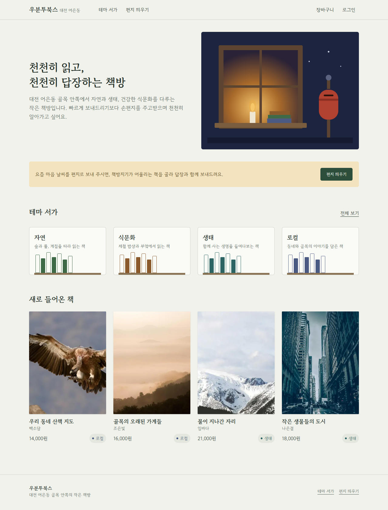
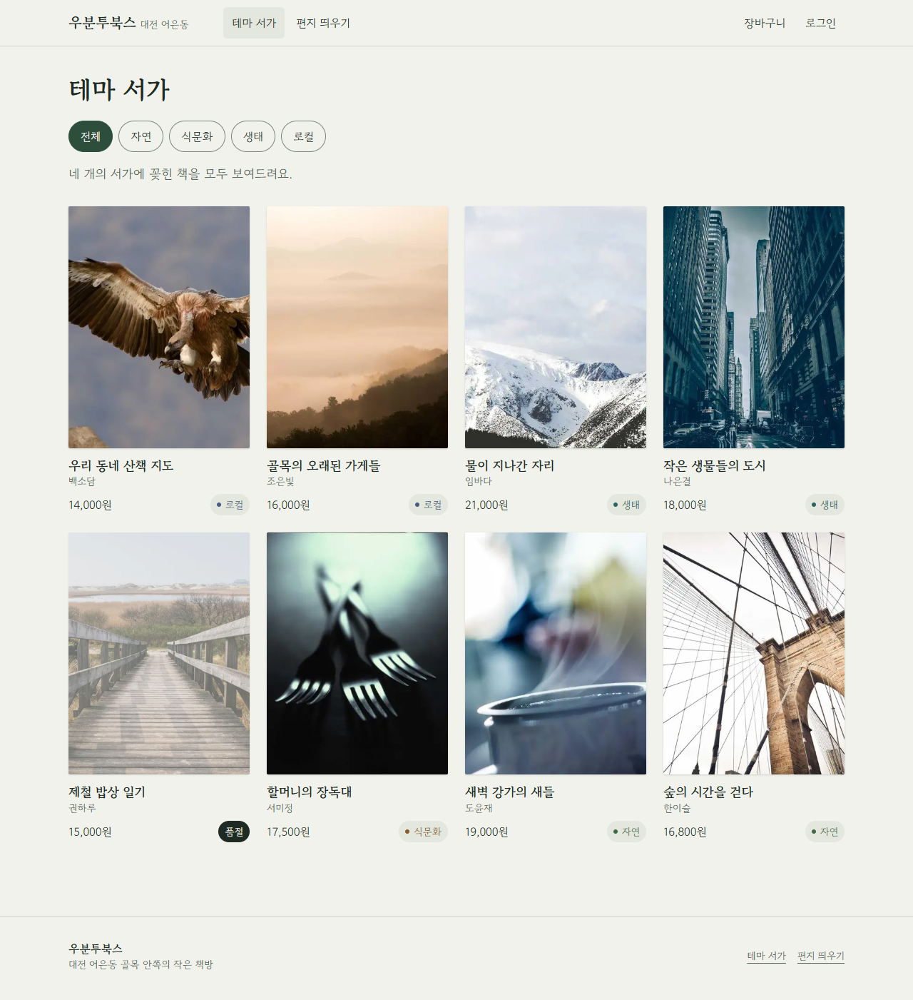
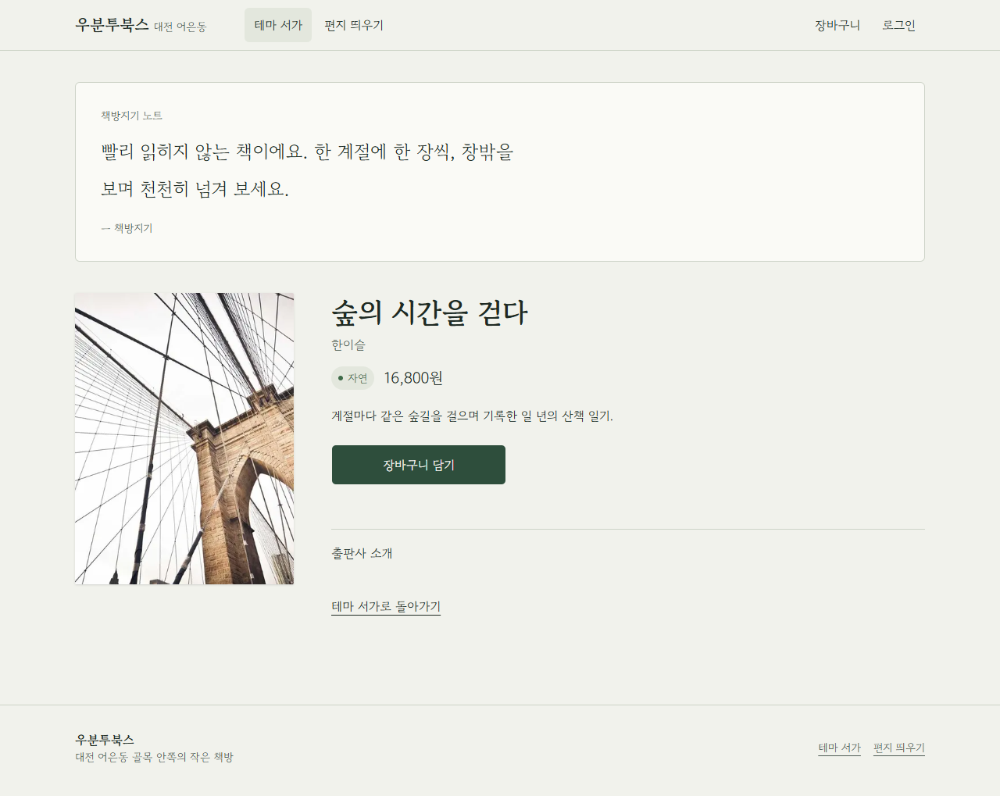
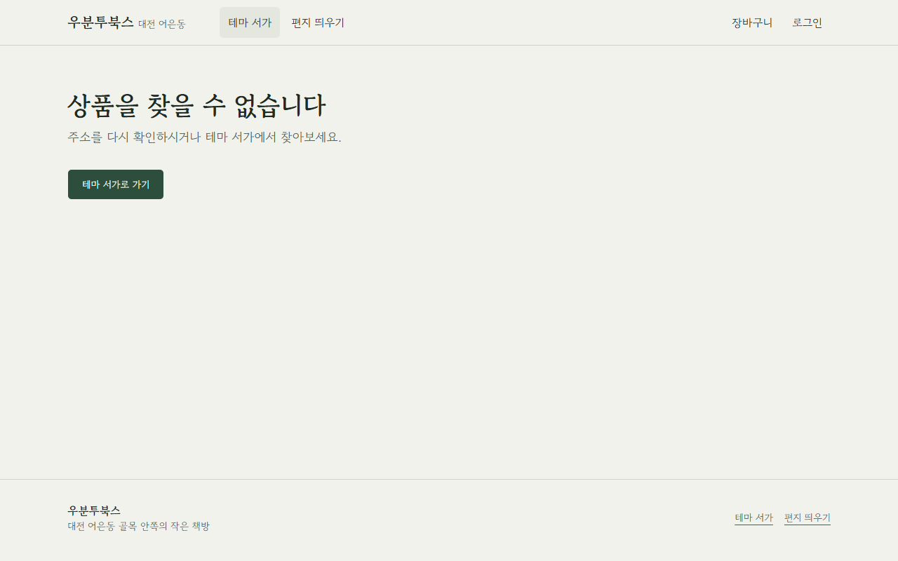
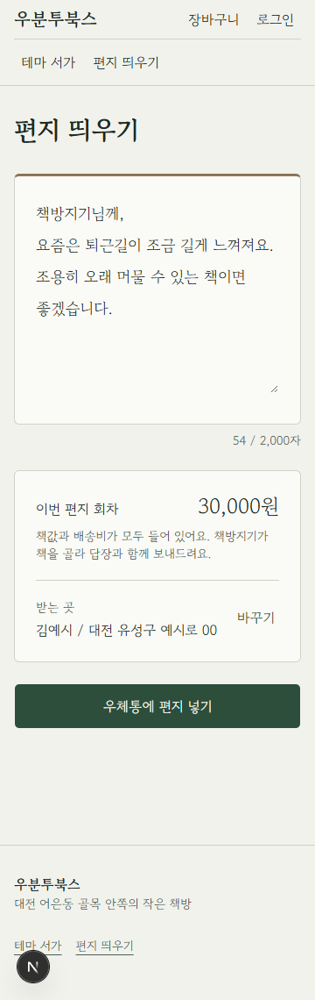
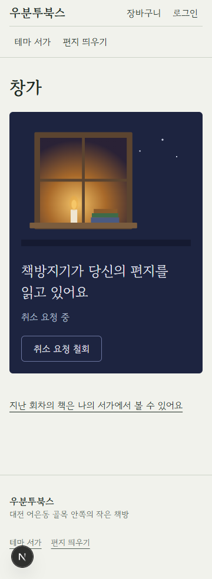
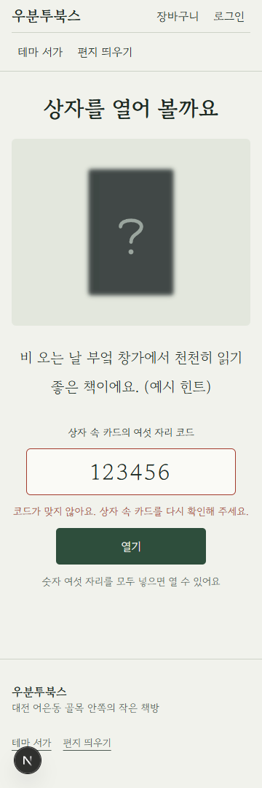
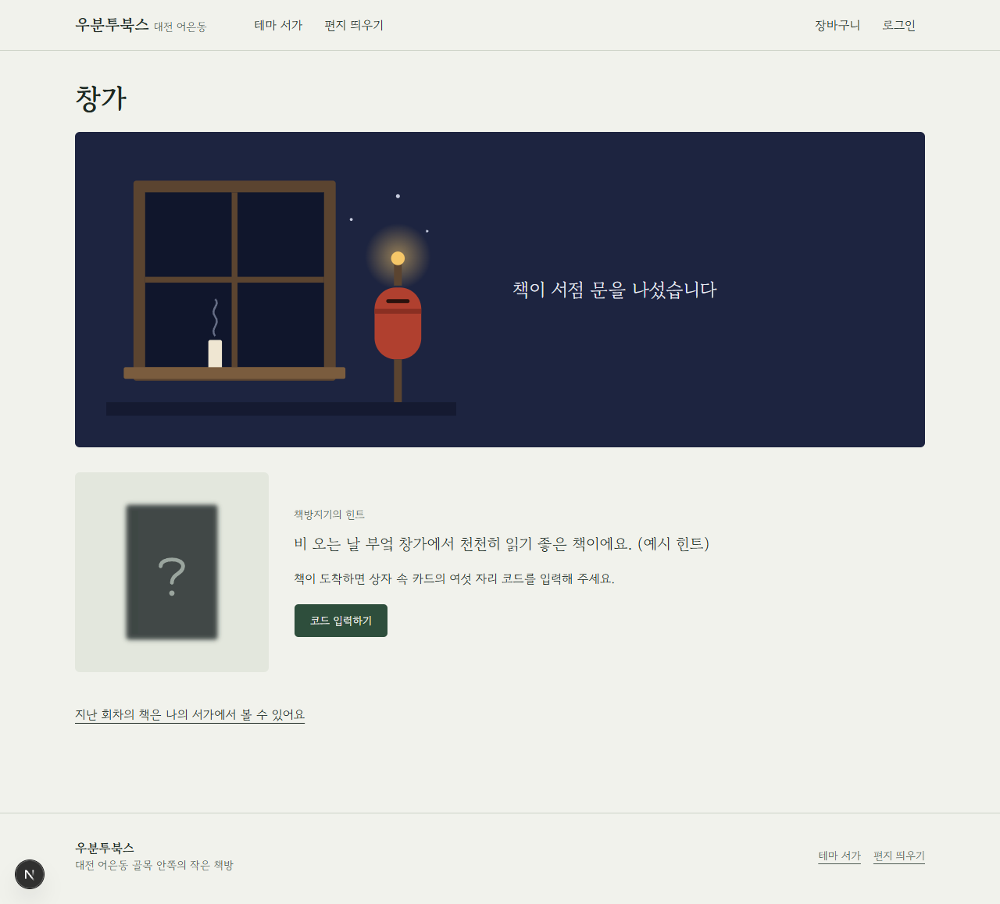
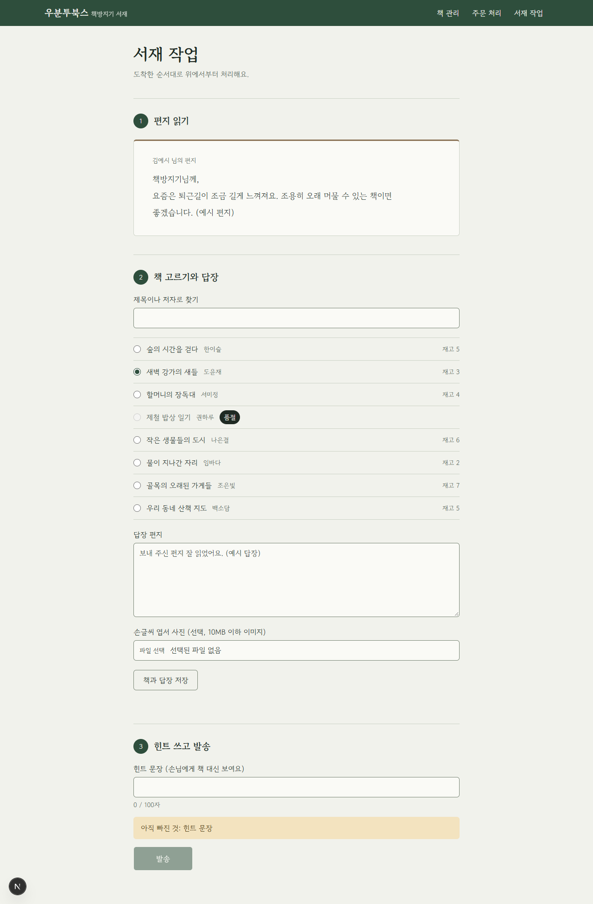

# 우분투북스

대전 어은동 골목 안쪽의 작은 독립서점 **우분투북스**의 웹사이트입니다. 방문자는 자연·식문화·생태·로컬 **4개 테마 서가**에서 책방지기 노트와 함께 책을 고르고, 회원은 요즘 마음 날씨를 적은 **손편지를 띄우면** 책방지기가 어울리는 책을 골라 답장과 함께 보내 주는 **편지 구독**을 이용합니다.

- 스택: Next.js 16(App Router) · TypeScript · Tailwind CSS 4 · Supabase(Postgres·Auth·Storage) · 토스페이먼츠(테스트 결제)
- 로그인: 카카오·네이버 소셜 로그인만(아이디·비밀번호 없음)
- 설계 문서: `docs/01-pm`(기획) → `docs/02-arch`(설계) → `docs/03-db`·`04-backend`·`05-frontend`(단계별 브리핑). 디렉토리 지도는 [`AGENTS.md`](AGENTS.md)

## 1. 화면과 흐름

| 누구 | 화면 |
|---|---|
| 방문자 | 메인 `/` · 테마 서가 `/products` · 책 상세 `/products/[id]` · 로그인 `/login` |
| 회원 | 장바구니 `/cart` → 주문서 `/checkout` → 결제 결과 `/checkout/result` · 편지 띄우기 `/letters/new` · 마이페이지 `/mypage` · 창가 `/mypage/window` · 언박싱 `/mypage/rounds/[id]` · 나의 서가 `/mypage/shelf` · 주문 현황 `/mypage/orders` · 기본 배송지 `/mypage/address` · 구독 마무리 `/mypage/farewell` |
| 책방지기 | 관리자 홈 `/admin` · 책 관리 `/admin/products` · 주문 처리 `/admin/orders` · 서재 작업 `/admin/desk` |

편지 구독 흐름: 편지 쓰기 → 결제(30,000원) → 창가가 "편지가 서점에 도착했어요" → 책방지기가 편지를 열면 촛불 → 책을 골라 답장·힌트와 함께 발송하면 우체통 불빛과 여섯 자리 코드 → 상자 속 카드의 코드로 언박싱 → 나의 서가에 한 줄 메모.

## 2. 컴포넌트 트리

```
app/layout.tsx
├── components/Header.tsx              로고 · 주 메뉴(테마 서가·편지 띄우기) · 내 메뉴(장바구니·로그인/마이페이지·서재)
│   └── components/NavLinks.tsx        현재 메뉴 표시(aria-current)
├── {children}  ← 각 화면
│   ├── app/page.tsx                   메인
│   │   ├── components/WindowArt.tsx   창가 그림
│   │   ├── components/ThemeSelector.tsx (ThemeShelves)
│   │   └── components/ProductGrid.tsx
│   │       └── components/ProductCard.tsx      표지·제목·저자·가격·테마/품절 배지
│   │           └── components/BookCover.tsx    3:4 표지, 깨지면 FallbackCover
│   ├── app/products/page.tsx          테마 서가: ThemePills + ProductGrid(.map → ProductCard)
│   ├── app/products/[id]/page.tsx     상세: KeeperNote · BookCover · AddToCartButton
│   │   └── not-found.tsx              "상품을 찾을 수 없습니다"
│   ├── app/letters/new/page.tsx       LetterForm(LetterPaper · ShippingFields · LetterArt)
│   ├── app/mypage/window/page.tsx     WindowScene · BlindBook · RoundCancelButton
│   └── app/admin/layout.tsx           책방지기 확인 → AdminBar + 본문(한 열)
│       └── app/admin/desk/page.tsx    LetterPaper · DeskContentsForm · ShipRoundForm · UnboxingCode
├── components/Footer.tsx              책방 이름 · 사이트 링크
└── components/ConfigNotice.tsx        환경 변수가 비면 맨 위에 안내
```

- 공통 UI 기본 컴포넌트는 `components/ui/`(shadcn), 디자인 토큰(색·글꼴·모션)은 `app/globals.css`
- 데이터는 서버 컴포넌트가 `lib/data/*`로 읽고, 쓰기는 `app/**/actions.ts`(Server Action)와 `app/api/**/route.ts`(결제·주소록)만 한다

## 3. 로컬 실행

필요한 것: Node.js 20.9 이상(Next 16 요구 사항), 원격 Supabase 프로젝트(로컬 Supabase·Docker는 쓰지 않음, ADR-005)

```bash
npm install
```

```bash
cp .env.example .env.local
```

`.env.local`에 아래 4절의 값을 넣은 뒤 실행합니다.

```bash
npm run dev
```

[http://localhost:3000](http://localhost:3000)에서 메인이 열립니다. Supabase 값이 비어 있으면 화면이 멈추지 않고 맨 위에 필요한 변수 이름을 안내합니다.

| 명령 | 하는 일 |
|---|---|
| `npm run lint` | ESLint |
| `npx tsc --noEmit` | 타입 검사 |
| `npm test` | 단위 테스트(`node --test`) |
| `npm run build` | 프로덕션 빌드(테스트를 먼저 실행) |

## 4. 환경 변수와 Supabase 설정

### 환경 변수 (`.env.example`, 값은 `.env.local`에만)

| 이름 | 공개 | 쓰는 곳 |
|---|---|---|
| `NEXT_PUBLIC_SUPABASE_URL` | 공개 | Supabase 원격 프로젝트 URL |
| `NEXT_PUBLIC_SUPABASE_PUBLISHABLE_KEY` | 공개 | Supabase publishable 키 |
| `SUPABASE_SERVICE_ROLE_KEY` | **비밀** | 서버 전용(결제 확정·탈퇴·엽서 서명). `lib/supabase/admin.ts`만 |
| `NEXT_PUBLIC_TOSS_CLIENT_KEY` | 공개 | 토스 테스트 클라이언트 키(결제창) |
| `TOSS_SECRET_KEY` | **비밀** | 토스 테스트 시크릿 키(결제 승인·취소). `lib/payments/toss.ts`만 |
| `NAVER_CLIENT_ID`, `NAVER_CLIENT_SECRET` | **비밀** | 네이버 로그인을 직접 구현으로 바꿀 때만(ADR-003 B) |
| `NEXT_PUBLIC_SITE_URL` | 공개 | 사이트 주소(로그인·결제 리다이렉트). 로컬은 `http://localhost:3000` |

`.env*`는 Git에 올리지 않습니다(`.env.example`만 추적).

### Supabase 원격 프로젝트 연결

1. supabase.com에서 프로젝트를 만듭니다(리전 Seoul 권장). DB 비밀번호를 따로 보관합니다.
2. CLI 로그인과 연결:

```bash
npx supabase login
```

```bash
npx supabase link --project-ref <프로젝트-ref>
```

3. 마이그레이션(`supabase/migrations/`)과 seed(책 8권, `data/products.ts`에서 생성)를 적용합니다. 먼저 `--dry-run`으로 적용 대상을 확인합니다.

```bash
npx supabase db push --linked --dry-run --include-seed
```

```bash
npx supabase db push --linked --include-seed
```

### 대시보드 설정

- **Authentication → URL Configuration**: Site URL `http://localhost:3000`, Redirect URLs에 `http://localhost:3000/auth/callback`(배포하면 운영 도메인의 `/auth/callback`도)
- **카카오**: 카카오 디벨로퍼스에서 앱 생성 → REST API 키·Client Secret 발급 → 카카오 로그인 켜기 → **"이메일 없이 허용"** 켜기 → Redirect URI에 `https://<project-ref>.supabase.co/auth/v1/callback` 등록 → 대시보드 Authentication → Providers → Kakao에 키 입력
- **네이버(`custom:naver`)**: 네이버 개발자센터에서 앱 생성("개발 중" 상태), 시연 계정을 테스트 ID로 등록, Callback URL에 위 Supabase 콜백 등록 → 대시보드 Authentication → Providers → Custom provider `naver`(OAuth2): authorize `https://nid.naver.com/oauth2.0/authorize`, token `https://nid.naver.com/oauth2.0/token`, userinfo `https://openapi.naver.com/v1/nid/me`
- **책방지기 권한 부여**: 책방지기 계정으로 한 번 로그인한 뒤, SQL 편집기에서 그 계정의 `auth.users.id`로 실행합니다.

```sql
update public.profiles set role = 'keeper' where id = '<책방지기 auth.users.id>';
```

## 5. 결제 테스트

- 결제는 토스페이먼츠 **테스트 키**로만 동작합니다. 개발자센터의 테스트 클라이언트 키·시크릿 키를 `.env.local`에 넣습니다. 테스트 키에서는 실제 돈이 나가지 않습니다.
- 주문: 책 상세에서 [장바구니 담기] → `/cart` [주문하기] → 받는 곳 입력 → [결제하기] → 토스 테스트 결제창에서 카드·간편결제를 고르고 결제창 안내대로 진행합니다. 테스트 카드 정보는 토스페이먼츠 개발자센터의 테스트 결제 문서를 따릅니다.
- 편지 구독: `/letters/new`에서 10자 이상 편지 → [우체통에 편지 넣기] → 같은 테스트 결제창(30,000원).
- 결제창을 닫으면 결과 화면에서 [다시 결제하기]로 이어집니다. 결제 확정·금액 검증·중복 확정 방지는 서버(`app/api/payments/toss/success`)가 합니다.

## 6. 운영 절차: 5년 지난 거래 기록 삭제

거래 기록(주문·회차·결제)은 전자상거래법에 따라 5년 보관한 뒤 지웁니다(PM-DOMAIN §7). 자동 작업은 없으니 책방지기가 SQL 편집기에서 실행합니다. 먼저 맨 끝의 `commit;`을 `rollback;`으로 바꿔 대상 건수만 확인하는 것을 권장합니다.

```sql
begin;
create temp table old_orders as
  select id from public.orders
  where created_at < now() - interval '5 years' and status in ('shipped', 'refunded', 'cancelled');
create temp table old_rounds as
  select id from public.subscription_rounds
  where created_at < now() - interval '5 years' and status in ('unboxed', 'cancelled');
select (select count(*) from old_orders) as orders, (select count(*) from old_rounds) as rounds;
-- 결제가 주문·회차를 참조하므로 결제부터 지운다 (주문 항목, 회차의 편지·답장·코드·메모는 함께 지워진다)
delete from public.payments where order_id in (select id from old_orders) or round_id in (select id from old_rounds);
delete from public.orders where id in (select id from old_orders);
delete from public.subscription_rounds where id in (select id from old_rounds);
delete from public.subscriptions s
  where s.status = 'ended'
    and s.ended_at < now() - interval '5 years'
    and not exists (select 1 from public.subscription_rounds r where r.subscription_id = s.id);
commit;
```

- 회차 엽서 사진(Storage `postcards` 버킷의 `rounds/<회차 id>/…`)은 위 SQL로 지워지지 않으니 대시보드 Storage에서 같은 회차 폴더를 지웁니다.
- 주소록 CSV는 서버에 저장하지 않습니다. 내려받은 파일은 발송 후 지웁니다.

## 7. 화면 캡처

| 메인 | 테마 서가 |
|---|---|
|  |  |

| 책 상세 | 상품 없음 |
|---|---|
|  |  |

| 편지 띄우기 (360px) | 창가 — 읽는 중 (360px) | 언박싱 (360px) |
|---|---|---|
|  |  |  |

| 창가 — 발송됨 | 서재 작업 (책방지기) |
|---|---|
|  |  |

- 메인·테마 서가·상세·상품 없음은 원격 DB의 seed 데이터로 찍은 실제 화면입니다.
- 편지·창가·언박싱·서재 작업은 로그인이 필요해, 같은 컴포넌트를 예시 데이터로 그려 찍은 화면입니다. 화면별 전체 캡처(1280px·360px)는 [`docs/05-frontend/screenshots/`](docs/05-frontend/screenshots/)에 있습니다.
