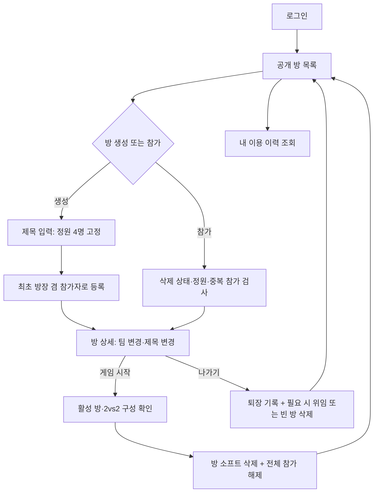

# 사용자 지정 2vs2 방 매치메이킹 요구사항

2026-10-28 · 팀 작성 · 레지스트리 ID: IN-REQ

> 기술 스택, 4계층 구조, 공통 산출물(README·노션·발표)은 발제 문서(`docs/00-inputs/kant-rubric.md`)를 따른다. 이 문서에는 이 Use Case에만 해당하는 내용을 적는다.

## 0. 이번 개정에서 바뀐 점

- 팀 회의 결과 **'게임 결과' 도메인을 제거**했다. 승리·패배 판정, 승패 기록, 게임 결과 조회는 범위에 없다.
- 이 프로젝트는 **게임 매치메이킹을 구현하며 학습하고 시연하는 것**이 목적이다. 실제 게임은 없다.
- **'게임 시작' 버튼을 누르면 결과 판정 없이 방이 사라진다(소프트 삭제).** 참가자 전원의 참가 상태가 해제되고, 모두 공개 방 목록으로 돌아간다.
- 이전 IN-REQ(자동 대기열 매칭·점프 게임 '점프 5')는 폐기한다.

## 1. 개요

- **한 문장 정의**: 회원이 2vs2(총 4명) 공개 방을 만들거나 찾아 참가하고, 방 안에서 팀을 바꾼 뒤 '게임 시작'을 누르면 방이 해산되어 모두 공개 방 목록으로 돌아가는 웹 서비스.
- **목적**: 정원·중복 참가·팀 정원·방장 위임·소프트 삭제 같은 매치메이킹 규칙을 도메인 객체가 스스로 검증하는 백엔드 서비스를 만든다.
- **대상 사용자**: 로그인한 회원. 서비스 전체 운영자는 두지 않는다. 방장은 특정 방 안의 역할이다.
- **발제 Use Case 대응**:

  | 발제 예시 구조 | 이 프로젝트 |
  |---|---|
  | 정원이 있는 자원 | 방 (정원 4명 고정, 팀당 2명) |
  | 신청 내역 | 참가·이용 기록 (입장·퇴장 시각) |
  | 회원 | 회원 |
  | 토큰 블랙리스트 | 토큰 블랙리스트 |

## 2. 액터와 접근 범위

회원가입·로그인 화면과 API만 인증 없이 접근한다. 나머지는 로그인해야 쓴다.

| 대상 | 접근 범위 |
|---|---|
| 활성 방 목록·상세 | 로그인한 회원이면 조회한다. |
| 방 생성·참가·나가기 | 본인 명의로 요청한다. |
| 제목 변경 | 현재 방장만 요청한다. |
| 팀 변경 | 현재 참가자를 대상으로 한다. (세부 권한은 §9 미정) |
| 게임 시작 | 활성 방과 2vs2 구성을 검사한다. (시작 권한은 §9 미정) |
| 삭제된 방의 보관 정보 | 과거 참가 회원만 제한된 정보를 조회한다. |
| 이용 이력 | 본인의 기록만 조회한다. |

'활성 방'은 소프트 삭제되지 않은 방이다. 보관 정보 조회는 삭제된 방에 다시 참가하는 기능이 아니다.

## 3. 핵심 도메인과 규칙

규칙은 "어떤 요청을 거부하는가"로 적는다. 규칙 위반은 화면이 멈추지 않고 안내 문구로 거부된다.

### 3.1 회원
- 회원가입·로그인·JWT 발급·블랙리스트 로그아웃을 제공한다.
- 저장 정보: 로그인 식별 정보, 닉네임, 비밀번호 해시.
- 어떤 응답에도 비밀번호(해시 포함)는 나오지 않는다.
- 가입 입력 항목·중복 기준·길이·비밀번호 검증 기준은 §9 미정.

### 3.2 방
- 생성 입력은 **제목 하나**다. 정원 입력은 받지 않고 서버가 고정 정원(4명)을 적용한다.
- 제목은 앞뒤 공백 제거 후 1~20자. 공백뿐인 제목은 거부한다. 중간 공백은 유지한다.
- 중복 제목은 허용한다. 방 식별자로 구분한다.
- 방장은 참가 인원에 포함한다. 총 정원 4명, 형식은 2vs2(팀당 2명)다.
- 정원 변경·다른 인원 형식은 제공하지 않는다.
- 생성자가 최초 방장 겸 참가자가 된다.
- 현재 방장만 활성 방의 제목을 바꿀 수 있다.
- 삭제된 방에는 참가·제목 변경·팀 변경·게임 시작을 허용하지 않는다.
- 저장 정보: 제목, 고정 정원, 현재 방장, 생성 시각, 삭제 시각, 삭제 사유(게임 시작 / 참가자 없음).

### 3.3 참가·팀
- 한 회원은 동시에 한 방에만 참가한다. 이미 참가 중이면 다른 방 생성·참가를 거부한다.
- 같은 방에 반복 참가 요청을 보내도 새 이용 기록을 만들지 않는다.
- 정원이 찬 방에는 참가할 수 없다. 목록에 빈자리가 보였어도 서버가 요청 시점 상태를 다시 검사한다.
- 참가자는 두 팀 중 하나에 속한다. 대상 팀이 가득 찼으면(2명) 팀 변경을 거부한다. 별도 자리 교환 기능은 없다.
- 나가기나 게임 시작으로 참가가 해제되면 새 방에 참여할 수 있다. 과거 이용 기록은 새 참여를 막지 않는다.
- 로그아웃하거나 브라우저를 닫아도 참가 상태와 방장은 유지된다. 접속 끊김 감지·자동 퇴장은 구현하지 않는다.
  - 주의: 돌아오지 않는 사용자의 자리와 방장 역할도 방 해산 전까지 유지된다.
- 저장 정보: 방, 회원, 입장 순서, 현재 팀, 입장 시각, 퇴장 시각.

### 3.4 나가기·방장 위임·빈 방 삭제
- 나가기는 본인의 참가를 해제하고 퇴장 시각을 기록한다.
- 일반 참가자가 나가면 방장은 그대로다.
- 방장이 나가고 남은 참가자가 있으면, **입장 순서상 가장 먼저 들어온 참가자**에게 방장을 위임한다.
- 마지막 참가자가 나가면 방을 소프트 삭제한다(삭제 사유: 참가자 없음). 이용 이력은 보존한다.
- 입장 순서는 그 방에 들어온 순서다(회원가입 순서와 다름). 화면에 공개하지 않는다.
- 재입장하면 새로운 입장 순서와 새 이용 기록을 부여한다.
- 방장 변경 이력은 별도로 기록하지 않는다.

### 3.5 게임 시작 (방 해산)
- 게임 시작 요청 시 서버가 활성 방인지, 현재 참가자가 **각 팀 2명**인지 검사한다. 아니면 거부한다.
- 검사를 통과하면 **결과 판정 없이** 방을 소프트 삭제하고(삭제 사유: 게임 시작), 전체 참가자의 참가 상태를 해제하고 퇴장 시각을 기록한다.
- 처리가 끝나면 참가자 전원이 기존 공개 방 목록으로 돌아간다. 별도 대기실은 없다.
- 게임 진행·종료 상태, 진행 시간 대기, 종료 버튼은 없다. '게임 시작'은 즉시 끝나는 해산 처리다.
- 이미 해산된 방에 대한 반복 시작 요청은 거부한다(삭제된 방 규칙).

### 3.6 이용 이력·보관 정보
- 방 제목·고정 정원·생성 시각·삭제 시각과 회원별 입장·퇴장 시각을 보존한다.
- 재입장은 이전 기록과 구분한다. 현재 참가 중인 기록은 '참가 중'으로 표시한다.
- 본인 이용 이력은 입장 시각 최신순, 페이지 이동만 제공한다(검색·필터·정렬 선택 없음).
- 다른 회원의 과거 입장·퇴장 기록은 공개하지 않는다.
- 삭제된 방의 보관 정보(방 정보 + 본인 이용 기록)는 과거 참가 회원만 조회한다. 참가한 적 없는 회원에게는 `404`.
- 삭제된 방을 다시 이용하거나 복구하는 기능은 없다. 이용 이력 삭제 기능도 없다.

### 3.7 토큰 블랙리스트
- 로그아웃한 토큰은 블랙리스트에 등록되고, 그 토큰으로 다시 요청하면 거부한다(`401`).

### 3.8 오류 응답 기준
- 인증 실패·만료·블랙리스트: `401`
- 미존재 방, 보관 정보 접근 권한 없음: `404`
- 잘못된 목록 입력: `422`
- 팀 정원 초과·시작 조건 불충족·시작 권한 없음 등의 응답 코드는 설계 단계에서 정한다.
- 민감 정보와 내부 DB 오류는 응답·로그에 그대로 노출하지 않는다.

## 4. CRUD 대응

| 구분 | 대상과 기능 |
|---|---|
| C · 생성 | 방 생성, 참가(이용 기록 생성) |
| R · 조회 | 방 목록·상세, 현재 참가 방, 이용 이력, 삭제 방 보관 정보 |
| U · 수정 | 방 제목 변경, 참가자의 소속 팀 변경 |
| D · 삭제 | 게임 시작 또는 마지막 퇴장 시 방 소프트 삭제 |

- 소프트 삭제는 DB 행을 남긴 채 삭제 상태(시각·사유)를 기록한다. SQL은 `UPDATE`여도 기능 관점에서는 방 삭제(D)다. 평가 시 기능 의미와 기록 보존을 함께 설명한다.
- 나가기는 참가 해제·퇴장 기록이다. 나가기 API의 메서드나 참가 행 물리 삭제를 D의 근거로 삼지 않는다.
- 별도의 수동 방 삭제 버튼·API는 두지 않는다.

## 5. 상태 흐름

### 5.1 상황별 처리

| 상황 | 방 처리 | 이용 이력 |
|---|---|---|
| 일반 참가자 퇴장 | 남은 참가자가 있으면 유지 | 퇴장 시각 기록 |
| 방장 퇴장 | 참가자가 남아 있으면 위임 | 퇴장 시각 기록 |
| 마지막 참가자 퇴장 | 소프트 삭제(참가자 없음) | 기존 기록 보존 |
| 게임 시작 | 소프트 삭제(게임 시작) | 전체 참가자 퇴장 시각 기록 |

### 5.2 함께 저장해야 하는 업무 단위
하나라도 실패하면 그 업무의 변경을 모두 되돌린다.
1. 방 생성: 방·최초 참가·이용 기록·방장 설정
2. 방 참가: 참가 상태·이용 기록
3. 나가기: 참가 해제·퇴장 기록·위임 또는 방 삭제
4. 게임 시작: 방 삭제·전체 참가 해제·퇴장 기록

## 6. 화면

Jinja2와 정적 CSS·폴링용 JavaScript를 사용한다. 배치는 기획 단계에서 정한다.

| 화면 | 목적 | 주요 동작 | 갱신 |
|---|---|---|---|
| 회원가입 | 계정 생성 | 가입 입력·오류 확인 | 제출 시 |
| 로그인 | 회원 인증 | 로그인 | 제출 시 |
| 공개 방 목록 | 방 탐색(대기실 역할) | 검색·필터·정렬·페이지 이동·방 생성 폼 | 1초 폴링 |
| 방 상세 | 참가자·팀 구성 확인 | 참가·나가기·제목 변경·팀 변경·게임 시작 | 1초 폴링 |
| 내 기록 | 본인 이용 이력 확인 | 최신순·페이지 이동·삭제 방 보관 정보 보기 | 수동 |

- 방 생성은 목록 화면의 폼으로 제공한다. 제목만 입력하고, 고정 인원(2vs2, 4명)은 안내 문구로 표시한다.
- 활성 방 상세에는 제목·현재 인원·고정 정원·방장·참가자 닉네임·현재 팀을 표시한다.
- 목록 상단에 현재 참가 중인 방의 링크를 제공한다. 방이 해산되면 링크도 사라진다.
- 활성 방은 로그아웃 후 다시 로그인해도 참가 상태를 유지한다.
- 빈 결과·통신 실패·인증 만료·접근 불가를 구분해 안내한다.

### 6.1 공개 방 목록 규칙

| 항목 | 규칙 |
|---|---|
| 기본 범위 | 삭제되지 않은 방. 정원이 찬 방도 포함 |
| 검색 | 제목 부분 검색. 영문 대소문자 구분 없음. 앞뒤 공백 제거, 비면 조건 미적용. `%`·`_`는 문자 그대로 검색 |
| 필터 | '빈자리 있는 방만 보기' 선택 시 정원이 찬 방 제외 |
| 정렬 | 생성 시각 최신순(기본)·오래된순. 동률은 방 식별자로 |
| 페이지 | 기본 1페이지·10건, 최대 50건 |
| 전체 건수 | 검색·필터·삭제 제외 조건을 적용한 건수 |
| 빈 결과 | 결과가 없거나 마지막 페이지를 넘으면 빈 목록 |
| 조건 변경 | 첫 페이지부터 조회. 페이지 이동 시 조건 유지 |

- 정원이 찬 방은 '정원 마감'으로 표시하고 참가 버튼을 비활성화한다. 서버도 다시 검사한다.

### 6.2 폴링과 해산 후 복귀
- 공개 방 목록과 활성 방 상세를 1초 간격으로 조회한다. WebSocket·SSE는 쓰지 않는다.
- 본인의 참가·나가기·변경 성공은 즉시 반영하고, 다른 사용자의 변경은 다음 조회에서 반영한다.
- 이전 조회가 진행 중이면 새 요청을 겹쳐 보내지 않는다. 조건 변경 전의 늦은 응답은 무시한다.
- 다른 탭으로 이동하거나 창을 최소화하면 중단하고, 돌아오면 즉시 조회 후 재개한다. 자동 조회 중단은 나가기가 아니다.
- 게임 시작 요청자는 성공 응답 후 방 상세 조회를 멈추고 목록으로 이동한다. 다른 참가자는 다음 조회에서 해산을 확인하고 목록으로 이동한다.
  - 주의: 모든 화면이 같은 순간에 이동한다고 보장하지 않는다. 1초는 조회 주기이며 지연될 수 있다.
- 게임 시작으로 인한 해산과 일반 접근 불가(권한 없음·미존재)를 구분하는 응답 계약이 필요하다.
- 게임 시작 전에 이미 나간 과거 참가자는 강제로 이동시키지 않는다.
- 통신 실패 시 마지막 정보를 유지하고 '최신 정보를 불러오지 못했습니다'를 표시한 뒤 다음 주기에 재시도한다.
- 인증이 만료되면 폴링을 멈추고 로그인 화면으로 안내한다.

## 7. 동시 요청·실패 처리

| 상황 | 처리 원칙 |
|---|---|
| 동시 방 생성·참가 | 한 회원에게 현재 참가 상태가 여러 개 생기지 않는다 |
| 마지막 자리 동시 참가 | 방 정원을 초과하지 않는다 |
| 같은 팀으로 동시 변경 | 팀당 정원을 초과하지 않는다 |
| 게임 시작 반복 요청 | 해산은 한 번만 일어나고 이후 요청은 거부된다 |
| 게임 시작과 팀 변경·퇴장·참가 동시 | 시작 검사 시점의 2vs2 구성과 실제 해산 대상이 어긋나지 않는다. 해산된 방에 참가자가 남지 않는다 |
| 방장과 참가자 동시 퇴장 | 실제 남은 참가자에게만 위임한다 |
| 마지막 퇴장과 신규 참가 동시 | 삭제된 방에 새 참가자를 남기지 않는다 |
| DB 처리 실패 | 방·참가 상태 일부만 저장하지 않고 해당 업무를 모두 되돌린다 |
| 응답 유실 | DB 실패로 단정하지 않고, 재조회로 처리 결과를 확인할 수 있게 한다 |

- 화면을 열었을 때의 정보만으로 권한·인원을 판단하지 않는다. 객체 검사만으로 동시 요청 안전성을 보장하지 않는다(DB 제약·잠금·트랜잭션은 설계 단계).

## 8. 초기 데이터와 발제 필수 사항

- `lifespan`에서 테이블 생성과 초기 도메인 시드 20건 이상을 준비한다. 서버를 재시작해도 시드가 중복되지 않는다.
- 시연 흐름: 회원가입 → Swagger 인증 → 방 생성·참가·팀 변경·게임 시작 → 로그아웃한 JWT 재사용 시 `401`.
- 실행 기준: `uv run uvicorn main:app --app-dir src --reload`.
- `.env`·`.venv`·`__pycache__`와 비밀 정보는 저장소에서 제외한다.

## 9. 기획 단계에서 정할 미정 사항

| 항목 | 팀 기본안(제안) |
|---|---|
| 최초 팀 지정 | 생성자와 신규 참가자가 빈자리 있는 팀을 직접 선택 |
| 팀 변경 권한 | 참가자가 본인의 팀만 변경. 방장의 타인 변경 허용 여부는 미정 |
| 게임 시작 권한 | 현재 방장만 요청 |
| 회원가입 입력 | 입력 항목·중복 기준·길이·비밀번호 검증 기준 |
| 해산 응답 계약 | 폴링 중 '게임 시작으로 해산됨'과 '접근 불가'를 구분하는 방식 |
| 이력 페이지 | 이용 이력 페이지 기본값·정렬 동률 방향 |
| 보관 정보 표시 | 삭제 방의 과거 제목·닉네임 표시 방식 |

## 10. 범위 밖

- **게임 결과 일체**: 승리·패배 판정, 무작위 승패 생성, 승패·게임 기록 저장, 게임 결과 조회 화면·API
- 자동 매칭·대기 신청·희망 포지션·자동 대기열 팀 배정
- 실제 게임 실행·플레이 화면·외부 게임 서버 연동
- 실력 점수·승률 기반 배정
- 준비 완료·강퇴·채팅·비밀번호 방·초대 코드
- 방 설명·게임 종류 선택·가변 정원 설정
- 별도 대기실, 서비스 전체 운영자
- 수동 방 삭제, 삭제 방 복구, 이용 이력 삭제, 방장 변경 이력
- 접속 끊김 감지·자동 퇴장
- 발제 제외 범위: 외부 프론트엔드 프레임워크(React·Next.js), 실제 결제, 상용 메일·SMS·메신저 알림
- WebSocket·SSE·메시지 브로커. 캐싱·CSV 스트리밍·외부 배포·대규모 부하 실험은 필수 범위에 넣지 않는다
