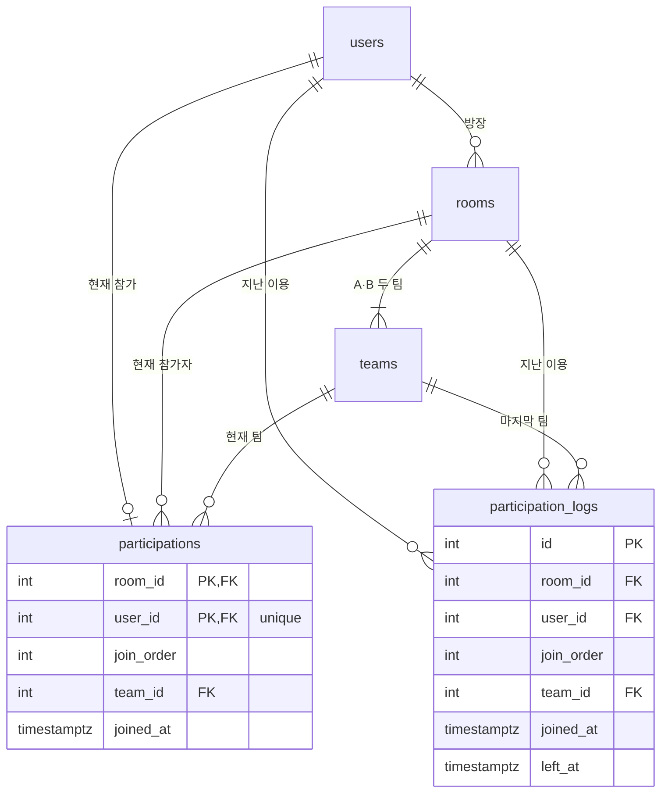

# D-025 분석: participations 복합 PK와 이용 로그 테이블

- 결정 카드: `decision-log.md` D-025 (승인됨, 2026-10-31). 기술 설계는 ADR-011
- 작성일: 2026-10-31
- 기준 문서: `docs/02-arch/03-db-schema.md`(변경 전 설계), `docs/01-pm/03-domain.md`

## 0. 변경 요청

| 구분 | 내용 |
|---|---|
| 맥락 | 같은 회원이 같은 방에 다시 들어온 것을 DB에서 확인할 수 있어야 한다 |
| 기존 | `participations`에 자체 `id`를 두고, 재입장마다 새 행을 넣는다. 로그 테이블은 없다 |
| 변경 | `participations`의 PK를 `(room_id, user_id)` 복합키로 바꾼다. 이렇게 하면 같은 방 재입장 행을 넣을 수 없으므로, 로그 테이블을 두어 재입장 이력을 남긴다 |

## 1. 먼저 정해야 할 것: 나간 회원의 participations 행

PK가 `(room_id, user_id)`이면 한 방에 같은 회원 행은 하나뿐이다. 나간 뒤의 행을 어떻게 다룰지에 따라 설계가 둘로 나뉜다.

| | A. 기록 유지안 | B. 현재 상태안 (추천) |
|---|---|---|
| 퇴장 | `left_at`을 채우고 행은 남김 | 그 체류를 로그 테이블에 INSERT하고, participations 행은 지움 |
| 재입장 | 기존 행을 덮어씀(UPDATE). 이전 값은 덮기 전에 로그로 옮김 | 새 행 INSERT. PK 충돌 없음 |
| participations의 뜻 | "이 방에 왔던 사람"과 "지금 있는 사람"이 섞임 | "지금 이 방에 있는 사람"만 |
| `left_at` 컬럼 | 필요 | 필요 없음 |

A는 한 행에 두 가지 뜻이 섞이고, 재입장 때 "덮기 전에 로그로 옮기기"를 빠뜨리면 이력이 사라진다. 아래 내용은 **B안 기준**이다.

## 2. 장점

1. **같은 방 중복 참가를 DB가 막는다.** 복합 PK가 같은 회원의 같은 방 중복 행을 도메인 검사와 별도로 거부한다.
2. **INV-04(한 회원 한 방)를 교안 수준 제약으로 지킨다.** B안의 participations에는 지금 참가 중인 회원만 있으므로, `user_id`에 `unique=True` 하나로 INV-04가 보장된다. 도전 A의 부분 UNIQUE 인덱스(`WHERE left_at IS NULL`, ADR-009)보다 단순하다.
3. **상태와 이력이 분리된다.** participations는 현재 상태, 로그는 지난 이력이다. 로그는 INSERT만 하므로 INV-10(기록 삭제 없음, 종료 기록 재개 없음)을 지키기 쉽다.
4. **현재 참가자 조회가 단순해진다.** `left_at IS NULL` 조건이 필요 없고, 방을 불러올 때 지난 기록까지 읽지 않는다(이전 설계에서는 방을 읽을 때 종료 기록까지 함께 읽었다).

## 3. 단점과 위험

1. **PM 문서와 충돌한다.** REQ-046("재입장하면 새로운 입장 순서와 새 이용 기록을 부여한다")과 INV-10을 "이용 기록 = 로그 행"으로 다시 해석해야 한다. PM 문서부터 고친 뒤 ARCH 문서를 고친다.
2. **한 동작에 두 테이블을 쓴다.** 나가기, 게임 시작(전원 퇴장)마다 participations DELETE와 로그 INSERT를 한 트랜잭션에서 해야 한다. 순서가 어긋나면 이력이 사라지거나 두 번 남는다.
3. **이용 이력 조회가 두 테이블을 합친다.** 이용 이력 = 현재 참가(participations) + 지난 이용(로그). 정렬·페이지 자르기는 합친 결과로 한다. 삭제 방 보관 정보(`get_archived_room`)는 로그만 읽는다.
4. **API 계약이 바뀐다.** `HistoryItemResponse.participation_id`(`04-interfaces-api.md`)가 가리킬 단일 id가 없다. `record_id`로 바꾸고 로그 id를 쓰거나 필드를 뺀다.
5. **도메인 `Participation`의 식별자가 바뀐다.** 레포지토리 `save`는 참가를 `id`가 아니라 `(room_id, user_id)` 기준으로 짝지어 저장해야 한다. DB·BE·QA가 모두 영향을 받는다.
6. **시드 구성이 바뀐다.** 끝난 이용은 로그 테이블에 넣는다. 이전 스키마로 만든 개발 DB가 있으면 지우고 다시 만든다(STK-13).
7. **팀 변경 이력은 여전히 남지 않는다.** 지금처럼 마지막 팀만 기록한다. 필요하면 별도 요구사항으로 정한다.

## 4. 로그 테이블에 저장할 정보

로그 한 행 = **방에 한 번 머문 기록(입장~퇴장) 1건**. 퇴장 때 INSERT하고 이후 바꾸지 않는다.

| 컬럼 | 이유 |
|---|---|
| `id` | 같은 (방, 회원)이 여러 번 쌓이므로 자체 PK가 필요하다 |
| `room_id`, `user_id` | 어느 방에 누가 있었는지 |
| `join_order` | REQ-046: 재입장은 새 입장 순서를 받으므로 매번의 순서를 남긴다 |
| `team_id` | 퇴장 때의 마지막 팀(지금 규칙과 같음) |
| `joined_at`, `left_at` | 이용 이력 화면과 삭제 방 보관 정보에 쓴다. 같은 방의 로그가 여러 행이면 재입장이다 |

- **퇴장 사유**(직접 나감 / 게임 시작 해산)는 정의된 요구가 없어 넣지 않는다. 필요하면 PM에서 확정한다.
- 사건마다 한 행(입장 INSERT, 퇴장 INSERT)씩 쌓는 방식도 있다. 하지만 이력 화면은 입장·퇴장 시각 쌍이 필요해 두 행을 짝짓는 코드가 따로 든다. 그래서 체류 1건 = 1행을 추천한다.

## 5. 새 DB 스키마 (B안)

`users`, `token_blacklist`, `rooms`, `teams`는 바뀌지 않는다. `rooms.last_join_order`는 재입장 번호 부여에 계속 쓴다.

### 5.1 `participations` (현재 참가)

| 컬럼 | 타입 | null | 제약 |
|---|---|---|---|
| `room_id` | `Integer` | N | `ForeignKey("rooms.id")`, `primary_key=True` |
| `user_id` | `Integer` | N | `ForeignKey("users.id")`, `primary_key=True`, `unique=True` (INV-04) |
| `join_order` | `Integer` | N | — |
| `team_id` | `Integer` | N | `ForeignKey("teams.id")` |
| `joined_at` | `DateTime(timezone=True)` | N | — |

### 5.2 `participation_logs` (지난 이용)

| 컬럼 | 타입 | null | 제약 |
|---|---|---|---|
| `id` | `Integer` | N | `primary_key=True` |
| `room_id` | `Integer` | N | `ForeignKey("rooms.id")` |
| `user_id` | `Integer` | N | `ForeignKey("users.id")` |
| `join_order` | `Integer` | N | — |
| `team_id` | `Integer` | N | `ForeignKey("teams.id")` |
| `joined_at` | `DateTime(timezone=True)` | N | — |
| `left_at` | `DateTime(timezone=True)` | N | — (항상 채워짐) |

`user_id`가 `unique=True`이면 `user_id`만으로도 행이 정해지지만, 요청한 "방·회원 결합키" 의미를 살려 복합 PK를 유지한다.

## 6. 바뀌는 범위

PM 문서부터 바꾸는 변경이다.

1. **PM**: `03-domain.md`의 INV-04·10·11과 기록 생명주기
2. **ARCH**: ADR-011 신설, `03-db-schema.md`, `04-interfaces-api.md` 이력 응답, ADR-009의 INV-04 방어 방식, `HANDOFF.md` 티켓
3. **구현(DB·BE·QA)**: 모델, 레포지토리, 시드, 도메인 `Room`·`Participation`, 테스트
