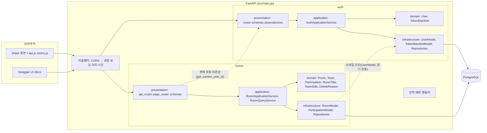

# 02. 시스템 아키텍처 & 기술 스택 (A2)

- 입력: `01-drivers.md`, ADR-001~008
- 기능 모듈은 `auth`, `rooms` 두 개다(ADR-001).

## 1. 구성도



- 점선은 기능 간 참조다. 방향은 `rooms → auth` 하나뿐이며 `auth`는 `rooms`를 모른다(ADR-001).

## 2. 기능 모듈

| 모듈 | 책임 | 도메인 | PM 근거 |
|---|---|---|---|
| `auth` | 회원가입, OAuth2 로그인(access·refresh JWT 발급), 재발급, 로그아웃(블랙리스트), 현재 회원 의존성 | `User`, `TokenBlacklist` | US-08~11 |
| `rooms` | 방 생성·참가·제목·팀 변경·나가기·게임 시작, 목록·상세·이력·보관 정보 조회, 화면 라우트 | `Room`, `Team`, `Participation`, `RoomTitle`, `TeamSide`, `DeleteReason` | US-01~07, US-12~20 |

## 3. 기술 스택

버전은 `pyproject.toml`에 하한(`>=`)만 적고 실제 버전은 `uv.lock`으로 고정한다. 예외는 bcrypt 상한 고정(ADR-002).

| 영역 | 선택 | 버전 | 근거 |
|---|---|---|---|
| 언어·패키지 | Python, uv | 3.13+ | 발제 |
| 웹 프레임워크 | fastapi, uvicorn | `fastapi>=0.115`, `uvicorn[standard]>=0.30` | 발제 |
| ORM·드라이버 | sqlalchemy(asyncio), asyncpg, greenlet | `sqlalchemy>=2.0.30`, `asyncpg>=0.29` | 발제 |
| DB | PostgreSQL | 15+ (부분 인덱스 사용) | 발제, ADR-009 |
| 검증 | pydantic | `>=2.7` | 발제 |
| 설정 | pydantic-settings | `>=2.3` | ADR-003 |
| 템플릿 | jinja2 | `>=3.1` | 발제 |
| 인증 | pyjwt, passlib[bcrypt], bcrypt | `pyjwt>=2.8`, `passlib[bcrypt]>=1.7.4`, `bcrypt==4.0.1` | 발제, ADR-002 |
| 폼 파싱 | python-multipart | `>=0.0.9` | 허용 목록 |
| 테스트 | pytest, pytest-asyncio, httpx | dev 그룹 | 허용 목록 |
| 린트·포맷 | ruff | dev 그룹 | ADR-005 |

## 4. 요청 처리 흐름 (README·PPT 원본)

```
요청 → CORSMiddleware → RequestLoggingMiddleware
     → presentation (router: 입력 검증, Depends(get_db), Depends(get_current_user_id))
     → application (service: 조회 → 도메인 메서드 → save → commit)
         ├→ domain (Room·Participation·User: 규칙 검사, 위반 시 DomainRuleError)
         └→ infrastructure (repository: ORM ↔ 도메인 변환. 도전 A 적용 시 SELECT … FOR UPDATE)
     → 응답 스키마(response_model) / 예외 → 전역 핸들러 → {"detail": "..."}
```

## 5. ADR 목록

| ADR | 주제 | 파일 (모두 Accepted, 2026-10-28) |
|---|---|---|
| ADR-001 | 기능 폴더 분할과 기능 간 참조 | `adr/ADR-001-feature-modules.md` |
| ADR-002 | 인증 세부(교안 6장 1강: access·refresh JWT·블랙리스트·헤더 전용·bcrypt 고정) | `adr/ADR-002-auth-details.md` |
| ADR-003 | 설정·환경변수 | `adr/ADR-003-settings.md` |
| ADR-004 | 422 입력 검증 에러 형식 | `adr/ADR-004-validation-error-format.md` |
| ADR-005 | 개발 도구 | `adr/ADR-005-dev-tools.md` |
| ADR-006 | 동시성 제어 — Superseded by ADR-009 | `adr/ADR-006-concurrency.md` |
| ADR-009 | 동시 요청 무결성을 도전 A로 이동 | `adr/ADR-009-concurrency-deferred.md` |
| ADR-007 | 목록 캐시(CH-C) | `adr/ADR-007-list-cache.md` |
| ADR-008 | 실행·배포 구성(CH-C) | `adr/ADR-008-deployment.md` |
