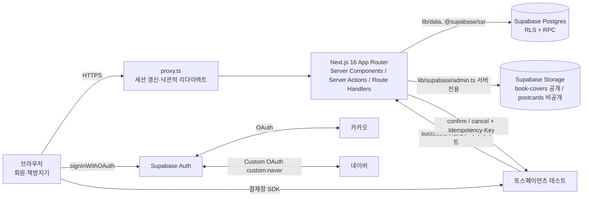

# 02. 시스템 아키텍처 & 기술 스택 (AR-SYS)

- 입력: AR-DRV, ADR-001~009 (모두 Accepted, 2026-10-21)

## 1. 구성도

- 상태의 원천은 DB 하나. 브라우저는 Supabase에 직접 쓰지 않는다(읽기도 서버 컴포넌트 경유, CONV-05).
- 실시간 연결·Edge Function·웹훅 없음(ADR-002, 004, 006).

## 2. 기술 스택
| 영역 | 선택 | 버전 | 선택 이유 | ADR |
|---|---|---|---|---|
| 프레임워크 | Next.js App Router | 16.4.2 (설치됨) | KANT 고정, `cacheComponents: true` | DRV-C-02 |
| UI 런타임 | React | 19.3.0 (설치됨) | Next 16 짝 | — |
| 언어 | TypeScript strict | ^5 | KANT 고정 | — |
| 스타일 | Tailwind CSS 4 + shadcn(base-nova, `@base-ui/react`) | ^4 / 설치됨 | 기존 `components/ui` 재사용 | ADR-009 |
| 아이콘 | `lucide-react` | 설치됨 | shadcn 기본. `react-icons`와 중복 → `react-icons` 제거(CONV-14) | — |
| DB·인증·파일 | Supabase(Postgres·Auth·Storage), `@supabase/ssr`·`@supabase/supabase-js` | 0.12.x / 2.118.x (설치됨) | 팀 고정 | ADR-002, 003 |
| DB 도구 | Supabase CLI(`link`, `db push --linked`, `test db --linked`, `gen types --linked`) | 설치됨 | 원격 프로젝트 1개에 마이그레이션·seed 적용, RLS 검증(로컬 Supabase 미사용) | ADR-005 |
| 결제 | 토스페이먼츠 `@tosspayments/tosspayments-sdk` | 2.x (추가) | 서버 승인 API + 멱등키 | ADR-004 |
| 입력 검증 | `zod` | 4.x (추가) | 타입·검증 일원화 | ADR-008 |
| 서버 전용 표시 | `server-only` | 최신 (추가) | 비밀키 모듈의 클라이언트 import를 빌드 오류로 차단(RISK-10) | ADR-005 |
| 단위 테스트 | `node --test` + `tsx` | 설치됨 | 기존 설정 그대로, 추가 의존성 0 | — |
| 호스팅 | Vercel(Production 1개) | — | Next 기본 지원 | ADR-005 |

- 추가 패키지는 위 3개(`@tosspayments/tosspayments-sdk`, `zod`, `server-only`)뿐이다. 그 밖의 추가는 ADR 필요.
- 제거 대상: `react-icons`(lucide와 중복), `cn` 패키지(`shared/utils/cn.ts`가 `clsx`+`tailwind-merge`로 대체하는지 TKT-FE-00에서 확인 후 하나만 남김), `sass`(Tailwind와 중복, 사용처 0이면 제거). 제거도 구조 정리 커밋에서만.

## 3. 외부 연동
| 대상 | 방식 | 콜백·엔드포인트 | 비밀값 위치 | 실패 처리 |
|---|---|---|---|---|
| 카카오 | Supabase 기본 제공자, 이메일 없이 허용 | Supabase → `/auth/callback` | Supabase 대시보드 | AC-05-5 안내 |
| 네이버 | Supabase Custom OAuth `custom:naver` (실패 시 ADR-003 B) | 동일 | Supabase 대시보드 (B: `NAVER_CLIENT_SECRET`) | AC-05-5 안내 |
| 토스페이먼츠 | 결제창 → 서버 confirm / cancel | `/api/payments/toss/success`, `/api/payments/toss/fail` | `TOSS_SECRET_KEY` (`lib/payments/toss.ts`) | SEQ-03, SEQ-08 |

## 4. 렌더링·캐시 전략 (Next 16 Cache Components)
| 데이터 | 방식 | 이유 |
|---|---|---|
| 상품 목록·상세·메인 새 책 | `'use cache'` + `cacheTag('products')`, 책 저장 시 `updateTag('products')` | 공개 데이터, LCP(NFR-01) |
| 세션·장바구니 개수·마이페이지·창가·관리자 화면 | 요청 시 조회, `<Suspense>` 안 | `cookies()` 사용 → Suspense 밖이면 빌드 오류(DRV-C-09) |
| 회원 개인 데이터 | 캐시하지 않음 | 개인정보·블라인드(NFR-08·09) |

## 5. 자가 점검
- D2: 스택 표의 모든 행에 이유·ADR. D3: 추가 패키지 3개, 중복 3개 제거. D4: 비밀값 위치 표로 고정. D5: 캐시 규칙을 표 1개로.
