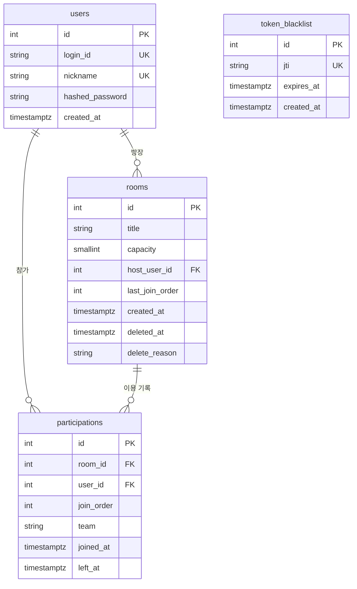

# 03. 도메인 모델 & DB 스키마 (A3)

- 입력: `docs/01-pm/03-domain.md` §3·§4·§6, ADR-001, ADR-002, ADR-009
- DB: PostgreSQL 15+. 테이블은 lifespan의 `Base.metadata.create_all`로 만든다(마이그레이션 없음).
- 현재 참가와 이용 이력은 **한 테이블** `participations`에 둔다. `left_at IS NULL`이 현재 참가다(ARCH-Q-03).
- 시각 컬럼은 모두 `timestamptz`(UTC 저장).

## 1. 엔티티

| ENT | 도메인 클래스 | 위치 | 테이블 | ORM 모델 |
|---|---|---|---|---|
| ENT-01 | `User` | `src/auth/domain/user.py` | `users` | `UserModel` |
| ENT-02 | `TokenBlacklist` | `src/auth/domain/token_blacklist.py` | `token_blacklist` | `TokenBlacklistModel` |
| ENT-03 | `Room` (+ 값 객체 `RoomTitle`, 열거 `TeamSide`, `DeleteReason`) | `src/rooms/domain/room.py` | `rooms` | `RoomModel` |
| ENT-04 | `Participation` | `src/rooms/domain/participation.py` | `participations` | `ParticipationModel` |

## 2. ERD

## 3. 테이블 정의

### 3.1 `users` (ENT-01)

| 컬럼 | SQLAlchemy 타입(Mapped) | null | 기본값 | 제약 | 설명 |
|---|---|---|---|---|---|
| `id` | `Mapped[int]`, `Integer` | N | identity | PK | 회원 ID |
| `login_id` | `Mapped[str]`, `String(20)` | N | — | UNIQUE `uq_users_login_id` | 4~20자 영문 소문자·숫자 (도메인 검증) |
| `nickname` | `Mapped[str]`, `String(12)` | N | — | UNIQUE `uq_users_nickname` | 2~12자 |
| `hashed_password` | `Mapped[str]`, `String(255)` | N | — | — | bcrypt 해시. 응답 스키마에 없음 |
| `created_at` | `Mapped[datetime]`, `DateTime(timezone=True)` | N | `func.now()` | — | 가입 시각 |

### 3.2 `token_blacklist` (ENT-02)

| 컬럼 | 타입 | null | 기본값 | 제약 | 설명 |
|---|---|---|---|---|---|
| `id` | `Integer` | N | identity | PK | |
| `jti` | `String(36)` | N | — | UNIQUE `uq_token_blacklist_jti` (조회 인덱스 겸용) | JWT `jti`(uuid4) |
| `expires_at` | `DateTime(timezone=True)` | N | — | INDEX `ix_token_blacklist_expires_at` | 토큰 `exp`. 지난 행은 로그아웃 때 삭제(ADR-002) |
| `created_at` | `DateTime(timezone=True)` | N | `func.now()` | — | 로그아웃 시각 |

### 3.3 `rooms` (ENT-03)

| 컬럼 | 타입 | null | 기본값 | 제약 | 설명 |
|---|---|---|---|---|---|
| `id` | `Integer` | N | identity | PK | |
| `title` | `String(20)` | N | — | CHECK `ck_rooms_title_not_blank`: `length(btrim(title)) BETWEEN 1 AND 20` | 다듬어진 제목 (INV-12) |
| `capacity` | `SmallInteger` | N | `4` | CHECK `ck_rooms_capacity_fixed`: `capacity = 4` | INV-01 |
| `host_user_id` | `Integer` | N | — | FK `users.id` `ondelete=RESTRICT`, INDEX | 현재(삭제 방은 마지막) 방장 |
| `last_join_order` | `Integer` | N | `0` | CHECK `ck_rooms_last_join_order`: `last_join_order >= 0` | 마지막으로 부여한 입장 순서. 재입장 번호 증가용 (INV-11) |
| `created_at` | `DateTime(timezone=True)` | N | — | — | 서비스가 `now`를 넣음 |
| `deleted_at` | `DateTime(timezone=True)` | Y | NULL | — | 소프트 삭제 시각 |
| `delete_reason` | `String(20)` | Y | NULL | CHECK `ck_rooms_delete_state`: `(deleted_at IS NULL AND delete_reason IS NULL) OR (deleted_at IS NOT NULL AND delete_reason IN ('GAME_STARTED','EMPTY'))` | INV-07 |

- 인덱스 `ix_rooms_active_created`: `(created_at DESC, id DESC) WHERE deleted_at IS NULL` — 공개 방 목록 정렬
- `updated_at`은 두지 않는다(변경 시각을 쓰는 요구가 없음).

### 3.4 `participations` (ENT-04)

| 컬럼 | 타입 | null | 기본값 | 제약 | 설명 |
|---|---|---|---|---|---|
| `id` | `Integer` | N | identity | PK | 이용 기록 ID |
| `room_id` | `Integer` | N | — | FK `rooms.id` `ondelete=RESTRICT` | |
| `user_id` | `Integer` | N | — | FK `users.id` `ondelete=RESTRICT` | |
| `join_order` | `Integer` | N | — | CHECK `ck_participations_join_order`: `join_order >= 1` | 방 안 입장 순서 |
| `team` | `String(1)` | N | — | CHECK `ck_participations_team`: `team IN ('A','B')` | 현재(종료 기록은 마지막) 팀 |
| `joined_at` | `DateTime(timezone=True)` | N | — | — | 입장 시각 |
| `left_at` | `DateTime(timezone=True)` | Y | NULL | CHECK `ck_participations_left_after_join`: `left_at IS NULL OR left_at >= joined_at` | 퇴장 시각. NULL = 참가 중 (INV-10) |

- UNIQUE `uq_participations_room_join_order`: `(room_id, join_order)` — INV-11
- 부분 UNIQUE 인덱스 `uq_participations_user_current`: `(user_id) WHERE left_at IS NULL` — INV-04. **도전 A에서 추가**(ADR-009, TKT-DB-M6-01). 필수 범위의 모델에는 두지 않는다
- 인덱스 `ix_participations_room_current`: `(room_id) WHERE left_at IS NULL` — 현재 참가자 로딩·인원 집계
- 인덱스 `ix_participations_user_joined`: `(user_id, joined_at DESC, id DESC)` — 이용 이력

## 4. INV → 제약 대응

| INV | DB 제약 | 도메인 검사 | DB로 못 내리는 이유 |
|---|---|---|---|
| INV-01 | `ck_rooms_capacity_fixed` | `Room` 상수 `CAPACITY=4`, `TEAM_CAPACITY=2` | 팀당 정원은 행 간 집계 |
| INV-02 | — | `Room.join()` | 다른 테이블 행 수 집계. 동시 요청은 도전 A의 방 행 잠금(ADR-009) |
| INV-03 | — | `Room.join()`, `Room.change_team()` | 같음 |
| INV-04 | (도전 A) `uq_participations_user_current` | `Room.create()`, `Room.join()`의 `current_participation` 검사 | 필수에서는 도메인 검사만 |
| INV-05 | `host_user_id` NOT NULL FK | `Room.leave()` 위임 | "현재 참가자" 여부는 행 간 조건 |
| INV-06 | — | 삭제 방 행위 메서드 거부, `start_game()`·`leave()`가 전원 종료 | 행 간 조건 → 도전 A 잠금 |
| INV-07 | `ck_rooms_delete_state` | `Room` 내부 `_soft_delete()` | — |
| INV-08 | — | `Room.start_game()` | 순차 요청은 삭제 상태 검사로 1회. 동시 요청은 도전 A 잠금 |
| INV-09 | 결과 테이블 없음 | — | — |
| INV-10 | `ck_participations_left_after_join`, 삭제 API 없음 | `Participation.end()` | — |
| INV-11 | `uq_participations_room_join_order` | `Room.last_join_order` 증가 | — |
| INV-12 | `ck_rooms_title_not_blank`, `String(20)` | `RoomTitle` | — |
| INV-13 | — | 응답 스키마에 필드 없음 | 표현 계층 규칙 |
| INV-14 | `uq_token_blacklist_jti` | 인증 의존성 | — |
| INV-15 | — | 조회 쿼리 조건(`user_id`) | 권한은 API 단위 |

## 5. ORM ↔ 도메인 매핑

모든 레포지토리는 `src/<기능>/infrastructure/repositories.py`에 있고 생성자에서 `AsyncSession`을 받는다. `commit`은 하지 않는다(`flush`만, 서비스가 commit).

| ORM 모델 | 도메인/읽기 모델 | 레포지토리 | 변환 | 메서드 시그니처 |
|---|---|---|---|---|
| `UserModel` | `User` | `UserRepository` | `_to_domain(model) -> User`, `_to_model(user) -> UserModel` | `find_by_id(user_id: int) -> User \| None` · `find_by_login_id(login_id: str) -> User \| None` · `exists_login_id(login_id: str) -> bool` · `exists_nickname(nickname: str) -> bool` · `save(user: User) -> User` |
| `TokenBlacklistModel` | `TokenBlacklist` | `TokenBlacklistRepository` | `_to_domain`, `_to_model` | `exists(jti: str) -> bool` · `save(entry: TokenBlacklist) -> None` · `delete_expired(now: datetime) -> int` |
| `RoomModel` + `ParticipationModel` | `Room`(현재 참가자 포함), `Participation` | `RoomRepository` | `_to_domain(room_model, participation_models) -> Room`, `_participation_to_domain(model) -> Participation` | `find_by_id(room_id: int) -> Room \| None` · (도전 A) `find_by_id_for_update(room_id: int) -> Room \| None` (`rooms` 행 `FOR UPDATE`, 현재 참가자 로딩) · `find_current_participation(user_id: int) -> Participation \| None` · `save(room: Room) -> Room` (방 행 insert/update, `room.participations`의 id 없는 기록 insert, 있는 기록은 `team`·`left_at` update, 저장 후 id가 채워진 `Room` 반환) |
| 조회 전용 (`RoomModel`·`ParticipationModel`·`UserModel` 조인) | `RoomSummary`, `RoomDetail`, `HistoryItem`, `ArchivedRoom` (`src/rooms/application/read_models.py`) | `RoomQueryRepository` | 쿼리 결과 → frozen dataclass | `list_active_rooms(cond: RoomListCondition) -> tuple[list[RoomSummary], int]` · `get_room_detail(room_id: int) -> RoomDetail \| None` · `list_history(user_id: int, page: int, size: int) -> tuple[list[HistoryItem], int]` · `get_archived_room(room_id: int, user_id: int) -> ArchivedRoom \| None` |

- `RoomQueryRepository`만 `auth.infrastructure.models.UserModel`을 import한다(ADR-001). 다른 `rooms` 코드는 `auth` 인프라를 import하지 않는다.
- (도전 A) `IntegrityError`(`uq_participations_user_current` 위반)는 `RoomRepository.save()`가 잡아 `AlreadyParticipatingError`(도메인 예외, 400)로 바꾼다. 다른 제약 위반은 그대로 올려 500으로 둔다.
- 검색 조건은 `title ILIKE :pattern ESCAPE '\'`이며 `pattern = '%' + escape(keyword) + '%'`, `escape`는 `\`·`%`·`_` 앞에 `\`를 붙인다(ARCH-Q-07).

## 6. 시드 계획

- 위치: `src/seed.py`의 `async def seed_initial_data(session: AsyncSession, settings: Settings) -> None`. `src/main.py` lifespan이 `create_all` 직후 호출한다.
- 중복 방지: `users`에 `login_id = 'seed01'`이 있으면 아무것도 넣지 않고 반환한다. 전체를 한 트랜잭션으로 넣는다(RISK-12, NFR-06).
- 비밀번호: 모든 시드 회원은 `settings.seed_user_password`(환경변수 `SEED_USER_PASSWORD`)를 bcrypt로 해시해 넣는다. 값은 `.env.example`과 README에만 적는다(D-014).
- 시각: 기준 시각 `base = 서버 시작 시각`에서 분 단위로 빼서 생성 시각 순서를 만든다.

| 엔티티 | 건수 | 내용 |
|---|---|---|
| `users` | 14 | `seed01`~`seed14`, 닉네임 `시드유저01`~`시드유저14` |
| 활성 `rooms` | 5 | R1 "2vs2 시연 방"(seed01~04, A·B 각 2명 — 게임 시작 시연, D-014) / R2 "한 자리 남음"(seed05~07, A2·B1) / R3 "Fun Room"(seed08~09, A1·B1) / R4 "100% 즐겜"(seed10) / R5 "초보 환영"(seed11). 방장은 각 방의 입장 순서 1 |
| 삭제 `rooms` | 3 | D1 "어제 한 판"(GAME_STARTED, seed01~04 과거 기록) / D2 "아무도 없음"(EMPTY, seed12 과거 기록) / D3 "저녁 매치"(GAME_STARTED, seed05~08 과거 기록) |
| `participations` | 20 | 현재 11건(R1~R5) + 과거 9건(D1 4, D2 1, D3 4) |
| 합계 | 42 | 20건 이상 |

- seed12~14는 참가 중이 아닌 회원이다(시연 중 참가·생성용). R2는 정원 마감 직전, R1은 정원 마감 + 게임 시작 가능 상태다.
