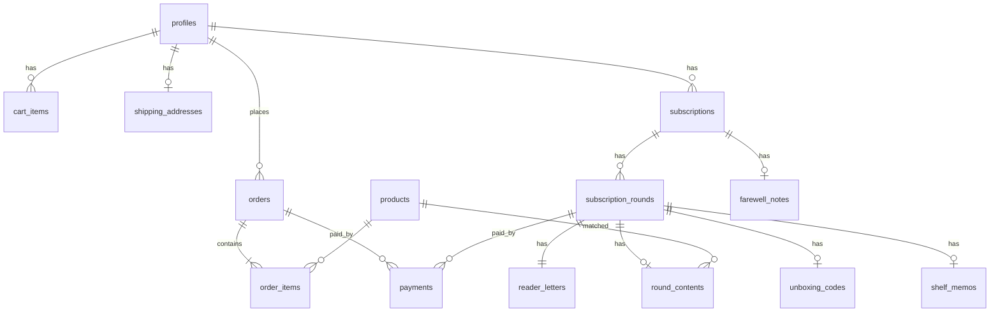

# 03. 도메인 모델 & DB 스키마 (AR-DB)

- 입력: PM-DOMAIN §3~§7, PM-AC, ADR-001~004·007, AR-DRV
- DB 에이전트는 이 문서의 이름(테이블·컬럼·enum·함수·버킷)을 **그대로** 쓴다. 변경이 필요하면 Architect에 질문한다.
- 공통: PK `uuid default gen_random_uuid()`(예외 표기), `created_at timestamptz not null default now()`, 변경되는 테이블은 `updated_at timestamptz not null default now()` + 트리거 `set_updated_at()`. 금액은 `integer`(원).

## 1. 엔티티 → 테이블
| ENT | 도메인(PM-DOMAIN §3) | 테이블 | 비고 |
|---|---|---|---|
| ENT-01 | Member (+ Keeper) | `profiles` | `auth.users` 1:1, `role` |
| ENT-02 | Product, Theme | `products`, enum `theme` | Theme은 4개 고정 → enum |
| ENT-03 | Cart / CartItem | `cart_items` | Cart는 회원 단위라 테이블 없음(D3) |
| ENT-04 | ShippingAddress | `shipping_addresses` | 회원당 1행 |
| ENT-05 | Order | `orders`, `order_items` | 배송지·가격 사본 |
| ENT-06 | Payment | `payments` | 주문·회차 공용 |
| ENT-07 | Subscription | `subscriptions` | |
| ENT-08 | SubscriptionRound (WindowLamp) | `subscription_rounds` | 회원에게 보이는 회차 정보만 |
| ENT-09 | ReaderLetter | `reader_letters` | |
| ENT-10 | 블라인드 대상: 매칭 책·ReplyLetter·PostcardPhoto | `round_contents` | 언박싱 전 회원 열람 0 (NFR-08) |
| ENT-11 | UnboxingCode | `unboxing_codes` | 책방지기만 열람 |
| ENT-12 | ShelfMemo | `shelf_memos` | 작성자만 |
| ENT-13 | FarewellNote | `farewell_notes` | |
| ENT-14 | ShippingList 다운로드 기록 | `shipping_list_downloads` | ADR-007 |
| — | FarewellLetter | (테이블 없음) | 고정 문구 상수 `domains/subscriptions/farewell-letter.ts` (D-014) |



## 2. Enum
```sql
create type theme          as enum ('nature','food','ecology','local');
create type member_role    as enum ('member','keeper');
create type order_status   as enum ('pending_payment','paid','cancel_requested','shipped','refunded','cancelled');
create type subscription_status as enum ('active','ended');
create type round_status   as enum ('pending_payment','arrived','reading','shipped','unboxed','cancelled');
create type payment_status as enum ('ready','paid','refunding','refunded','failed');
```

## 3. 테이블 DDL (요지)
```sql
create table profiles (
  id uuid primary key references auth.users(id) on delete cascade,
  nickname text not null default '독자',
  role member_role not null default 'member',
  created_at timestamptz not null default now());
-- 가입 트리거: auth.users insert → profiles insert (handle_new_user, security definer)

create table products (
  id uuid primary key default gen_random_uuid(),
  name text not null check (char_length(name) between 1 and 200),
  author text not null check (char_length(author) between 1 and 100),
  price integer not null check (price >= 0),
  image_url text not null,
  description text not null check (char_length(description) between 1 and 300),
  theme theme not null,
  keeper_note text not null check (char_length(keeper_note) >= 1),
  publisher_description text,
  stock integer not null check (stock >= 0),          -- INV-05
  created_at timestamptz not null default now(), updated_at timestamptz not null default now());
create index products_theme_created_idx on products (theme, created_at desc);

create table cart_items (
  member_id uuid not null references profiles(id) on delete cascade,
  product_id uuid not null references products(id) on delete restrict,
  quantity integer not null check (quantity >= 1),
  created_at timestamptz not null default now(), updated_at timestamptz not null default now(),
  primary key (member_id, product_id));                -- AC-07-3 줄 중복 0

create table shipping_addresses (
  member_id uuid primary key references profiles(id) on delete cascade,
  recipient_name text not null check (char_length(recipient_name) between 1 and 50),
  phone text not null check (phone ~ '^[0-9-]{9,13}$'),
  address text not null check (char_length(address) between 1 and 200),
  updated_at timestamptz not null default now());

create table orders (
  id uuid primary key default gen_random_uuid(),
  order_number text not null unique,                   -- 'UB' || yymmdd(Asia/Seoul) || '-' || 시퀀스 4자리, 화면 표시용 (§5.2)
  member_id uuid references profiles(id) on delete set null,   -- 탈퇴 시 연결 끊고 보관(§7)
  status order_status not null default 'pending_payment',
  total_amount integer not null check (total_amount >= 0),
  ship_recipient_name text not null, ship_phone text not null, ship_address text not null,  -- D-004 사본
  cancel_rejected_at timestamptz,                      -- 거절 안내(AC-09-6), 새 취소 요청 시 null
  paid_at timestamptz, shipped_at timestamptz,
  created_at timestamptz not null default now(), updated_at timestamptz not null default now());

create table order_items (
  order_id uuid not null references orders(id) on delete cascade,
  product_id uuid not null references products(id) on delete restrict,
  product_name text not null, unit_price integer not null check (unit_price >= 0),
  quantity integer not null check (quantity >= 1),
  primary key (order_id, product_id));

create table subscriptions (
  id uuid primary key default gen_random_uuid(),
  member_id uuid references profiles(id) on delete set null,
  status subscription_status not null default 'active',
  started_at timestamptz not null default now(), ended_at timestamptz,
  check ((status = 'ended') = (ended_at is not null)));
create unique index subscriptions_one_active on subscriptions (member_id) where status = 'active';

create table subscription_rounds (
  id uuid primary key default gen_random_uuid(),
  member_id uuid references profiles(id) on delete set null,
  subscription_id uuid references subscriptions(id) on delete restrict,  -- 결제 확정 시 연결
  status round_status not null default 'pending_payment',
  amount integer not null default 30000 check (amount = 30000),           -- D-003
  ship_recipient_name text not null, ship_phone text not null, ship_address text not null,
  teaser text check (teaser is null or char_length(teaser) between 1 and 100),  -- 발송 시 필수(RPC 검사)
  cancel_requested_at timestamptz,                    -- 취소 요청 "표시"(D-029)
  cancel_rejected_at timestamptz,
  paid_at timestamptz, opened_at timestamptz, shipped_at timestamptz, unboxed_at timestamptz,
  created_at timestamptz not null default now(), updated_at timestamptz not null default now(),
  check (status = 'pending_payment' or status = 'cancelled' or subscription_id is not null),
  check (cancel_requested_at is null or status in ('arrived','reading')));
create unique index rounds_one_in_progress on subscription_rounds (member_id)
  where status in ('pending_payment','arrived','reading');                -- INV-12 DB 강제

create table reader_letters (
  round_id uuid primary key references subscription_rounds(id) on delete cascade,
  member_id uuid references profiles(id) on delete set null,
  body text not null check (char_length(body) between 10 and 2000),       -- D-025
  created_at timestamptz not null default now(), updated_at timestamptz not null default now());

create table round_contents (                          -- 블라인드 대상 (NFR-08)
  round_id uuid primary key references subscription_rounds(id) on delete cascade,
  product_id uuid references products(id) on delete restrict,
  reply_letter text check (reply_letter is null or char_length(reply_letter) between 1 and 3000),
  postcard_path text,                                  -- Storage 'postcards' 객체 경로
  updated_at timestamptz not null default now());

create table unboxing_codes (
  round_id uuid primary key references subscription_rounds(id) on delete cascade,
  code char(6) not null check (code ~ '^[0-9]{6}$'),
  used_at timestamptz,
  created_at timestamptz not null default now());
create unique index unboxing_codes_active_unique on unboxing_codes (code) where used_at is null;  -- A-05

create table shelf_memos (
  round_id uuid primary key references subscription_rounds(id) on delete cascade,  -- INV-16 1권 1개
  member_id uuid not null references profiles(id) on delete cascade,
  body text not null check (char_length(body) between 1 and 100),
  updated_at timestamptz not null default now());      -- 화면 날짜 = 마지막 저장일(AC-17-2)

create table farewell_notes (
  subscription_id uuid primary key references subscriptions(id) on delete cascade,
  member_id uuid references profiles(id) on delete set null,
  body text not null check (char_length(body) between 1 and 1000),       -- 빈칸이면 행을 만들지 않음
  created_at timestamptz not null default now());

create table payments (
  id uuid primary key default gen_random_uuid(),
  order_id uuid references orders(id) on delete restrict,
  round_id uuid,                                       -- FK(→ subscription_rounds, on delete restrict)는 0030에서 alter로 추가 (§5.1)
  pg_order_id text not null unique,                    -- 토스 orderId (영숫자·-_ 6~64자)
  pg_payment_key text unique,                          -- RISK-01 중복 확정 차단
  amount integer not null check (amount > 0),          -- 서버 계산 금액(NFR-19)
  status payment_status not null default 'ready',
  failure_code text, approved_at timestamptz, refunded_at timestamptz,
  created_at timestamptz not null default now(), updated_at timestamptz not null default now(),
  check ((order_id is null) <> (round_id is null)));
create unique index payments_one_settled_per_order on payments (order_id) where status in ('paid','refunding','refunded');
create unique index payments_one_settled_per_round on payments (round_id) where status in ('paid','refunding','refunded');

create table shipping_list_downloads (
  id uuid primary key default gen_random_uuid(),
  keeper_id uuid references profiles(id) on delete set null,
  row_count integer not null check (row_count >= 1),
  created_at timestamptz not null default now());
```

### 3.1 INV → DB 제약 매핑
| INV | DB에서 | 앱(RPC/코드)에서 | 앱에서만 지키는 이유 |
|---|---|---|---|
| INV-01 | `not null`·`check` | 폼 검증 | — |
| INV-04 | — | RPC `ship_*`가 `status in ('paid')`/`('reading','arrived')` 조건 | 상태 조합 조건 |
| INV-05 | `stock >= 0` | RPC에서 `update … set stock = stock - n where stock >= n` | — |
| INV-06 | `pg_payment_key unique`, 정산 결제 1개 부분 unique | RPC 조건부 갱신 | — |
| INV-07 | `round_contents` 분리 + RLS(언박싱 후만) | 회원용 조회 함수가 그 테이블을 언박싱 전에는 읽지 않음 | — |
| INV-08 | 코드 형식 `check`, 활성 코드 unique | `unbox_round`가 소유자 검사 | 소유자 비교 |
| INV-09 | — | 전이 RPC의 `where status = <이전>` | 전이 그래프 |
| INV-12 | `rounds_one_in_progress` 부분 unique | — | — |
| INV-15 | RLS `is_keeper()` | 화면 가드 | — |
| INV-16 | `shelf_memos` PK=round_id, 길이 check | 언박싱 여부 RLS | — |
| INV-17 | — | `list_shipping_targets()` 조건 | 다중 테이블 조건 |
| INV-19 | RLS(§4) | — | — |
| INV-20 | 회차 `cancel_requested_at` check | 발송 RPC가 취소 요청 시 거부 | — |

## 4. RLS (모든 테이블 `enable row level security`, 기본 거부)
- 헬퍼: `public.is_keeper() returns boolean` — `security definer`, `stable`, `select exists(select 1 from profiles where id = auth.uid() and role = 'keeper')`. `search_path = ''` 고정.
- 표기: `own` = `member_id = (select auth.uid())`, `K` = `is_keeper()`, `RPC` = 직접 쓰기 정책 없음(`security definer` 함수로만).

| 테이블 | anon select | 회원 select | 회원 insert/update/delete | 책방지기 |
|---|---|---|---|---|
| `profiles` | ✗ | 자기 행 | update 자기 `nickname`만(컬럼 권한) | select 전체 |
| `products` | ✓ | ✓ | ✗ | insert·update (delete 정책 없음, D-023) |
| `cart_items` | ✗ | own | own (insert·update·delete) | ✗ |
| `shipping_addresses` | ✗ | own | own (insert·update) / delete는 탈퇴 RPC | select |
| `orders`, `order_items` | ✗ | own (`order_items`는 주문 소유 기준) | RPC | select (`member_id is not null`만), 전이는 RPC |
| `payments` | ✗ | own(주문·회차 소유 기준) | RPC | select |
| `subscriptions` | ✗ | own | RPC | select |
| `subscription_rounds` | ✗ | own | RPC | select, 전이는 RPC |
| `reader_letters` | ✗ | own | RPC(`post_letter`) / 결제 대기 중 본문 수정 update own | select (회차 `status <> 'pending_payment'`만, INV-18) |
| `round_contents` | ✗ | 회차 own **and** `status = 'unboxed'` | ✗ | select·insert·update (회차 `arrived`·`reading`일 때만 쓰기) |
| `unboxing_codes` | ✗ | ✗ | ✗ (`unbox_round` RPC) | select |
| `shelf_memos` | ✗ | own | own insert·update·delete (회차 `unboxed` + own 조건) | ✗ (INV-19) |
| `farewell_notes` | ✗ | own | RPC(`end_subscription`) | select |
| `shipping_list_downloads` | ✗ | ✗ | ✗ | insert·select |

- 회원 화면의 회차 조회는 `subscription_rounds`(+`teaser`는 `status in ('shipped','unboxed')`에서만 화면 표시)만 읽고, 책·답장·엽서는 `round_contents`에서 읽는다. RLS가 언박싱 전 행을 막으므로 응답에 섞일 수 없다(NFR-08).
- GATE-07: `select relname from pg_class where relkind='r' and relnamespace='public'::regnamespace and not relrowsecurity` 결과 0행.

## 5. RPC (Postgres 함수, `security definer`, `search_path=''`, 첫 줄 권한 검사)
| 함수 | 호출 주체 | 하는 일(원자) | 상세 |
|---|---|---|---|
| `create_order(p_ship jsonb) returns orders` | 회원 | 장바구니(재고>0 줄) → `orders`+`order_items`(가격 사본) `pending_payment`, 합계 서버 계산 | SEQ-02 |
| `create_round(p_letter text, p_ship jsonb) returns subscription_rounds` | 회원 | `reader_letters` + 회차 `pending_payment` (INV-12 unique 위반 → `ROUND_IN_PROGRESS`) | SEQ-04 |
| `create_payment(p_order_id uuid, p_round_id uuid) returns payments` | 회원 | 소유·상태 검사, 금액=주문 합계/30,000, `pg_order_id` 생성, `ready` | SEQ-03 |
| `confirm_payment(p_pg_order_id text, p_payment_key text, p_amount int) returns jsonb` | 서버(service role) | `ready→paid`, 금액 대조, 주문: 재고 차감·장바구니 제거·`paid` / 회차: 활성 구독 연결(없으면 생성)·`arrived`, 기본 배송지 upsert. 이미 `paid`면 `{already:true}` | SEQ-03 |
| `fail_payment(p_pg_order_id text, p_code text)` | 서버 | `ready→failed` | SEQ-03 |
| `request_cancel / withdraw_cancel(p_kind, p_id)` | 회원 | 주문 `paid↔cancel_requested` / 회차 `cancel_requested_at` 설정·해제 | SEQ-08 |
| `reject_cancel(p_kind, p_id)` | 책방지기 | 요청 해제 + `cancel_rejected_at = now()` | SEQ-08 |
| `begin_refund(p_kind, p_id) returns payments` | 책방지기 | 결제 `paid→refunding` (2번째 클릭은 영향 0 → `ALREADY_PROCESSING`) | SEQ-08 |
| `complete_refund(p_payment_id) / fail_refund(p_payment_id)` | 서버 | `refunding→refunded` + 주문 `refunded`·재고 복구 / 회차 `cancelled` · 실패 시 `refunding→paid` | SEQ-08 |
| `ship_order(p_order_id)` | 책방지기 | `paid→shipped` (취소 요청이면 거부) | SEQ-02 |
| `open_round(p_round_id)` | 책방지기 | `arrived→reading`, `opened_at` (이미 reading이면 변화 0) | SEQ-05 |
| `ship_round(p_round_id, p_code char(6)) returns char(6)` | 책방지기 | 검사(책·답장·힌트 있음, 취소 요청 없음, 재고≥1) → 재고−1, 코드 insert(충돌 시 `CODE_COLLISION`), `reading/arrived→shipped`. 이미 shipped면 기존 코드 반환 | SEQ-06 |
| `unbox_round(p_round_id, p_code text) returns boolean` | 회원 | 소유자·`shipped`·코드 일치 → `unboxed`, `used_at`. 불일치는 false(구분 없음, AC-16-4) | SEQ-07 |
| `cancel_pending(p_kind, p_id)` | 회원 | 결제 대기 주문 취소(D-037) / 회차 [편지 거두기] `cancelled` | SEQ-02, 04 |
| `end_subscription(p_note text)` | 회원 | 구독 `ended`, 결제 대기 회차 `cancelled`, 안부 있으면 insert | SEQ-09 |
| `withdraw_member() returns jsonb` | 회원 | §7 처리, 반환값에 삭제할 Storage 경로 목록 | SEQ-10 |
| `list_shipping_targets() returns table(...)` | 책방지기 | INV-17 대상(결제 시점 배송지) | SEQ-11 |
| `keeper_counts() returns jsonb` | 책방지기 | SCR-20 오늘 할 일 수 | — |

### 5.1 주문/회차 공용 RPC의 마이그레이션 분할 (사용자 승인 2026-10-22)
`payments`와 공용 RPC는 `0020`(TKT-DB-02)에서 만들지만 `subscription_rounds`는 `0030`(TKT-DB-03)에서 생긴다. 그래서 두 번에 나눈다.
| 대상 | `0020_commerce.sql` (TKT-DB-02) | `0030_subscription.sql` (TKT-DB-03) |
|---|---|---|
| `payments.round_id` | 컬럼만(FK 없음), `check ((order_id is null) <> (round_id is null))`와 부분 unique는 그대로 | `alter table public.payments add constraint payments_round_id_fkey foreign key (round_id) references public.subscription_rounds(id) on delete restrict` |
| `create_payment`, `confirm_payment`, `request_cancel`, `withdraw_cancel`, `reject_cancel`, `begin_refund`, `complete_refund`, `fail_refund`, `cancel_pending` | 주문 분기만 구현. 회차 대상(`p_round_id` not null, `p_kind = 'round'`, 회차 결제)이면 `INVALID_STATE` | 같은 시그니처로 `create or replace function` — 주문 분기는 그대로 두고 회차 분기를 추가 |
| `payments` RLS select own | 주문 소유 기준만 | 정책을 `drop policy` 후 주문·회차 소유 기준으로 다시 만든다 |
- 시그니처(함수 이름·인자·반환 타입)는 두 파일에서 같아야 한다. BE는 `0030` 적용 전에도 같은 RPC를 부른다.
- pgTAP: `0020` 범위 테스트는 회차 호출이 `INVALID_STATE`인지 확인하지 않는다(0030 적용 후 바뀌므로). 회차 분기 테스트는 TKT-DB-03에서 쓴다.

### 5.2 주문 번호 `orders.order_number`
- `0020`에서 시퀀스 `public.order_number_seq`를 만든다. `create_order`가 만든다:
  `'UB' || to_char(now() at time zone 'Asia/Seoul', 'YYMMDD') || '-' || lpad((nextval('public.order_number_seq') % 10000)::text, 4, '0')`
- 예: `UB261022-0007`. 날짜는 한국 시간 기준, 뒤 4자리는 날마다 초기화하지 않는 순번이다.
- 같은 날 1만 건을 넘으면 `unique` 위반이 날 수 있으나 시연 규모 밖으로 보고 재시도는 두지 않는다.
- 시퀀스는 RLS 대상이 아니다. `create_order`(security definer)만 쓰므로 `anon`·`authenticated`에 시퀀스 권한을 주지 않는다.

## 6. Storage
| 버킷 | 공개 | 경로 규칙 | 정책 | 제한 |
|---|---|---|---|---|
| `book-covers` | 공개 | `products/{product_id}/{uuid}.{jpg|png|webp}` | select 모두, insert·update `is_keeper()` | 이미지 MIME, 5MB |
| `postcards` | **비공개** | `rounds/{round_id}/postcard.{jpg|png|webp}` | insert·update·select·delete `is_keeper()`만. 회원 정책 없음 | 이미지 MIME, 10MB (D-025, AC-14-3) |
- 회원의 엽서 열람: 서버가 RLS 클라이언트로 `round_contents`를 읽어(언박싱 후에만 행이 옴) `postcard_path`를 얻은 뒤, `lib/supabase/admin.ts`로 `createSignedUrl(path, 600)`을 발급한다(A-08).
- `next.config.ts` `images.remotePatterns`: `<project-ref>.supabase.co/storage/v1/object/public/book-covers/**`, `picsum.photos`(seed 표지).

## 7. 탈퇴 (`withdraw_member`, PM-DOMAIN §7)
1. 거부: `orders.status in ('paid','cancel_requested')` 또는 회차 `arrived`·`reading` 존재 → `WITHDRAW_BLOCKED`
2. 결제 대기 주문·회차 → `cancelled`
3. 삭제: `shipping_addresses`, `cart_items`, `reader_letters`, `round_contents`(경로 수집), `shelf_memos`, `farewell_notes`
4. 연결 끊기: `orders`·`subscriptions`·`subscription_rounds`·`payments` 경유 소유는 `member_id = null`
5. 서버: Storage 엽서 삭제 → `auth.admin.deleteUser(uid)`(→ `profiles` cascade) → 로그아웃
- 5년 경과 거래 기록 삭제는 운영 SQL(README 운영 절차)로 처리, 자동 작업 없음(RISK-14 잔여).

## 8. seed·타입
- `data/products.ts`(8권, 테마별 2권, `imageUrl = https://picsum.photos/seed/ub-<n>/600/800`, 고정 uuid) → `scripts/gen-seed.mjs` → `supabase/seed.sql`(`products`만). 생성 파일은 커밋하고, `data/products.ts`를 고치면 다시 생성한다(ADR-001).
- 원격 전용(ADR-005): seed는 `npx supabase db push --linked --include-seed`로 적용한다. 같은 원격 DB에 여러 번 적용되므로 `insert … on conflict (id) do update set …`로 쓴다(재적용해도 8행 유지).
- pgTAP 테스트(`supabase/tests/*.test.sql`)는 원격 DB에서 돌므로 파일마다 `begin;` → `create extension if not exists pgtap with schema extensions;` → 테스트 → `select * from finish();` → `rollback;` 구조로 쓴다. 테스트용 사용자·행은 rollback으로 남지 않는다.
- **결과 표 형식 (사용자 승인 2026-10-22)**: Docker 없이 SQL 편집기로 실행하면 마지막 결과만 보이므로, 모든 TAP 줄을 임시 테이블에 모아 마지막에 한 번에 출력한다. TKT-DB-02부터 이 형식으로 쓰고, `rls.test.sql`(TKT-DB-01)도 다음에 고칠 때 바꾼다.
  ```sql
  begin;
  create extension if not exists pgtap with schema extensions;
  create temp table tap (n serial, line text);
  grant insert, select on tap to anon, authenticated, service_role;   -- 역할을 바꿔도 결과를 쌓을 수 있게
  grant usage on sequence tap_n_seq to anon, authenticated, service_role;
  select no_plan();                                   -- 출력 없음, 계획만 시작 (tap에 넣지 않는다)
  insert into tap (line) select ok(…, 'AC-08-6 …');   -- 단언마다 insert into tap (line) select …
  set local role authenticated;
  insert into tap (line) select throws_ok(…);
  reset role;
  insert into tap (line) select * from finish();      -- 실패 수 요약
  select line from tap where line is not null order by n;   -- 편집기에 모든 ok / not ok 줄이 이름과 함께 보인다
  rollback;
  ```
  - `supabase test db --linked`로 돌려도 같은 결과가 나온다(마지막 select가 TAP 줄을 그대로 출력).
  - 판정: 출력에 `not ok`가 0줄이고 마지막 줄이 `1..N`이면 통과.
- 적용된 마이그레이션 파일은 고치지 않는다. 원격 DB는 `db reset`으로 되돌리지 않으므로 변경은 새 마이그레이션 파일로 한다.
- `types/database.ts`: `npx supabase gen types typescript --linked --schema public > types/database.ts`(DB 에이전트만 수정, 원격 적용 후 실행).
- 매핑 함수는 한 곳: `lib/data/products.ts`의 `toProduct(row: Tables<'products'>): Product` (snake → camel).

## 9. 마이그레이션 파일
| 파일 | 내용 | TKT |
|---|---|---|
| `supabase/migrations/0001_profiles_products.sql` | enum 전체, `profiles`, `products`, `is_keeper`, 가입 트리거, `set_updated_at`, `book-covers` 버킷 + `storage.objects` 정책 | TKT-DB-01 |
| `0020_commerce.sql` | `cart_items`, `shipping_addresses`, `orders`, `order_items`, `payments`(round FK 없음), `order_number_seq`, 주문 RPC·결제 RPC(주문 분기, §5.1) | TKT-DB-02 |
| `0030_subscription.sql` | 구독·회차·편지류·코드·메모·안부, 회차 RPC, `payments.round_id` FK·공용 RPC 회차 분기(§5.1), `postcards` 버킷 + `storage.objects` 정책 | TKT-DB-03 |
| `0040_admin_ops.sql` | `shipping_list_downloads`, `list_shipping_targets`, `keeper_counts`, `withdraw_member` | TKT-DB-04 |
- 버킷은 그 버킷을 쓰는 티켓의 마이그레이션에 둔다(사용자 승인 2026-10-22). 원격 전용(ADR-005)에서는 적용된 파일을 고칠 수 없고, 번호가 큰 파일을 먼저 적용하면 뒤에 오는 작은 번호 파일을 `db push`가 거부하기 때문이다.
- **번호 간격 (사용자 승인 2026-10-22)**: 아직 적용하지 않은 계획 파일은 10 단위(`0020`·`0030`·`0040`)로 띄운다. `0001`은 이미 적용돼 그대로 둔다.
  - 적용된 마이그레이션을 고쳐야 하면 그 파일 바로 뒤의 빈 번호로 새 파일을 만든다: `0020` 적용 후 고침 → `0021_<slug>.sql`, `0022_…`. `0001` 고침은 `0002`~`0019`를 쓴다.
  - 고침 파일은 다음 계획 파일(예: `0030`)보다 반드시 작은 번호여야 한다. 계획 파일이 이미 적용됐으면 그 뒤의 빈 번호를 쓴다.
  - 고침 파일을 만들면 이 표에 행을 추가하고 TKT를 적는다.
