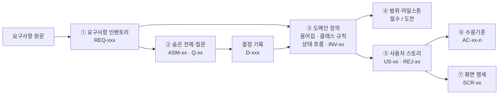
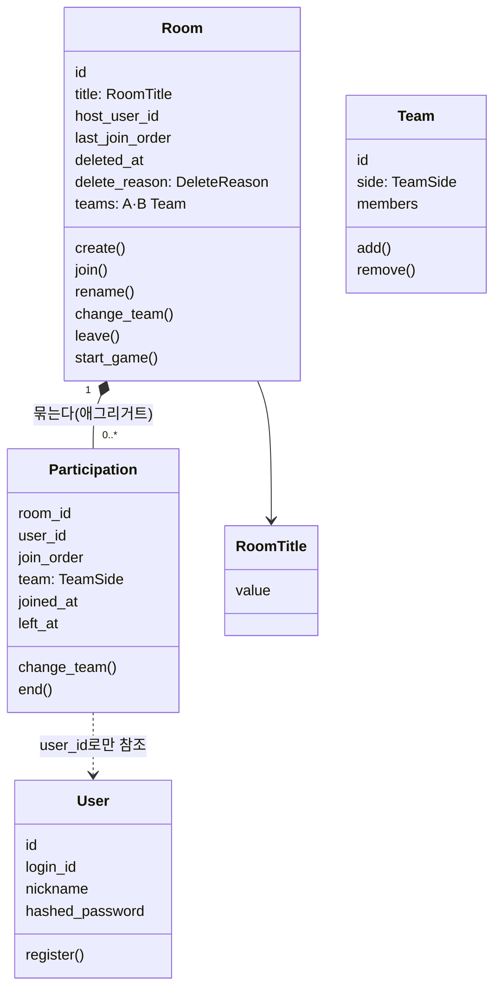
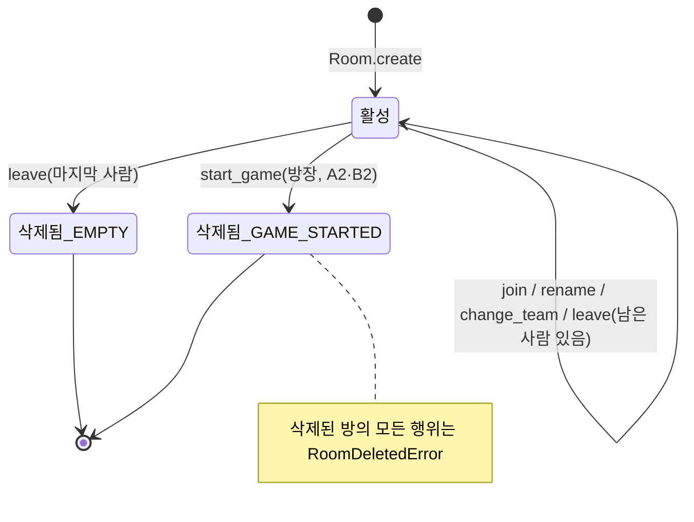
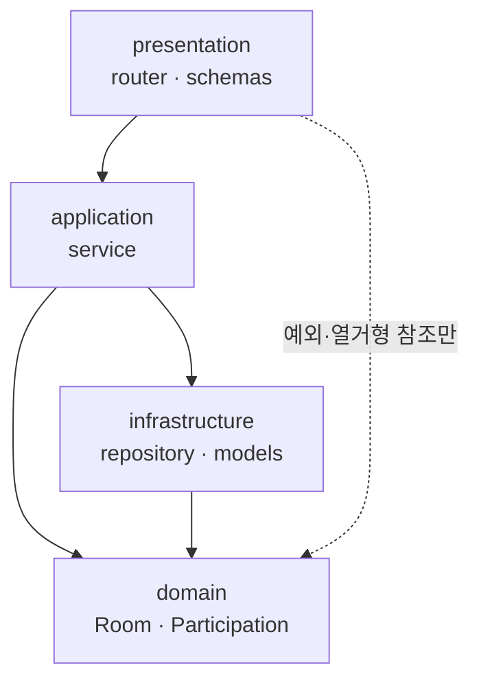
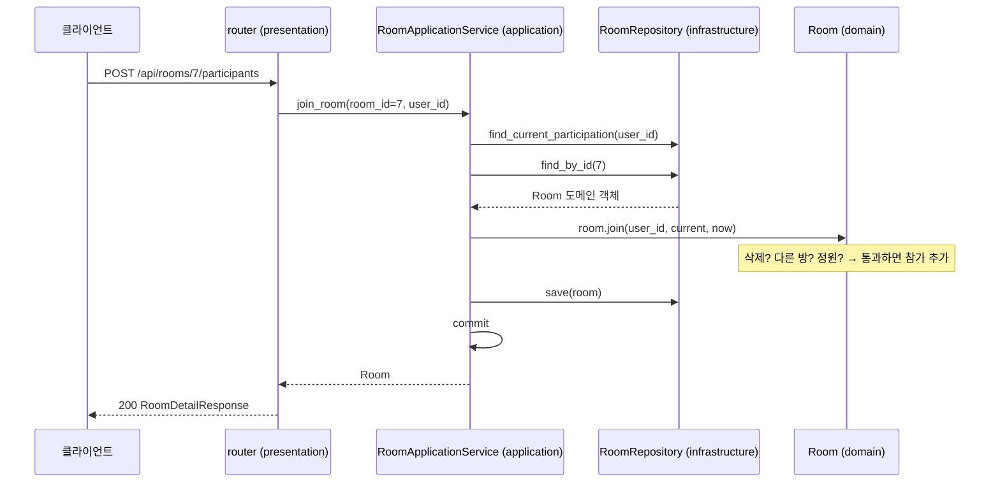

# 도메인 중심으로 기획하고 설계하기 — 2vs2 매치메이킹 프로젝트로 배우는 DDD 첫걸음

> 대상: 백엔드 부트캠프 1년차 수강생
> 바탕 자료: 이 저장소의 PM 산출물(`docs/01-pm/`), ARCH 산출물(`docs/02-arch/`), 실제 코드(`src/`)
> 함께 보면 좋은 교안: KANT 백엔드 교안 1장 2강(도메인 모델), 2장 1강(스키마), 3장 1강(스스로 검증하는 모델), 4장 1강(도메인별 라우터), 4장 2강(상태 변경 메서드), 7장(도메인 중심 4계층, 발제 §4.1)

---

## 0. 이 문서에서 배우는 것

1. **왜** 코드를 짜기 전에 "도메인"부터 정리하는지
2. 요구사항 문장을 **용어 → 규칙 → 상태 → 스토리 → 수용기준**으로 쪼개는 기획 방법
3. 그 결과를 **도메인 클래스(엔티티·값 객체·애그리거트)** 로 옮기는 설계 방법
4. 도메인 클래스를 **4계층 구조**(presentation·application·domain·infrastructure) 안에 배치하는 방법

이 문서 전체에서 **"방 정원은 4명"** 이라는 규칙 하나가 기획 문서에서 출발해 코드와 HTTP 응답이 되기까지를 계속 따라가 볼 거예요(§3.7).

### 교안과 연결되는 부분

| 교안 | 교안에서 배운 것 | 이 문서에서 이어지는 것 |
|---|---|---|
| 1장 2강 | `Book` 클래스가 생성자에서 규칙을 검사하고 `ValueError`를 낸다. "현실 세계의 규칙을 코드로 옮긴 핵심 객체 = 도메인 모델" | §2, §4: `Room`, `Participation`, `User` |
| 2장 1강 | `schemas/` 폴더의 Pydantic 모델은 "웹으로 주고받는 데이터 양식" | §5.3: 스키마·도메인 모델·ORM 모델 세 가지 구분 |
| 3장 1강 | "스스로 검증하는 데이터 모델", 전역 예외 처리기 | §4.4, §5.5 |
| 3장 2강 | Pydantic 스키마(`MenuCreateSchema`)와 도메인 모델(`MenuItem`)을 따로 둔다 | §5.3 |
| 4장 1강 | 회원 도메인·상품 도메인처럼 기능별로 라우터를 나눈다 | §6: `auth`·`rooms` 기능 폴더 |
| 4장 2강 | `MultimediaAsset.mark_as_processing()`처럼 상태를 바꾸는 메서드가 규칙을 검사한다 | §4.5: `Room.start_game()` 상태 흐름 |
| 7장(발제) | 도메인 중심 4계층, 레포지토리 | §5 |

---

## 1. 왜 도메인부터 정리할까?

### 1.1 도메인이란?

**도메인(domain)** 은 우리가 소프트웨어로 해결하려는 **현실의 업무 영역**이에요. 교안 1장 2강에서는 "동네 책방"이 도메인이었고, 이 프로젝트에서는 **"2vs2 게임 방 매치메이킹"** 이 도메인이에요.

도메인에는 그 업무만의 **말(용어)** 과 **규칙**이 있어요.

- 용어: 방, 방장, 팀, 참가, 게임 시작, 해산 …
- 규칙: "방은 4명까지", "한 팀은 2명까지", "한 사람은 한 방에만", "방장이 나가면 다음 사람이 방장" …

### 1.2 빈약한 도메인 모델 vs 풍부한 도메인 모델

발제 문서는 이 프로젝트의 목적을 이렇게 설명해요.

> "빈약한 도메인 모델(Anemic Domain Model)과 비대해진 컨트롤러 문제를 해결하기 위해 …"

두 방식을 같은 기능("방 참가")으로 비교해 볼게요.

**빈약한 도메인 모델** — 객체는 데이터만 담고, 규칙은 라우터(컨트롤러)에 흩어져 있어요.

```python
# ❌ 규칙이 라우터에 있다 (이 프로젝트에서 쓰지 않는 방식)
@router.post("/rooms/{room_id}/participants")
async def join_room(room_id: int, user_id: int, db = Depends(get_db)):
    room = await db.get(RoomModel, room_id)
    if room.deleted_at is not None:
        raise HTTPException(400, "이미 삭제된 방입니다")
    count = ...  # 현재 인원 세기
    if count >= 4:
        raise HTTPException(400, "정원이 마감되었습니다")
    ...  # 팀 배정, 입장 순서 계산도 여기에
```

- "정원 4명" 규칙이 이 함수 안에만 있어요. 방을 만드는 API, 시드 데이터, 테스트에서도 같은 규칙이 필요하면 **복사**해야 해요.
- 규칙을 바꾸려면 여러 라우터를 다 찾아 고쳐야 해요.
- DB와 HTTP 없이는 규칙만 따로 테스트할 수 없어요.

**풍부한 도메인 모델** — 규칙을 가진 객체가 스스로 판단해요(교안 1장 2강의 `Book`과 같은 생각).

```python
# ✅ 실제 코드: src/rooms/domain/room.py
def join(self, user_id: int, current_participation: Participation | None, now: datetime) -> Participation:
    self._ensure_active()                       # 삭제된 방이면 RoomDeletedError
    if current_participation is not None:
        if self.id is not None and current_participation.room_id == self.id:
            return self.participation_of(user_id) or current_participation   # 같은 방 재요청은 그대로
        raise AlreadyParticipatingError()       # 다른 방에 참가 중
    if self.is_full:
        raise RoomFullError()                   # 정원 4명 마감
    team = self._team_to_join()                 # A팀에 자리가 있으면 A, 없으면 B (D-024)
    self.last_join_order += 1
    participation = Participation(
        id=None, room_id=self.id, user_id=user_id,
        join_order=self.last_join_order,
        team=team.side,
        joined_at=now,
    )
    team.add(participation)                     # 팀 정원 2명은 Team이 검사
    self.participations.append(participation)
    return participation
```

- 규칙이 `Room` **한 곳**에만 있어요. 라우터·서비스·시드·테스트가 모두 `room.join(...)`을 부르면 같은 규칙이 지켜져요.
- `Room`은 FastAPI도 SQLAlchemy도 모르는 **순수 파이썬 클래스**라서, `Room(...)`을 직접 만들어 바로 테스트할 수 있어요(`tests/unit/test_room.py`).

> 💡 **한 줄 요약**: 규칙은 그 규칙의 주인인 객체 안에 둔다. 라우터는 "요청 받기"와 "응답 만들기"만 한다.

---

## 2. DDD 핵심 용어, 쉬운 말로

**DDD(Domain-Driven Design, 도메인 주도 설계)** 는 "업무의 말과 규칙을 중심에 두고 소프트웨어를 설계하자"는 방법론이에요. 처음부터 전부 알 필요는 없고, 아래 용어만 알아도 이 프로젝트 구조를 읽을 수 있어요.

| 용어 | 쉬운 설명 | 이 프로젝트에서 |
|---|---|---|
| **유비쿼터스 언어** (공통 언어) | 기획자·개발자·코드가 **같은 단어**를 쓰자는 약속. 문서의 "방장"이 코드에서도 `host`여야 한다 | PM 용어집 `docs/01-pm/03-domain.md` §3 |
| **엔티티** (Entity) | **식별자** 로 구분되는 객체. 내용이 바뀌어도 같은 객체 | `User`, `Room`(id), `Participation`(방 + 회원) |
| **값 객체** (Value Object) | **값 자체**로 구분되는 객체. 바뀌지 않고, 같은 값이면 같은 것 | `RoomTitle`, `TeamSide`, `DeleteReason` |
| **애그리거트** (Aggregate, 집합) | 함께 바뀌어야 하는 객체들의 묶음. 바깥에서는 **루트** 하나로만 다룬다 | `Room`(루트)이 `Participation`들을 묶는다 |
| **불변 규칙** (Invariant) | 언제나 참이어야 하는 규칙 | `INV-01`~`INV-15` (예: 활성 방 인원은 1~4명) |
| **레포지토리** (Repository) | 애그리거트를 저장하고 꺼내 오는 창구. DB 세부 사항을 숨긴다 | `RoomRepository`, `UserRepository` |
| **응용 서비스** (Application Service) | 한 유스케이스의 **순서**를 조율한다. 규칙 판단은 하지 않는다 | `RoomApplicationService.join_room()` |
| **바운디드 컨텍스트** (Bounded Context) | 같은 단어가 같은 뜻으로 쓰이는 경계. 보통 기능 폴더 하나 | `auth`(회원·인증), `rooms`(방·참가) |

---

## 3. 기획: 요구사항을 도메인 중심으로 구조화하기 (PM 단계)

PM 에이전트는 요구사항 원문을 바로 기능 목록으로 만들지 않고, 아래 순서로 **잘게 나누고 번호를 붙여요**. 번호가 있으면 "이 코드는 어느 요구사항 때문에 있지?"를 언제든 거꾸로 추적할 수 있어요.



### 3.1 ① 요구사항 인벤토리 — 원문을 한 문장씩 번호 붙이기

파일: `docs/01-pm/01-requirements-inventory.md`

원문을 **고치지 않고 그대로 인용**한 뒤 `REQ-001`처럼 번호와 태그(`[기능]`, `[제약]` …)를 붙여요. 이후 모든 문서는 원문 대신 이 번호로 말해요.

| ID | 원문 (요약) | 태그 |
|---|---|---|
| REQ-003 | "'게임 시작' 버튼을 누르면 결과 판정 없이 방이 사라진다(소프트 삭제)…" | 기능 |
| REQ-007 | "정원·중복 참가·팀 정원·방장 위임·소프트 삭제 같은 매치메이킹 규칙을 **도메인 객체가 스스로 검증**하는 백엔드…" | 제약 |

> REQ-007이 바로 "풍부한 도메인 모델로 만들라"는 요구사항이에요.

### 3.2 ② 숨은 전제·모호성 찾기 — 질문하기

파일: `docs/01-pm/02-assumptions-questions.md`

요구사항에는 **안 적힌 것**이 많아요. 액터(비로그인·회원·방장·동시 사용자) × 관점(기능·데이터·상태·보안 …) 표를 만들어 빈칸을 찾고, 모호한 것은 질문으로 만들어요.

- `ASM-01` 게임 시작은 **누가** 누를 수 있나? → 질문 `Q-01` → 답: 현재 방장만
- `ASM-03` 처음 들어온 사람은 **어느 팀**? → 질문 `Q-03` → 답: A팀에 자리가 있으면 A팀, 없으면 B팀(D-024로 변경)

답은 결정 기록(`docs/01-pm/decision-log.md`, `D-xxx`)에 남겨요. **코드에서 "왜 A팀이지?"라는 질문이 생기면 여기서 답을 찾을 수 있어요.**

### 3.3 ③ 도메인 정의 — 이 문서의 핵심

파일: `docs/01-pm/03-domain.md`. 네 부분으로 되어 있어요.

**(가) 한 문장 정의와 액터** — 누가, 무엇을 위해 쓰는지

> 로그인한 회원에게, 2vs2 공개 방을 만들거나 찾아 참가하고 팀을 바꾼 뒤 방장이 '게임 시작'을 누르면 결과 판정 없이 방이 해산되는 매치메이킹 시연 서비스.

액터: 비로그인 방문자 / 회원(참가자) / 방장. **방장은 "사람 종류"가 아니라 "특정 방 안의 역할"** 이라는 점이 중요해요(위임으로 바뀌니까요).

**(나) 용어집 — 유비쿼터스 언어**

| 용어 | 코드 이름 | 정의 |
|---|---|---|
| 방 | `Room` | 정원 4명 고정의 2vs2 공개 방. 참가 기록을 묶는 집합의 루트 |
| 방 제목 | `RoomTitle` (값 객체) | 앞뒤 공백 제거 후 1~20자 |
| 참가(이용 기록) | `Participation` | 한 회원이 한 방에 한 번 입장한 기록. 퇴장 시각이 없으면 '참가 중'. 참가 중인 기록은 (방, 회원)으로 구분 |
| 이용 로그 | — | 끝난 이용 기록의 보관본. 같은 방에 로그가 여러 건이면 재입장 (D-025) |
| 소프트 삭제 | `Room._soft_delete()` | 행을 남기고 삭제 시각·사유를 기록 |

문서의 단어와 코드의 이름이 1:1로 맞아요. 기획 회의에서 "참가 기록"이라고 말하면 개발자는 바로 `Participation`을 떠올릴 수 있어요.

**(다) 클래스별 행위와 거부 규칙** — "무엇을 할 수 있고, 언제 거부되는가"

| 행위 | 거부 규칙 | 결과 |
|---|---|---|
| `Room.join(...)` | 삭제된 방 / 정원 4명 마감 / 다른 방에 참가 중 | 새 참가(다음 입장 순서, A팀 우선) |
| `Room.start_game(...)` | 삭제된 방 / 방장이 아님 / A·B팀이 각각 2명이 아님 | 소프트 삭제(`GAME_STARTED`), 전원 퇴장 |

기능을 "API 목록"이 아니라 **"도메인 객체가 하는 행동(메서드)"** 으로 정리한 점이 도메인 중심 기획의 특징이에요.

**(라) 상태 흐름과 불변 규칙(INV)**

| ID | 규칙 |
|---|---|
| INV-01 | 방의 정원은 4명, 팀당 정원은 2명으로 고정 |
| INV-02 | 활성 방의 현재 참가자 수는 1 이상 4 이하 |
| INV-04 | 한 회원의 현재 참가는 최대 1건 |
| INV-06 | 삭제된 방은 다시 활성이 되지 않으며 어떤 변경도 받지 않는다 |

**불변 규칙 = 테스트할 목록**이에요. QA는 INV마다 "깨뜨리려는 시도"를 테스트로 만들어요.

### 3.4 ④ 범위 — 무엇을 먼저 할까

파일: `docs/01-pm/04-scope.md`. 도메인 규칙을 **필수**(순차 요청 기준으로 지킴)와 **도전**(동시 요청까지 지킴: DB 잠금)으로 나눴어요(결정 D-018). 같은 규칙이라도 "어디까지 보장하느냐"를 범위로 나눌 수 있다는 점을 기억하세요.

### 3.5 ⑤ 사용자 스토리 — 정상 흐름과 거부 시나리오

파일: `docs/01-pm/05-user-stories.md`

```
US-02: 회원으로서, 게임에 함께하기 위해, 빈자리가 있는 방에 참가하고 싶다.
- 정상 흐름: 다음 입장 순서로 참가 기록이 생기고, A팀에 자리가 있으면 A팀, 없으면 B팀에 배정된다 …
- 거부 시나리오: REJ-09 정원 4명 마감 → 거부 (REQ-035)
- 관련 INV: INV-02, INV-03, INV-04, INV-06, INV-11
```

스토리마다 **거부 시나리오(REJ)** 와 **관련 INV**가 붙어 있어요. "잘 되는 경우"만큼 "거절해야 하는 경우"를 먼저 생각하는 게 도메인 중심 기획의 습관이에요.

### 3.6 ⑥ 수용기준 — 테스트할 수 있는 문장으로

파일: `docs/01-pm/06-acceptance-criteria.md`. **Given(상황) / When(행동) / Then(결과)** 형식이에요.

```
AC-02-3: Given 참가자 4명, When 참가, Then 400, 참가자 4명 유지
```

이 문장은 그대로 테스트 함수 이름이 돼요(`test_ac_02_3_...`).

### 3.7 따라가 보기: "정원 4명" 규칙의 여행

| 단계 | 문서·코드 | 내용 |
|---|---|---|
| 원문 | `REQ-027` | 방 정원은 4명 |
| 도메인 정의 | `INV-01`, `INV-02` | 정원 4명 고정, 활성 방 인원 1~4명 |
| 행위 규칙 | `Room.join` 거부 규칙 | 정원 마감이면 거부 |
| 스토리 | `US-02` `REJ-09` | 정원 4명 마감 → 거부 |
| 수용기준 | `AC-02-3` | 참가자 4명일 때 참가 → 400, 4명 유지 |
| 도메인 코드 | `Room.CAPACITY = 4`, `Room.is_full`, `RoomFullError` | `src/rooms/domain/room.py` |
| 예외 → HTTP | `RoomFullError`(`DomainRuleError`) → 400 | `src/main.py` 전역 핸들러 |
| 응답 | `{"detail": "정원이 마감되었습니다"}` | HTTP 400 |

어느 칸에서 출발하든 앞뒤를 찾아갈 수 있어요. 이것이 **추적 가능성(traceability)** 이고, 번호를 붙이는 이유예요.

---

## 4. 설계: 도메인 모델 만들기 (ARCH 단계)

ARCH 에이전트는 PM의 용어집·규칙을 받아 **클래스 시그니처**(`docs/02-arch/04-interfaces-api.md` §2)를 확정해요.

### 4.1 용어집에서 클래스로



### 4.2 엔티티와 값 객체

**엔티티**: `Room`은 제목이 바뀌어도, 참가자가 바뀌어도 `id`가 같으면 같은 방이에요. `Participation`은 따로 `id`가 없고 **(방, 회원)** 짝으로 구분해요. 한 회원은 한 방에 동시에 한 번만 참가할 수 있으니 이 짝이면 충분해요(D-025, ADR-011).

**값 객체**: `RoomTitle`은 "값 그 자체"예요. 만들 때 규칙을 검사하고, 만든 뒤에는 바꿀 수 없어요(`frozen=True`).

```python
# src/rooms/domain/room.py
@dataclass(frozen=True)
class RoomTitle:
    """앞뒤 공백을 뺀 1~20자 제목 (INV-12)."""

    value: str

    def __post_init__(self) -> None:
        if self.value != self.value.strip() or not 1 <= len(self.value) <= MAX_TITLE_LENGTH:
            raise InvalidRoomTitleError()

    @classmethod
    def of(cls, raw: str) -> "RoomTitle":
        return cls(raw.strip())
```

> 💡 교안 1장 2강의 `Book.__init__`이 `title`을 검사한 것과 같은 생각이에요. 차이는 "제목"이라는 작은 개념을 **자기 클래스**로 뽑아냈다는 점이에요. 그래서 방을 만들 때(`create`)도, 제목을 바꿀 때(`rename`)도 같은 검사가 자동으로 돼요.

`TeamSide`(A·B)와 `DeleteReason`(GAME_STARTED·EMPTY)도 값 객체예요. 문자열 `"A"` 대신 `TeamSide.A`를 쓰면 오타가 날 수 없어요.

### 4.3 애그리거트: 왜 `Room`이 `Participation`을 묶을까?

"팀당 2명까지"(INV-03)를 판단하려면 **그 팀의 현재 팀원**을 봐야 해요. `Participation` 하나만 봐서는 알 수 없죠. 그래서 팀 정원은 `Team`(현재 팀원 목록)이 검사하고(D-023·ADR-010), `Team`과 참가 기록은 `Room` 안에 묶어요:

- `Room`이 **루트**, `Team`(A·B 두 개)과 `Participation`은 그 안의 구성원이에요.
- 참가·팀 변경·나가기는 모두 `room.join()`, `room.change_team()`, `room.leave()`처럼 **루트를 통해서만** 해요.
- 저장도 `RoomRepository.save(room)` 한 번으로 방·팀·참가 기록을 함께 저장해요.

반대로 **다른 애그리거트는 id로만 참조**해요. `Participation`은 `User` 객체를 갖지 않고 `user_id: int`만 가져요(ADR-001). 그래야 방을 불러올 때 회원 정보까지 줄줄이 불러오지 않아요.

### 4.4 행위 메서드 = 규칙을 지키는 유일한 문

`Room`의 상태(`deleted_at`, `host_user_id` …)를 바꾸는 방법은 행위 메서드뿐이에요. 메서드 안에서 검사 순서도 정해져 있어요.

```python
# src/rooms/domain/room.py
def start_game(self, requester_id: int, now: datetime) -> None:
    self._ensure_active()                        # 1. 삭제된 방?
    if requester_id != self.host_user_id:
        raise NotHostError()                     # 2. 방장이 아님?
    if not all(team.is_full for team in self.teams.values()):
        raise InvalidTeamCompositionError()      # 3. A·B 각 2명이 아님?
    for participation in self.current_participants:
        participation.end(now)                   # 전원 퇴장
    for team in self.teams.values():
        team.members.clear()
    self._soft_delete(DeleteReason.GAME_STARTED, now)
```

- **현재 시각(`now`)을 인자로 받는다**: 도메인 안에서 `datetime.now()`를 부르지 않아요. 그래서 테스트에서 시각을 마음대로 정할 수 있어요.
- **결과 데이터를 만들지 않는다**: "게임 결과 도메인은 없다"(REQ-001, INV-09)는 기획 결정을 코드가 그대로 따라요.

### 4.5 상태 흐름



교안 4장 2강의 `MultimediaAsset`(PENDING → PROCESSING → COMPLETED)과 같은 생각이에요. **허용된 화살표만 메서드로 만들고, 나머지는 예외로 막아요.**

### 4.6 도메인 혼자 판단할 수 없는 규칙은?

"한 회원은 한 방에만"(INV-04)은 **다른 방**의 정보가 필요해요. `Room` 하나는 다른 방을 모르죠. 그래서 역할을 나눠요.

- **응용 서비스**: 회원의 현재 참가를 레포지토리에서 **조회**해 넘긴다
- **도메인**: 넘겨받은 값으로 **판단**한다(`current_participation`이 있으면 `AlreadyParticipatingError`)

> 💡 "조회는 서비스, 판단은 도메인." 서비스에 `if 이미_참가중: raise ...`를 쓰고 싶어질 때 이 원칙을 떠올리세요.

---

## 5. 4계층 구조에 배치하기 (교안 7장, 발제 §4.1)

### 5.1 네 개의 층

| 계층 | 폴더 | 하는 일 | 이 프로젝트 예 |
|---|---|---|---|
| 표현 (presentation) | `presentation/` | 요청 받기, 입력 형식 검사, 응답 만들기 | `router.py`, `schemas.py` |
| 응용 (application) | `application/` | 유스케이스 순서 조율, 트랜잭션(commit) | `RoomApplicationService` |
| 도메인 (domain) | `domain/` | **규칙과 상태 변경** (순수 파이썬) | `Room`, `Participation`, `User` |
| 인프라 (infrastructure) | `infrastructure/` | DB 저장·조회, ORM ↔ 도메인 변환 | `RoomModel`, `RoomRepository` |



**의존 방향은 한쪽으로만** 흘러요. 가장 중요한 규칙은 **도메인은 아무것도 import하지 않는다**(fastapi·sqlalchemy·pydantic 금지)예요. 품질 게이트 GATE-02가 이걸 `grep`으로 검사해요.

### 5.2 "방 참가" 요청 한 번의 여행



실제 응용 서비스 코드는 이 그림과 거의 같아요.

```python
# src/rooms/application/service.py
async def join_room(self, room_id: int, user_id: int) -> Room:
    current = await self.rooms.find_current_participation(user_id)   # 조회
    room = await self._get_room(room_id)                             # 조회 (없으면 404)
    room.join(user_id, current, self.clock())                        # 도메인이 판단
    saved = await self.rooms.save(room)                              # 저장
    await self._commit()                                             # 확정
    return saved
```

`if` 문이 하나도 없어요. **규칙 판단은 모두 `room.join()` 안에** 있으니까요.

### 5.3 헷갈리기 쉬운 세 가지 "모델"

교안 2장 1강에서 `domain` 대신 `schemas` 폴더를 쓴 이유를 설명했죠. 이 프로젝트에서는 세 가지를 **모두** 따로 둬요.

| 종류 | 위치 | 역할 | 예 |
|---|---|---|---|
| Pydantic 스키마 | `presentation/schemas.py` | 웹으로 주고받는 **데이터 양식**(입력 형식 검사, 응답 필드 선택) | `RoomCreateRequest`, `RoomDetailResponse` |
| 도메인 모델 | `domain/*.py` | 업무 **규칙**과 상태 변경 | `Room`, `RoomTitle` |
| ORM 모델 | `infrastructure/models.py` | DB **테이블**과의 매핑 | `RoomModel`, `ParticipationModel` |

왜 셋으로 나눌까요?

- 응답 스키마에 `hashed_password`가 없으니 비밀번호 해시가 **실수로라도** 응답에 나가지 않아요(INV-13).
- 테이블 구조가 바뀌어도(인프라) 규칙 코드(도메인)는 그대로예요.
- 규칙 테스트에 DB가 필요 없어요.

### 5.4 레포지토리: ORM ↔ 도메인 번역가

레포지토리는 DB에서 꺼낸 ORM 객체를 **도메인 객체로 바꿔서** 돌려줘요. 레포지토리 밖으로 `RoomModel`이 나가지 않아요(GATE-08).

```python
# src/rooms/infrastructure/repositories.py (일부)
@classmethod
def _to_domain(cls, model: RoomModel) -> Room:
    return Room(
        id=model.id,
        title=RoomTitle(model.title),
        host_user_id=model.host_user_id,
        last_join_order=model.last_join_order,
        created_at=model.created_at,
        deleted_at=model.deleted_at,
        delete_reason=DeleteReason(model.delete_reason) if model.delete_reason else None,
        participations=[cls._participation_to_domain(p) for p in _current(model)],
    )
```

저장할 때(`save`)는 반대로 번역해요. 나가기·게임 시작으로 **끝난 참가**(`left_at`이 채워진 `Participation`)는 `participation_logs`(이용 로그)에 한 행으로 넣고, `participations`(현재 참가) 행은 지워요. 도메인은 "끝났다"는 사실만 알고, 어느 테이블로 옮길지는 레포지토리가 정해요(D-025, ADR-011).

레포지토리는 `flush`까지만 하고, **commit은 응용 서비스가 한 번만** 해요. "방 참가" 같은 업무 하나가 통째로 저장되거나 통째로 취소되게 하려는 거예요(PM §5.3 "함께 처리되는 업무 단위").

### 5.5 도메인 예외 → HTTP 응답

도메인은 HTTP를 몰라요. 그래서 `HTTPException` 대신 **도메인 예외**를 던지고, `main.py`의 전역 예외 처리기(교안 3장 1강)가 상태 코드로 바꿔요.

| 도메인 예외 부모 | HTTP | 예 |
|---|---|---|
| `DomainRuleError` | 400 | `RoomFullError` "정원이 마감되었습니다" |
| `NotFoundError` | 404 | `RoomNotFoundError` "방을 찾을 수 없습니다" |
| `GoneError` | 410 | `RoomDissolvedError` "게임이 시작되어 방이 해산되었습니다" |
| `AuthenticationError` | 401 | 토큰 없음·만료·블랙리스트 |

새 규칙을 추가할 때 라우터를 고칠 필요가 없어요. 예외 클래스를 알맞은 부모 아래 만들기만 하면 돼요.

---

## 6. 바운디드 컨텍스트 = 기능 폴더

이 프로젝트는 기능 폴더가 두 개예요(ADR-001).

| 폴더 | 다루는 말 | 도메인 |
|---|---|---|
| `src/auth/` | 회원, 아이디, 비밀번호, 토큰, 로그아웃 | `User`, `TokenBlacklist` |
| `src/rooms/` | 방, 방장, 팀, 참가, 게임 시작 | `Room`, `Team`, `Participation`, `RoomTitle`, `TeamSide`, `DeleteReason` |

- 각 폴더 안에 4계층이 다시 있어요(`auth/domain/`, `rooms/domain/` …).
- 참조 방향은 **`rooms → auth` 하나뿐**이에요. 방에는 "현재 회원 ID"가 필요하지만, 인증은 방을 몰라도 돼요. 반대 방향 import는 GATE-02가 막아요.
- 교안 4장 1강에서 "회원 도메인 라우터, 상품 도메인 라우터"로 나눈 것과 같은 생각을 폴더 전체로 넓힌 거예요.

---

## 7. 직접 해 보기

### 연습 1. 새 규칙은 어디에 넣을까?

> 새 요구사항: "방 제목에 `운영자`라는 단어를 쓸 수 없다."

<details>
<summary>정답 보기</summary>

- 기획: 요구사항 `REQ-xxx` 추가 → 도메인 정의의 `RoomTitle` 규칙과 INV-12 갱신 → `US-01` 거부 시나리오 추가 → `AC-01-n` 추가
- 코드: **`RoomTitle.__post_init__`** 에 검사 한 줄 추가. 제목은 `create`와 `rename` 모두 `RoomTitle`을 거치므로 두 기능에 한 번에 적용돼요.
- 라우터·서비스·DB는 고치지 않아요. 예외는 `InvalidRoomTitleError`(400)를 그대로 쓰거나 새 `DomainRuleError` 하위 예외를 만들어요.

</details>

### 연습 2. 이 코드는 어느 계층의 잘못일까?

```python
# rooms/application/service.py
async def change_team(self, room_id, user_id, team):
    room = await self._get_room(room_id)
    if room.team(team).count >= 2:
        raise TeamFullError()
    ...
```

<details>
<summary>정답 보기</summary>

"팀 정원 2명" 판단이 **서비스**에 있어요. 이 판단은 도메인 안에 있어야 해요(실제 코드는 `Room.change_team()`이 `Team.add()`를 불러 검사해요). 서비스에 규칙이 생기면 빈약한 도메인 모델로 돌아가는 첫걸음이에요(금지 패턴 4번: "서비스·라우터에 비즈니스 규칙 if-else").

</details>

### 연습 3. 엔티티일까, 값 객체일까?

`User`, `RoomTitle`, `Participation`, `TeamSide`

<details>
<summary>정답 보기</summary>

- 엔티티: `User`(id로 구분), `Participation`((방, 회원)으로 구분) — 둘 다 상태가 바뀜
- 값 객체: `RoomTitle`, `TeamSide` (값으로 구분, 바뀌지 않음)

</details>

### 개념 확인 문제

**Q1.** "한 회원은 한 방에만 참가할 수 있다"를 `Room.join()` 혼자 판단할 수 없는 이유와, 이 프로젝트의 해결 방법은?

<details>
<summary>정답</summary>

다른 방의 참가 정보가 필요해서 `Room` 하나로는 알 수 없어요. 응용 서비스가 레포지토리로 회원의 현재 참가를 **조회**해 `current_participation` 인자로 넘기고, 도메인이 그 값으로 **판단**해요.

</details>

**Q2.** 도메인 클래스가 `datetime.now()`를 직접 부르지 않고 `now`를 인자로 받는 이유는?

<details>
<summary>정답</summary>

테스트에서 시각을 고정할 수 있고, 한 요청 안에서 모든 기록이 같은 시각을 쓰게 하려고요. 현재 시각은 응용 서비스의 `clock()`이 한 번 얻어 넘겨요.

</details>

---

## 8. 자주 하는 실수 체크리스트

- [ ] 도메인 파일에서 `fastapi`, `sqlalchemy`, `pydantic`을 import했다 → 도메인은 순수 파이썬만
- [ ] 서비스·라우터에 "정원·팀·방장" 판단 `if`를 썼다 → 도메인 메서드로 옮긴다
- [ ] 레포지토리가 `RoomModel`을 그대로 반환했다 → `_to_domain`으로 바꿔서 반환
- [ ] 레포지토리 안에서 `commit`했다 → `flush`까지만, commit은 서비스가 한 번
- [ ] 응답 스키마에 `hashed_password`를 넣었다 → 응답 스키마는 보여 줄 필드만
- [ ] 도메인 안에서 `datetime.now()`를 불렀다 → `now` 인자로 받기
- [ ] 문서의 용어와 다른 이름을 코드에 붙였다 → 용어집(유비쿼터스 언어)을 따른다
- [ ] 거부 시나리오 없이 정상 흐름만 기획했다 → 스토리마다 REJ·INV를 먼저 적는다

---

## 9. 용어 사전

| 용어 | 영어 | 설명 |
|---|---|---|
| 도메인 | Domain | 소프트웨어로 해결하려는 현실의 업무 영역 |
| 도메인 주도 설계 | Domain-Driven Design (DDD) | 업무의 말과 규칙을 중심에 두고 설계하는 방법론 |
| 유비쿼터스 언어 | Ubiquitous Language | 기획·개발·코드가 함께 쓰는 공통 용어 |
| 풍부한 도메인 모델 | Rich Domain Model | 데이터와 규칙(행위)을 함께 가진 도메인 객체 |
| 빈약한 도메인 모델 | Anemic Domain Model | 데이터만 있고 규칙은 바깥(컨트롤러·서비스)에 흩어진 모델 |
| 엔티티 | Entity | 식별자로 구분되는 객체 |
| 값 객체 | Value Object | 값으로 구분되고 바뀌지 않는 객체 |
| 애그리거트 / 루트 | Aggregate / Root | 함께 바뀌는 객체 묶음과 그 대표 객체 |
| 불변 규칙 | Invariant | 언제나 참이어야 하는 규칙 |
| 레포지토리 | Repository | 애그리거트를 저장·조회하고 DB 세부를 숨기는 객체 |
| 응용 서비스 | Application Service | 유스케이스의 순서와 트랜잭션을 조율하는 객체 |
| 바운디드 컨텍스트 | Bounded Context | 같은 말이 같은 뜻으로 쓰이는 경계(이 프로젝트에서는 기능 폴더) |
| 소프트 삭제 | Soft Delete | 행을 지우지 않고 삭제 시각·사유만 기록하는 삭제 방식 |
| 추적 가능성 | Traceability | 요구사항 ↔ 규칙 ↔ 스토리 ↔ 수용기준 ↔ 코드를 번호로 오가는 성질 |

## 10. 더 읽을 문서

| 문서 | 무엇을 볼 수 있나 |
|---|---|
| `docs/01-pm/03-domain.md` | 용어집, 클래스별 규칙, 상태 흐름, INV 전체 |
| `docs/01-pm/05-user-stories.md`, `06-acceptance-criteria.md` | 스토리·거부 시나리오·수용기준 |
| `docs/01-pm/decision-log.md` | "왜 이렇게 정했지?"에 대한 답(D-xxx) |
| `docs/02-arch/04-interfaces-api.md` §2·§3·§10 | 도메인·서비스 시그니처, 상태 머신 |
| `docs/02-arch/05-structure-conventions.md` §2·§4 | 의존 방향, 금지 패턴 |
| `docs/02-arch/adr/ADR-001-feature-modules.md` | 기능 폴더를 나눈 이유 |
| `src/rooms/domain/room.py` | 풍부한 도메인 모델의 실제 코드 |
| `tests/unit/test_room.py` | DB 없이 도메인 규칙을 테스트하는 방법 |
