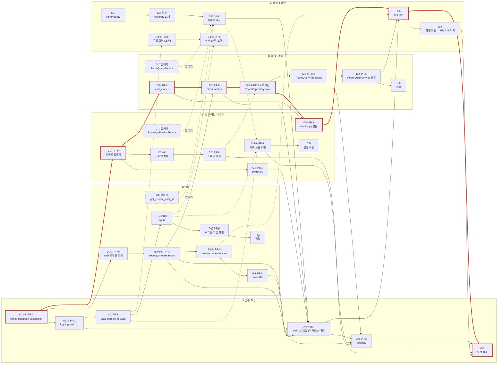

# 팀 작업계획표 — 5인 손코딩 전체 순서와 선후 관계

> 기준: `docs/work-assignment.md`(D-026 반영본), `docs/02-arch/*`, 파트별 계획표 `work-plan-A.md`~`work-plan-E.md`
> 표기: 파트 글자 + 그 파트 계획표의 단계 번호. 예) **A②** = A 계획표 ② `config.py`, **D④** = D 계획표 ④ `RoomRepository.save`
> 일차는 "하루 = 팀이 함께 코딩하는 하루"를 기준으로 한 권장안이에요. 실제 달력에 맞춰 늘리거나 줄여요

---

## 0. 한눈에 보기

- **총 4일 + 통합 반나절**을 목표로 해요. 가장 긴 줄(임계 경로)은 **A①~④ → C① → D①③④ → C⑦ → E⑦ → A⑩**이에요.
- 기다림을 없애는 열쇠는 두 가지예요.
  1. **0단계 이름 합의(1시간)**: 파일이 없어도 이름만 맞추면 서로 기다리지 않고 동시에 작성할 수 있어요.
  2. **껍데기 먼저 머지**: import 대상이 되는 파일은 "이름·시그니처만 있는 껍데기"를 먼저 머지하고 본문은 나중에 채워요.
- 분담표 §5의 "먼저 끝낼 것" 3개에 더해, 이 계획은 껍데기 대상을 **C `service.py`, D `read_models.py`·`queries.py`, B `dependencies.py`**까지 넓혀요. 그래야 E 라우터와 A의 라우터 등록이 2일차까지 밀리지 않아요(§6 근거).

## 1. 선후 관계 도식

### 1-1. 단계 의존 그래프

> 📊 **그림 버전: `team-dependency-diagram.html`** — 브라우저로 열면 일차(가로) × 파트(세로) 칸에 단계 상자와 선후 관계 선이 그려져 있어요. 상자를 누르면 그 단계와 이어진 선만 강조돼요. 회의 화면 공유용으로 이 파일을 쓰세요.

아래는 같은 내용의 Mermaid 그래프예요. 굵은 빨간 선(`==>`)은 임계 경로, 실선(`-->`)은 "**뒤 단계는 앞 단계가 머지된 뒤에** 실행·머지할 수 있다", 점선(`-.->`)은 "이름 합의만 있으면 작성은 먼저 하고 **확인만** 기다린다", `껍데기` 점선은 "이름·시그니처만 있는 껍데기가 먼저 머지되면 된다"는 뜻이에요.



> 마크다운 미리보기에서 위 그림이 안 보이면(머메이드 미지원 뷰어) 아래 1-2의 글자 도식을 보세요. GitHub, VS Code(Markdown Preview Mermaid 확장), Notion 코드 블록(Mermaid)에서는 그림으로 보여요.

### 1-2. 일차별 흐름 (글자 도식)

각 줄이 한 파트예요. `──▶`는 같은 파트의 다음 단계, `┊`와 `◀─ X`는 다른 파트를 기다리는 지점이에요. **굵은 단계는 임계 경로**예요.

```
            0단계      │ 1일차 오전          │ 1일차 오후               │ 2일차                       │ 3일차                        │ 4일차 / 통합
            (1시간)    │                     │                          │                             │                              │
A 공통   ─ 이름 합의 ─┼─ **A①②③④ PR①** ──▶┼ A⑤⑥ PR② ──▶ A⑦ PR③ ──▶┼ A⑧ PR④ (머지되는 대로     ┼ A⑧ 계속 ──▶ A⑨ seed PR⑤  ┼ **A⑩ 통합 점검**
         (전원)       │  (반나절 안 머지)  │                          │  모델·라우터 한 줄씩 등록)  │ ◀─ B PR②, C PR②, D PR③     │ ◀─ 모든 PR
                      │         │           │                          │                             │                              │
B 인증               │ B② B③ PR①  ◀─A①   ┼ B④⑤⑥ PR② ◀─A①          ┼ B⑦⑧ PR③ ──▶ B⑨ PR④        ┼ B⑩ api.js PR⑤ ◀─A⑦         ┼ B⑫ 점검
                      │ B⑧ 껍데기 공유 ★   │  (D·A가 UserModel 기다림) │  (E 라우터 실행 전 머지)    │ B⑪ 화면 PR⑥                 │
                      │         │           │                          │                             │                              │
C 방 도메인          │ **C① 껍데기 PR①** ┼ C② C③ C④ ──▶ C⑤        ┼ C⑤ PR② (도메인 완성)       ┼ **C⑦ service PR④** ◀─D PR③ ┼ C⑩ 연결 확인
                      │  ◀─A① (반나절)     │ C⑥ pages PR③            │ C⑦ service 껍데기 ★        │ C⑧⑨ 화면 PR⑤ ◀─A⑦·B⑩·E② │
                      │         │           │                          │                             │                              │
D 방 DB              │ **D① read_models** ┼ D② models PR②          ┼ **D③④ save PR③** (최우선) ┼ D⑤⑥ PR④ ──▶ D⑦ PR⑤        ┼ D⑧ 점검
                      │  PR① ◀─C①         │  ◀─A①, B PR②(확인)      │  ◀─C② ~ ⑤(동작 확인)        │  (E 조회 API가 기다림)      │
                      │ D⑦ 껍데기 ★       │                          │                             │                              │
                      │         │           │                          │                             │                              │
E 방 API·화면        │ E① schemas         ┼ E② router 작성           ┼ E② PR① 머지 ◀─★껍데기들   ┼ E⑤⑥ 상세 PR③               ┼ **E⑦ API 확인** ◀─C⑦·D⑦
                      │ (기다림 없음)      │                          │ E③④ 목록 PR② (초안)       │                              │ E⑧ 화면 확인 → PR②·③ 머지

★ = 이 계획에서 추가로 권하는 "껍데기 먼저" 대상 (§6)
```

### 1-3. 파트 사이에 오가는 것 (누가 → 누구에게)

```
                 config·database·exceptions (A PR①)
        ┌──────────────┬──────────────┼──────────────┬──────────────┐
        ▼              ▼              ▼              ▼              ▼
        B              C              D              E          (A 자신)
        │              │ 도메인 껍데기 │              │
        │              ├─────────────▶│ TeamSide·Room 시그니처
        │              │              │              │
        │              │◀─────────────┤ LeaveResult·GameStartResult (D①)
        │              │◀─────────────┤ RoomRepository.save (D④)
        │ UserModel ───┼─────────────▶│ (FK users.id, 닉네임 조회)
        │              │              │              │
        │ get_current_user_id ────────┼─────────────▶│ (API 11개)
        │              │ RoomApplicationService ────▶│
        │              │              │ RoomQueryService ─▶│
        │ api.js 함수 ─┼──────────────┼─────────────▶│ (화면 JS)
        │              │◀─────────────┼──────────────┤ API-ROOM-10·11 (기록·보관 화면 데이터)
        │              │              │              │
        └──────┬───────┴──────┬───────┴──────┬───────┘
               ▼              ▼              ▼
     A⑧ main.py v2: 모델 import(B·D) + router·page_router 등록(B·C·E)
     A⑨ seed.py: User·UserRepository·PasswordHasher(B) + Room(C) + RoomRepository.save(D)
     A⑦ base.html·app.css ──▶ B·C·E 템플릿 (block·DOM ID·클래스)
```

## 2. 0단계 — 이름 합의 회의 (1일차 시작, 전원, 1시간)

코드를 쓰기 전에 아래 이름만 정해요. 모두 참고 구현과 `04-interfaces-api.md`에 정답이 있으니 **새로 정하는 게 아니라 확인**하는 자리예요. 결과는 팀 채널에 한 메시지로 고정해요.

| # | 연결 지점 | 만드는 쪽 → 쓰는 쪽 | 합의할 이름 |
|---|---|---|---|
| 1 | 공통 예외 | A → B·C·D | `DomainError`, `DomainRuleError`, `NotFoundError`, `GoneError`, `AuthenticationError` (`message` 속성) |
| 2 | DB | A → B·D·E | `Base`, `get_db`, `AsyncSessionLocal`, `engine` |
| 3 | 모델 모듈 경로 | B·D → A | `auth.infrastructure.models`, `rooms.infrastructure.models` |
| 4 | 라우터 변수 | B·C·E → A | `auth.presentation.router.router`, `auth.presentation.pages.page_router`, `rooms.presentation.router.router`, `rooms.presentation.pages.page_router` |
| 5 | 인증 의존성 | B → E | `auth.presentation.dependencies.get_current_user_id` → `int` |
| 6 | 도메인 시그니처 | C → D·E·A | `Room(…, teams, participations)` 9개 인자, `Team(id, side)`, `Participation(room_id, user_id, join_order, team, joined_at, left_at=None)`(id 없음), `TeamSide`(`rooms.domain.participation`, `room.py`가 다시 내보냄), `RoomTitle`, `DeleteReason` |
| 7 | 서비스·조회 | C·D → E | `RoomApplicationService(db)` 6개 메서드, `RoomQueryService(db)` 5개 메서드, `RoomListCondition` |
| 8 | 읽기 모델 | D → C·E | `read_models.py` 데이터클래스 이름·필드(E `schemas.py`와 1:1, `HistoryItem`에 `participation_id` 없음), `LeaveResult`·`GameStartResult` |
| 9 | 레포지토리 | D → C·A | `RoomRepository(session)`: `find_by_id`, `find_current_participation`, `save` |
| 10 | 시드가 부르는 것 | B·C·D → A | `User.register`, `UserRepository.exists_login_id`·`save`, `PasswordHasher().hash`, `Room.create`·`join`·`leave`·`start_game`, `current_participants` |
| 11 | 공통 틀 | A → B·C·E | block `title`·`require_login`·`content`·`scripts` / DOM `#notice`, `#pagination`, `#nav-member`·`#nav-guest`·`#nav-nickname`·`#nav-logout`, `body[data-require-login]` |
| 12 | 공통 CSS 클래스 | A → B·C·E | `container`, `card`, `form-row`, `form-field`, `table-wrap`, `muted`, `nowrap`, `secondary`, `button`, `notice`(+`error`/`success`), `pagination`, `cell-title`, `teams`·`team-a`·`team-b` |
| 13 | 화면 JS 함수 | B → C·E | `api.js`: `apiRequest`, `errorMessage`, `showNotice`, `hideNotice`, `formatTime`, `renderPagination`, `getAccessToken` |
| 14 | 화면 컨텍스트 | C ↔ E | `/` → `cond`(4개 키)·`notice`(`?notice=dissolved`), `/rooms/{room_id}` → `room_id` |
| 15 | 응답 필드 | E → C | `HistoryListResponse`, `HistoryItemResponse`, `ArchivedRoomResponse`, `MyRecordResponse` 필드 이름 |

## 3. 일차별 파트 작업표

| 시점 | A 공통·조립 | B 인증 | C 방 도메인·서비스 | D 방 DB·조회 | E 방 API·화면 |
|---|---|---|---|---|---|
| **0단계** | 이름 합의 진행 | ① 이름 공유 | 이름 공유 | 이름 공유 | 이름 공유 |
| **1일차 오전** | **A①②③④ → PR① 머지**(반나절 안) | ② 예외 → ③ 도메인 → PR① (A PR① 뒤 머지). ⑧ `get_current_user_id` **껍데기** 공유 | **① 도메인 껍데기 → PR①** (A PR① 직후, 반나절 안) | **① read_models → PR①** (C PR① 직후). ⑦ `RoomQueryService` **껍데기** | ① schemas (혼자) |
| **1일차 오후** | ⑤ 로깅 → ⑥ main v1 → PR② / ⑦ 공통 틀 → PR③ | ④ security → ⑤ models → ⑥ repos → PR② | ②~④ 도메인 / ⑥ pages → PR③ / ⑦ service **껍데기** | ② models → PR② (B PR② 뒤 테이블 확인) | ② router 작성 |
| **2일차** | ⑧ main v2: 머지되는 순서대로 모델 import·라우터 등록 | ⑦ service → ⑧ dependencies → PR③ / ⑨ API → PR④ | ⑤ 도메인 완성 → PR② | **③④ save → PR③ (최우선)** | ② PR① 머지(껍데기 덕분) / ③④ 목록 → PR② 초안 |
| **3일차** | ⑨ seed → PR⑤ (B PR②·C PR②·D PR③ 뒤) | ⑩ api.js → PR⑤ / ⑪ 화면 → PR⑥ | **⑦ service 본문 → PR④** (D PR③ 뒤) / ⑧⑨ 기록·보관 화면 → PR⑤ | ⑤⑥ → PR④ / ⑦ 본문 → PR⑤ | ⑤⑥ 상세 → PR③ 초안 |
| **4일차** | ⑩ 통합 점검(GATE·시드 60건·오류 형식) | ⑫ 점검 | ⑩ 연결 확인 | ⑧ 점검 | **⑦ API 확인 → ⑧ 화면 확인 → PR②·③ 머지** |

## 4. 권장 머지 순서 (dev 기준 전체 큐)

같은 줄은 순서와 상관없이 머지해도 돼요. 위 줄이 먼저예요.

| 순서 | PR | 이유 |
|---|---|---|
| 1 | **A PR①** config·database·exceptions | 모두가 import |
| 2 | **C PR①** 도메인 껍데기 · B PR① auth 도메인 | D·E가 `TeamSide`·`Room` 시그니처, B 자신의 다음 단계 |
| 3 | **D PR①** read_models (+ `RoomQueryService` 껍데기) · B ⑧ 의존성 껍데기 · C `service.py` 껍데기 | C⑦·E①②가 import |
| 4 | A PR② main v1 · B PR② auth 인프라 · A PR③ 공통 틀 · C PR③ pages | 서로 독립 |
| 5 | D PR② ORM 모델 | B `UserModel` 뒤라야 테이블 생성 확인 가능 |
| 6 | E PR① router · B PR③ service·dependencies | 껍데기들이 다 있어 import 성공 |
| 7 | A PR④ main v2 (앞 PR들이 머지된 만큼 등록, 이후 계속 갱신) | 앱 조립 |
| 8 | C PR② 도메인 완성 → **D PR③ save** | save 동작 확인에 도메인 메서드 필요 |
| 9 | **C PR④ service** · D PR④ QueryRepository · B PR④ auth API | 변경 API 실제 동작 |
| 10 | D PR⑤ QueryService · B PR⑤ api.js | 조회 API 실제 동작, 화면 JS |
| 11 | A PR⑤ seed · B PR⑥ 로그인 화면 · C PR⑤ 기록·보관 화면 | 시연 데이터, 화면 |
| 12 | E PR② 목록 화면 → E PR③ 상세 화면 | 같은 `rooms.js`라 순서대로 |

## 5. 임계 경로와 지연 대응

```
A①~④(반나절) → C① 껍데기(반나절) → D① read_models → D③④ save(2일차) → C⑦ service(3일차) → E⑦ API 확인 → A⑩
                                      └──────────────▶ D⑤⑥⑦ 조회(3일차) ───────┘
```

| 지연되는 곳 | 영향 | 대응 |
|---|---|---|
| A PR① | 전원 실행 확인 불가 | 0단계 직후 A가 가장 먼저. 리뷰어 1명을 미리 지정해 바로 머지 |
| C PR① 껍데기 | D①·E② import 불가 | 본문은 `raise NotImplementedError`로 두고 시그니처만 올려요(C 계획표 ①) |
| D PR③ `save` | C⑦ 서비스, A⑨ 시드가 모두 밀림 | D는 2일차에 ③④만 집중. 다른 사람은 D에게 리뷰 외 요청을 넣지 않아요 |
| B PR③ 의존성 | E⑦에서 인증 필요 | E는 `app.dependency_overrides`로 로컬에서만 우회(커밋 금지) |
| A⑨ 시드 | 화면 확인이 불편 | Swagger로 회원·방을 직접 만들어 확인. 시드는 마지막이어도 괜찮아요 |
| 화면(A⑦·B⑩) | C⑧⑨·E③~⑥ 확인 불가 | 이름 합의대로 먼저 작성, 확인만 뒤로 |

## 6. 분담표 §5 대비 이 계획에서 바꾼 점

| 바꾼 점 | 이유 (각 파트 계획표 §6에서 확인) |
|---|---|
| 껍데기 대상을 C `service.py`, D `read_models.py`·`queries.py`, B `dependencies.py`로 확대 | E `router.py`가 이 셋을 import해요. 본문 완성(3일차)까지 기다리면 E PR①과 A⑧의 rooms 라우터 등록이 3일차 이후로 밀려요 |
| D①(read_models)을 1일차 오전으로 당김 | C `service.py`가 `LeaveResult`·`GameStartResult`를, E `schemas.py`가 필드 이름을 기다려요. 분담표 §4에는 D → C 의존이 빠져 있어요 |
| D③④(`save`)를 2일차 최우선으로 | C⑦ 서비스와 A⑨ 시드가 둘 다 기다리는 단일 병목이에요 |
| A⑧(main v2)을 "한 번에"가 아니라 "머지되는 대로 한 줄씩" | 아직 없는 모듈을 import하면 앱 전체가 멈춰요 |
| 0단계 이름 합의 회의 추가 | 15개 연결 지점(§2)을 먼저 고정하면 화면·JS는 확인만 기다리고 작성은 바로 할 수 있어요 |

## 7. 계획표 작성 중 발견한 문서 불일치 (팀 확인 필요)

설계 문서끼리 어긋나는 곳이에요. HANDOFF 원칙("티켓 설명과 설계 문서가 다르면 설계 문서를 따른다")대로 하되, 아래는 0단계 회의에서 한 번 짚고 가요.

| # | 내용 | 관련 파트 | 권장 |
|---|---|---|---|
| 1 | `work-assignment.md`의 `templates/`·`static/` 경로는 실제로 `src/templates/`·`src/static/` | 전원 | 실제 경로 기준 |
| 2 | ADR-003 본문 환경변수 `JWT_EXPIRE_MINUTES`·`COOKIE_SECURE`는 옛 이름 | A·B | `.env.example`·HANDOFF 이름 |
| 3 | ADR-002의 `hash_password`/`verify_password` vs 04 §3·스켈레톤의 `PasswordHasher.hash`/`.verify` | B·A(시드) | `PasswordHasher` |
| 4 | HANDOFF TKT-DB-M3-01은 `IntegrityError`를 `Duplicate*Error`로 바꾸라 하지만 03 §5·SEQ-01은 바꾸지 않음(중복은 서비스가 미리 검사) | B | 03 §5·SEQ-01 |
| 5 | HANDOFF의 임시 `X-Debug-User-Id` 의존성, B의 `main.py` 등록 산출물 | B·E·A | 5인 분담 기준: `dependencies.py`는 B만, `main.py`는 A만. 임시 코드 대신 껍데기 |
| 6 | `save`의 참가 짝짓기: 03 §5·04 §2.3·ADR-011은 `user_id`, 분담표·blueprint는 (`user_id`, `join_order`) | D·C | (`user_id`, `join_order`) — 시드 D2처럼 같은 회원 기록 2건이 한 번에 저장되는 경우 때문 |
| 7 | 03 §5에 "저장된 행 없이 이미 끝난 참가 → 바로 로그" 경우가 없음(시드 삭제 방이 이 경우) | D·A | blueprint처럼 처리 |
| 8 | 04 §3의 `list_cache`(도전 C 범위)가 서비스·조회 생성자에 보임 | C·D·E | 필수 범위에서는 `(db)`만 |
| 9 | 04 §3 `RoomApplicationService(db, clock, …)` vs CONV-04·blueprint `(db)`(clock 기본값) | C·E | `clock` 기본값 두고 라우터는 `db`만 |
| 10 | 04 §3 읽기 모델 목록에 `MyRecord` 누락 | D·E | 만들어요(스켈레톤에 있음) |
| 11 | 닉네임 조회: ADR-001 "조인" vs 03 §5·STK-02 `session.get` | D | `session.get` |
| 12 | 분담표 "화면 라우트 6개(`pages.py`)" — rooms는 4개(PAGE-03~06), 2개는 B | C·B | 각자 몫만 |
| 13 | `05` §1 트리의 `partials/room_row.html`·`history_row.html`은 스켈레톤·blueprint에 없음 | A·C·E | 만들지 않아요(행은 JS가 그림) |
| 14 | CONV-03 `APIRouter(tags=["rooms"])` vs §4.2 `me` 태그 | E | blueprint처럼 엔드포인트마다 태그 |
| 15 | STK-09 `TemplateResponse` 위치 인자 vs §8·blueprint 키워드 인자 | B·C | 키워드 인자(`request=`, `name=`, `context=`)로 통일 |
| 16 | 상세 화면 5xx 문구: SEQ-13 "최신 정보를 불러오지 못했습니다" vs blueprint "서버 오류가 발생했습니다" | E | SEQ-13 문구 |
| 17 | `read_models`·`queries` 담당: HANDOFF는 BE 티켓, 분담표는 D | D | 분담표(D) |

## 8. 파일 목록

| 파일 | 내용 |
|---|---|
| `plan/team-work-plan.md` | 이 문서 |
| `plan/team-dependency-diagram.html` | 선후 관계 도식(그림, 상자 클릭 시 연결 강조) |
| `plan/work-plan-A.md` ~ `plan/work-plan-E.md` | 파트별 계획표(단계별 할 일·참고·유의·완료 확인, §6 선후 관계 표) |
| `guide/db-table-creation-flow.md` | 앱 기동 때 테이블·시드가 만들어지는 과정 |
| `guide/db-table-creation-slides.html` | 같은 내용의 발표용 슬라이드(브라우저로 열기, ←/→ 이동, P로 PDF 인쇄) |
