# [UI/UX → ④ 프론트엔드] 화면별 디자인 시안과 명세 (UX-PLAN-FE / screens)
- 버전: v0.1 / 기반: PM-SCR·PM-US·PM-AC (7b5d528), `design-system.md` v0.1 / 승인: 조성아 (2026-10-21)
- 화면 번호·구성 요소·우선순위는 **PM-SCR가 기준**이다. 이 문서는 그 위에 "어떻게 보이는가"를 더한다. 둘이 다르면 PM-SCR를 따르고 UX에 알린다.
- 시안은 화면마다 1280px·360px 두 장이다. 원본 HTML은 `mockups/html/`, 다시 만드는 방법은 `README.md` §5.

## 시안을 읽는 법

| 시안과 같아야 하는 것 | 시안과 달라도 되는 것 |
|---|---|
| 구성 요소의 순서와 배치(한 열/두 단), 버튼 종류(기본/외곽선/글자), 색·글꼴·간격 토큰, PM 고정 문구 | 책 제목·저자·가격·주문 번호·편지 내용 등 **예시 데이터**(시안 오른쪽 아래 "예시 데이터" 표시), 시안용 제안 문구(사람이 바꿀 수 있음), 픽셀 단위의 높이 |

- 시안 문구 중 PM-AC·PM-US에 큰따옴표로 있는 문구는 **고정**이다. 나머지는 `[제안]` 문구이며 브리핑에서 바꿀 수 있다.
- 시안의 표지 그림은 실제 표지가 아니다. 실제로는 `imageUrl` 이미지가 들어가고, 이미지가 깨졌을 때만 이 그림 방식(UX-D-10)을 쓴다.

---

## M1 쇼핑 기반

### SCR-01 메인 `/`
| 1280px | 360px |
|---|---|
| 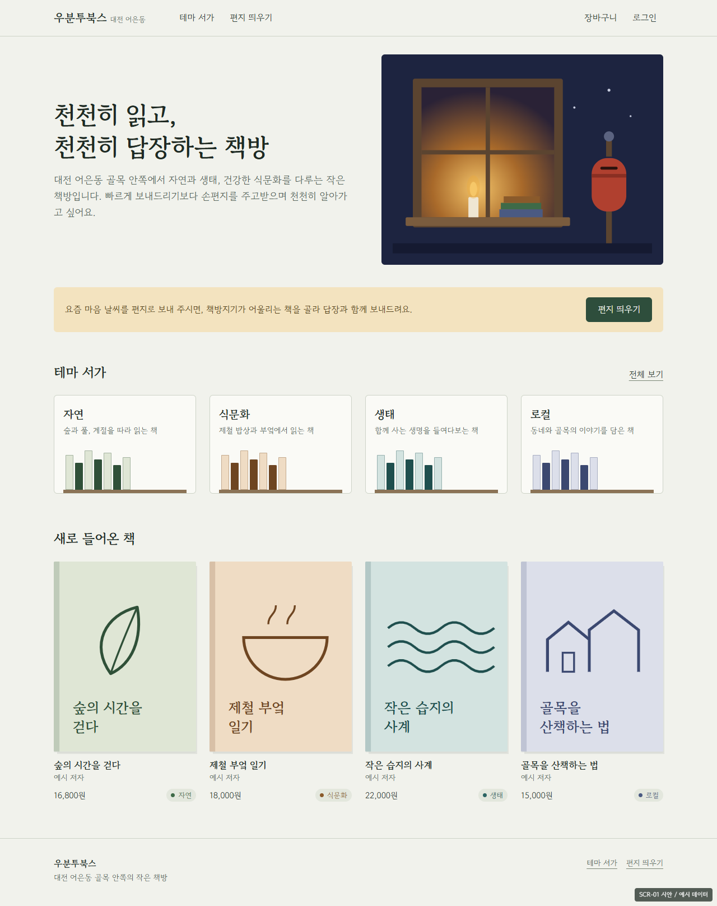 | 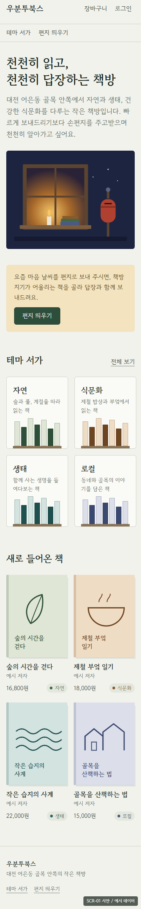 |

- 위→아래: Header → 소개(제목 + 소개 글 | 창가 그림) → 편지 띄우기 안내 띠 → 테마 서가(서가 칸 4개) → 새로 들어온 책(ProductCard 최대 4권) → Footer
- 소개 제목·소개 글은 시안 문구 `[제안]`. 근거는 REQ-001·002·004만 썼다. 영업시간·위치는 넣지 않는다(Q-UX-06 답 전).
- 편지 띄우기 안내 띠는 `--accent` 바탕. 버튼 이름은 "편지 띄우기"(D-042).
- 서가 칸: 테마 이름(heading) + 한 줄 소개(`[제안]` 문구) + 책등 그림(장식, `aria-hidden`). 칸 전체가 링크.
- 상태: 책 조회 실패 시 "새로 들어온 책" 자리에만 "책을 불러오지 못했어요"(AC-01-4) + 테마 서가 링크(UX-14).
- 관련: AC-01-1~4, UX-4, UX-5, UX-D-04

### SCR-02 상품 목록(테마 서가) `/products`
| 1280px | 360px |
|---|---|
| 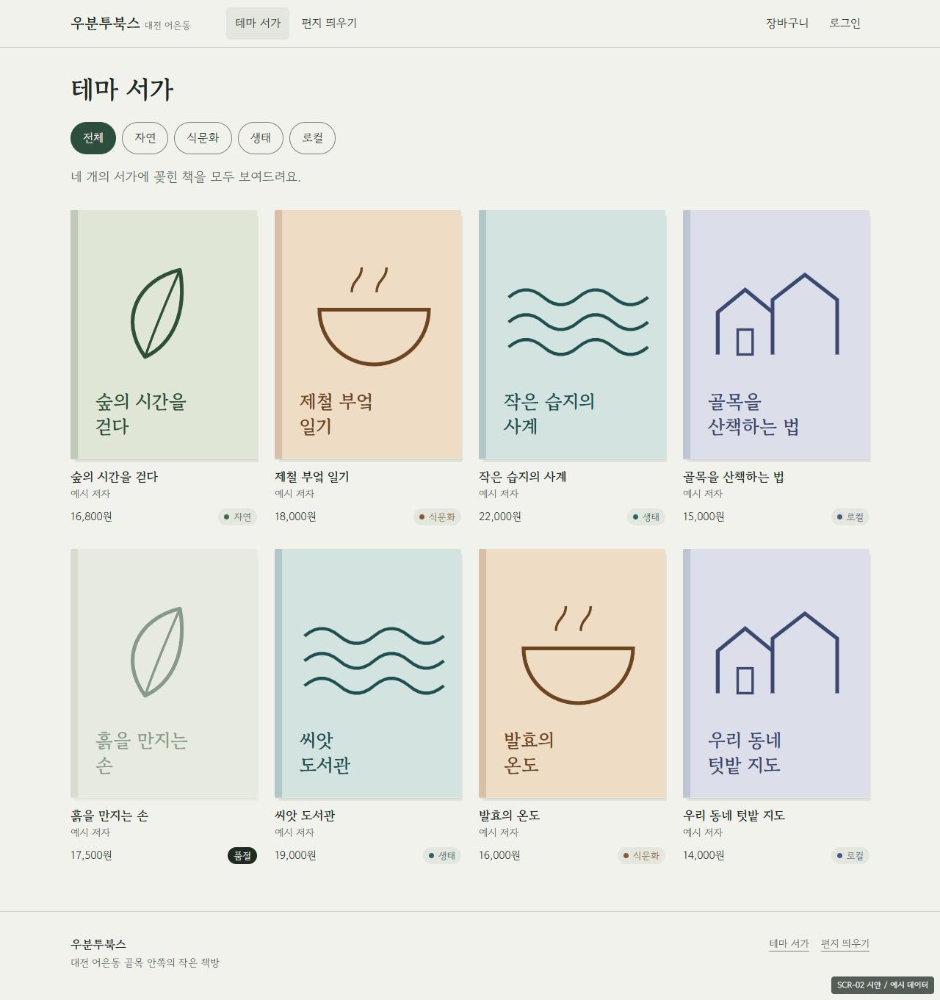 | 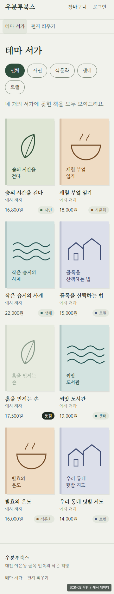 |

빈 테마:

| 1280px | 360px |
|---|---|
| 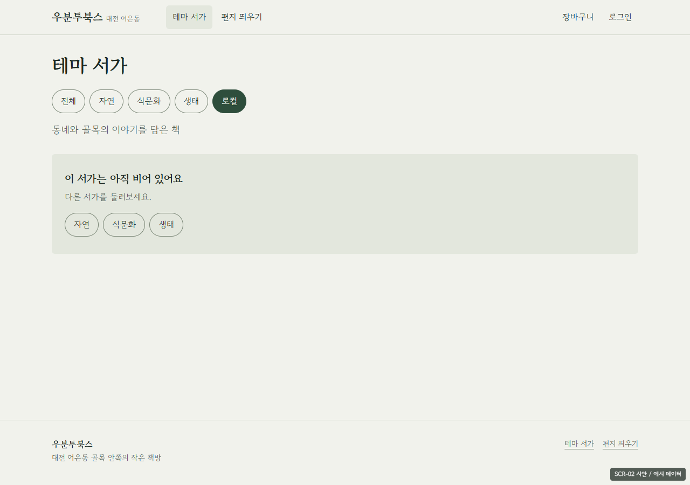 | 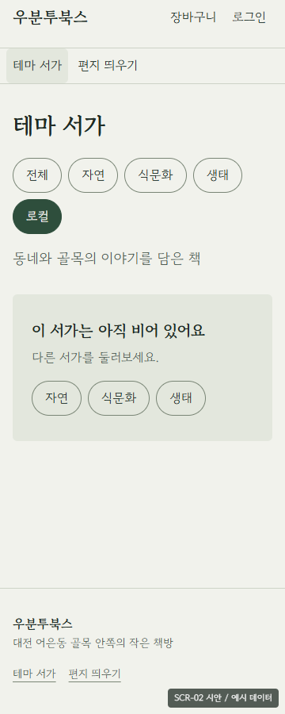 |

- 위→아래: h1 "테마 서가" → ThemeSelector(전체·자연·식문화·생태·로컬, 알약 버튼) → 선택한 테마의 한 줄 소개 → 카드 격자(NFR-02: 2·3·4열)
- 선택된 알약은 `--primary` 바탕 + `aria-pressed="true"`. 주소의 `?theme=`와 맞춘다(AC-02-2).
- 품절 카드: 표지 흐리게 + "품절" 배지(AC-02-3).
- 빈 테마: "이 서가는 아직 비어 있어요"(AC-02-4) + 다른 테마 알약 링크.
- 관련: AC-02-1~5, NFR-02, NFR-10(페이드), UX-11

### SCR-03 상품 상세 `/products/[id]`
| 1280px | 360px |
|---|---|
| 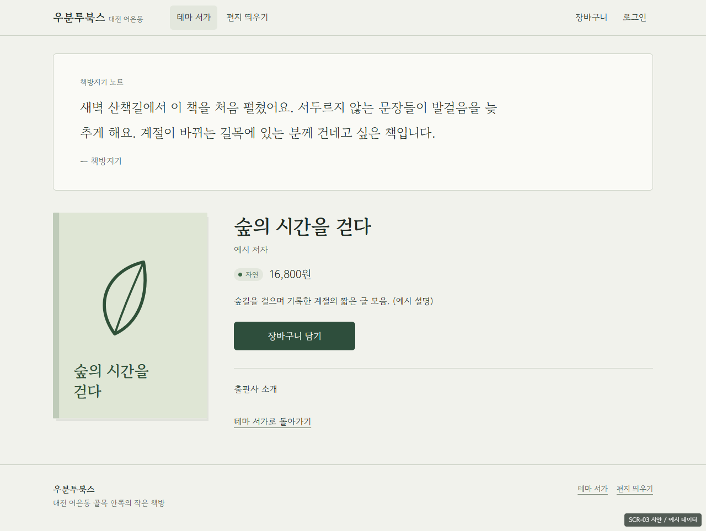 | 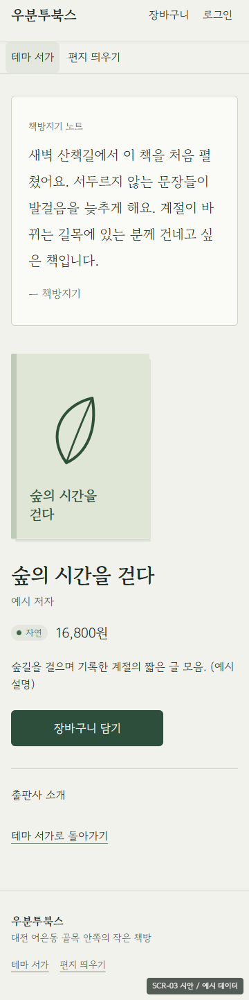 |

- 위→아래: 책방지기 노트(KeeperNote, 맨 위) → [표지 | 제목·저자·테마 배지·가격·짧은 설명·[장바구니 담기]·출판사 소개(접힘)·테마 서가로 돌아가기]
- 360px은 노트 → 표지 → 정보 한 열(PM-SCR §3). 표지는 360px에서 최대 200px 폭(UX-7).
- [장바구니 담기]가 이 화면의 기본 버튼 1개. 품절이면 비활성 + "품절"(AC-03-5).
- 담기 성공 시 "장바구니에 담았어요"(AC-07-1)를 버튼 아래 `role="status"`로 보이고 Header 개수를 바꾼다.
- 관련: AC-03-1~5, INV-02, UX-6, UX-7, UX-8, UX-D-05

### SCR-04 상품 없음
| 1280px | 360px |
|---|---|
| 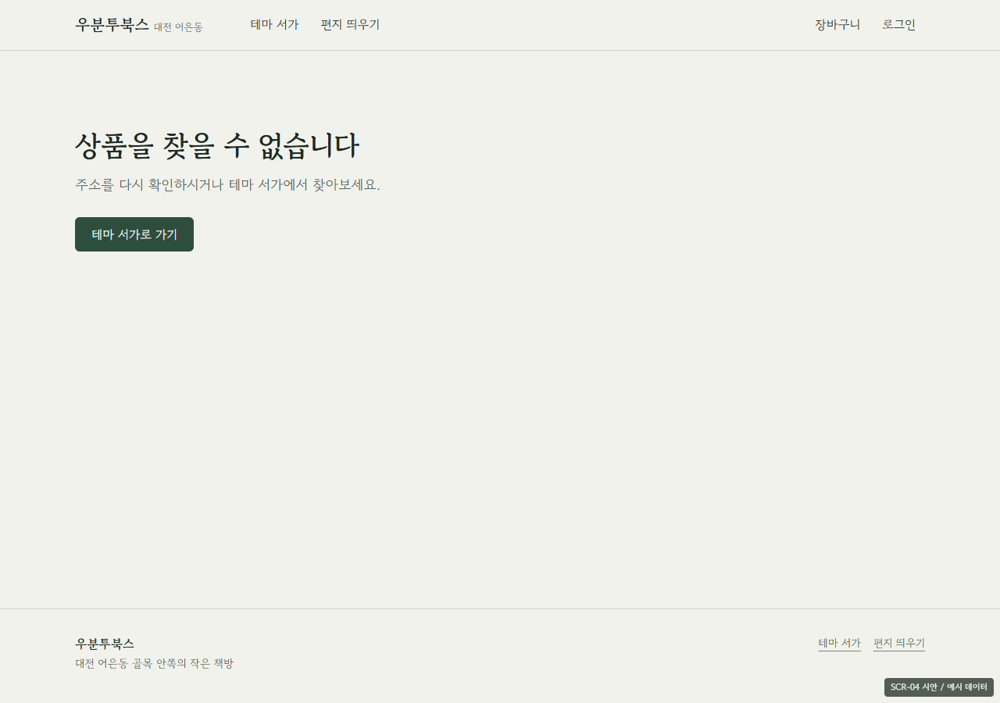 | 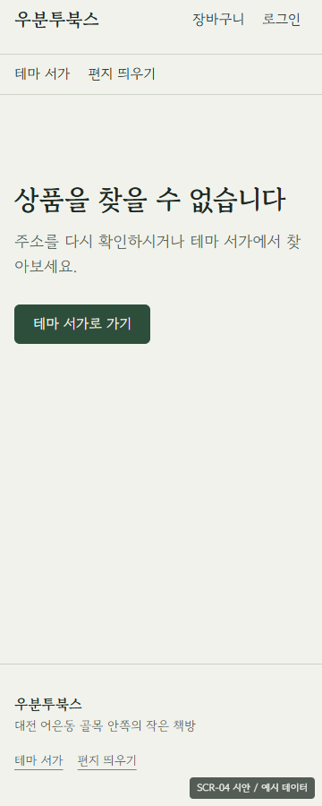 |

- h1 "상품을 찾을 수 없습니다"(AC-03-4, 고정) + 안내 한 줄 `[제안]` + [테마 서가로 가기].
- Header·Footer는 그대로 보인다(화면이 멈추지 않음).

## M2 회원·관리자 기반

### SCR-05 로그인 `/login`
| 1280px | 360px |
|---|---|
| 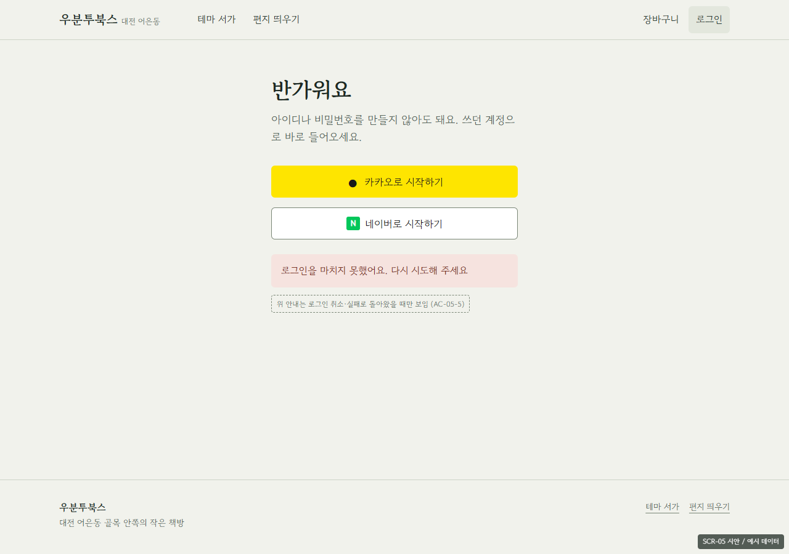 | 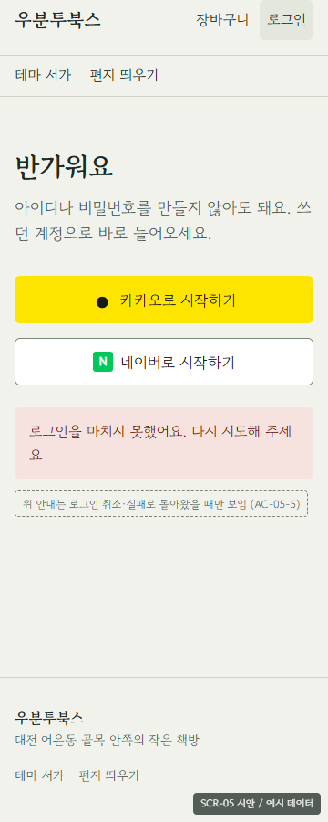 |

- 환영 제목·안내 `[제안]` → [카카오로 시작하기] → [네이버로 시작하기]. 두 버튼 폭 같게, 높이 52px.
- 버튼 색은 design-system §2 예외(UX-D-08).
- 시안의 빨간 안내 상자는 로그인 취소·실패로 돌아왔을 때만 보인다: "로그인을 마치지 못했어요. 다시 시도해 주세요"(AC-05-5, `role="alert"`).
- 관련: AC-05-1, AC-05-5, INV-03

### SCR-06 마이페이지 `/mypage`
| 1280px | 360px |
|---|---|
| 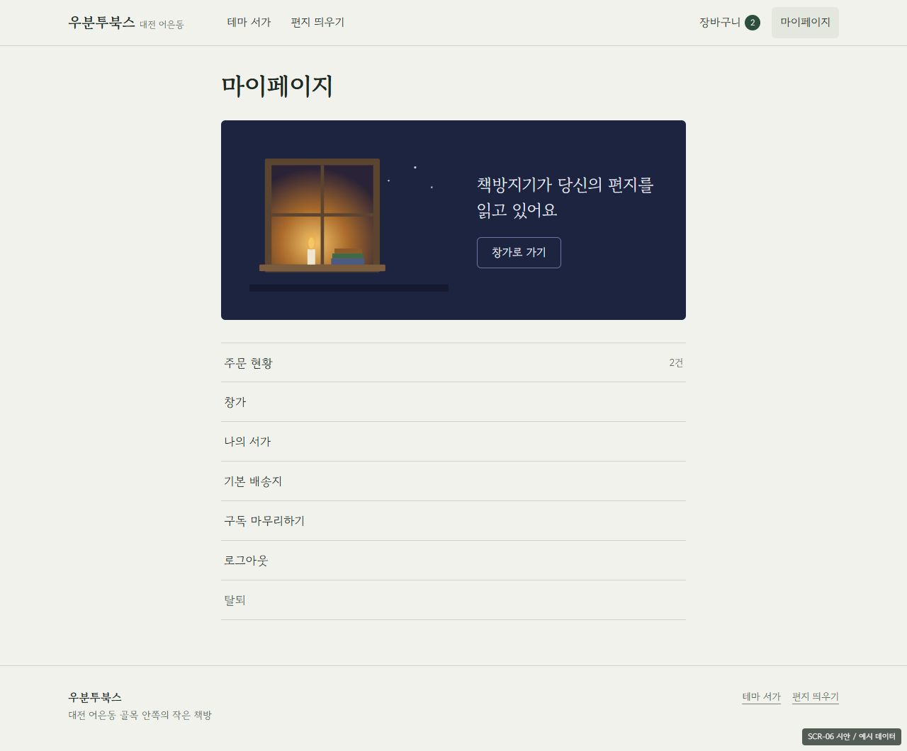 | 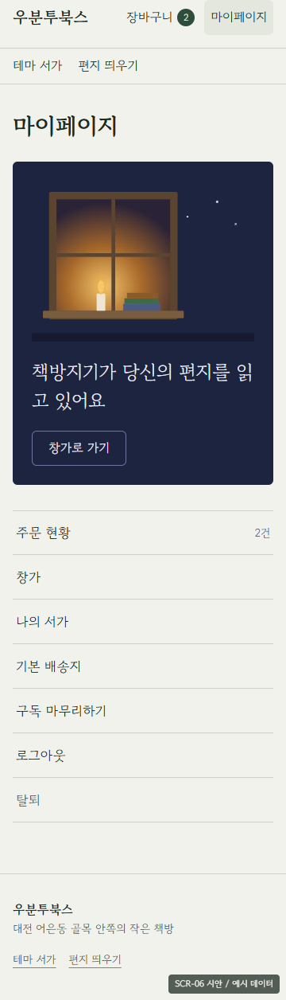 |

- 위→아래: 창가 요약(WindowScene 작게 + 상태 문구 + [창가로 가기]) → 메뉴 목록(주문 현황, 창가, 나의 서가, 기본 배송지, 구독 마무리하기, 로그아웃, 탈퇴)
- 메뉴는 줄 높이 56px 링크 목록. 탈퇴는 흐린 글자(빨간색 아님, UX-D-09).
- 상태: 구독 없음 → 창가 요약 자리에 빈 창가 + [편지 띄우기](AC-12-5). 구독이 없거나 마무리됨 → "구독 마무리하기" 없음(AC-18-7).
- 탈퇴 불가 시 이유 안내(AC-05-7, AC-05-9)는 탈퇴 메뉴 아래 안내 상자로 보인다. 확인 팝업은 쓰지 않는다.
- 관련: AC-05-3~9, AC-12-5, AC-18-7

### SCR-07 기본 배송지 `/mypage/address`
| 1280px | 360px |
|---|---|
| 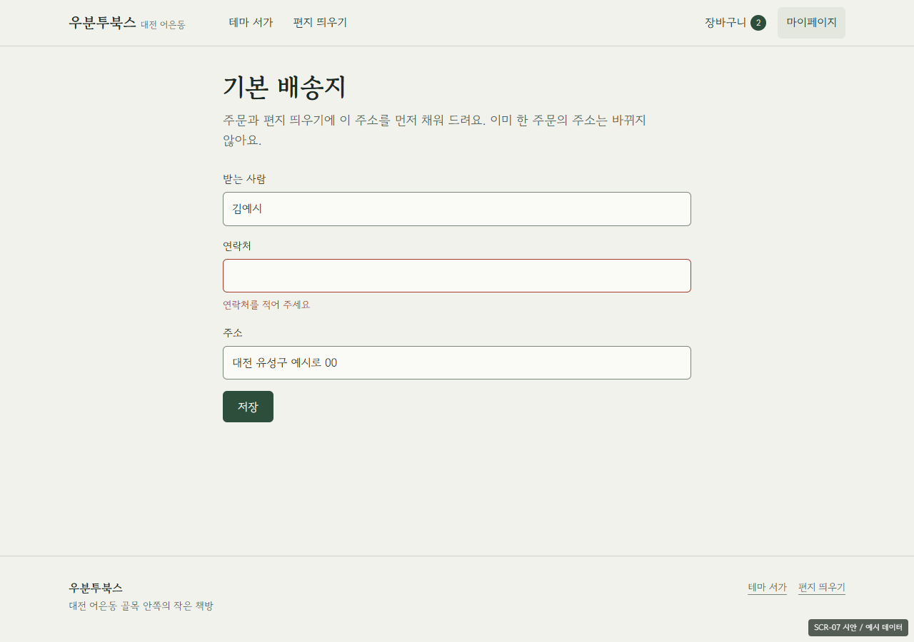 | 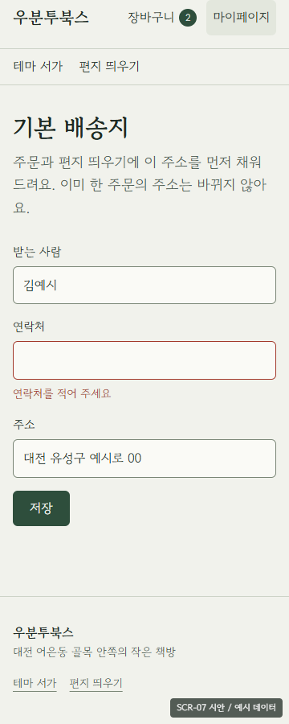 |

- 받는 사람 → 연락처 → 주소 → [저장]. 시안은 연락처 빈칸 오류 상태를 보여 준다(UX-15).
- 안내 문단의 "이미 한 주문의 주소는 바뀌지 않아요"는 AC-08-3을 회원에게 알리는 `[제안]` 문구.

### SCR-08 관리자: 책 관리 `/admin/products`
| 목록 1280px | 목록 360px |
|---|---|
| 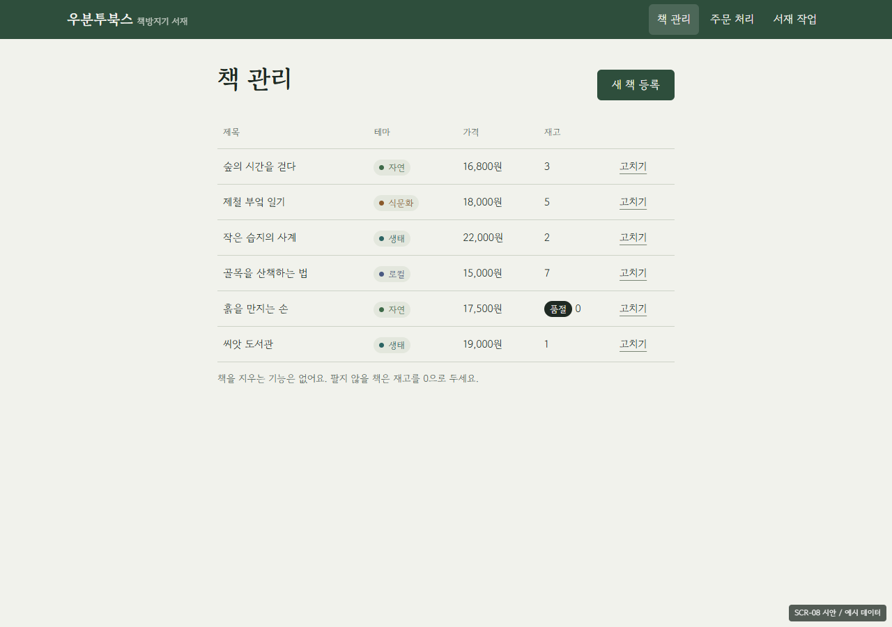 | 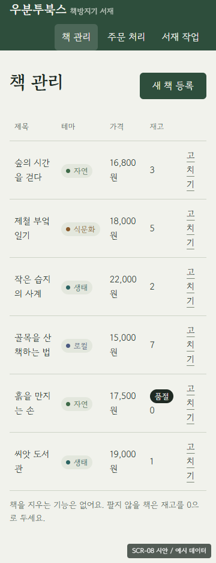 |

| 등록·수정 1280px | 등록·수정 360px |
|---|---|
| 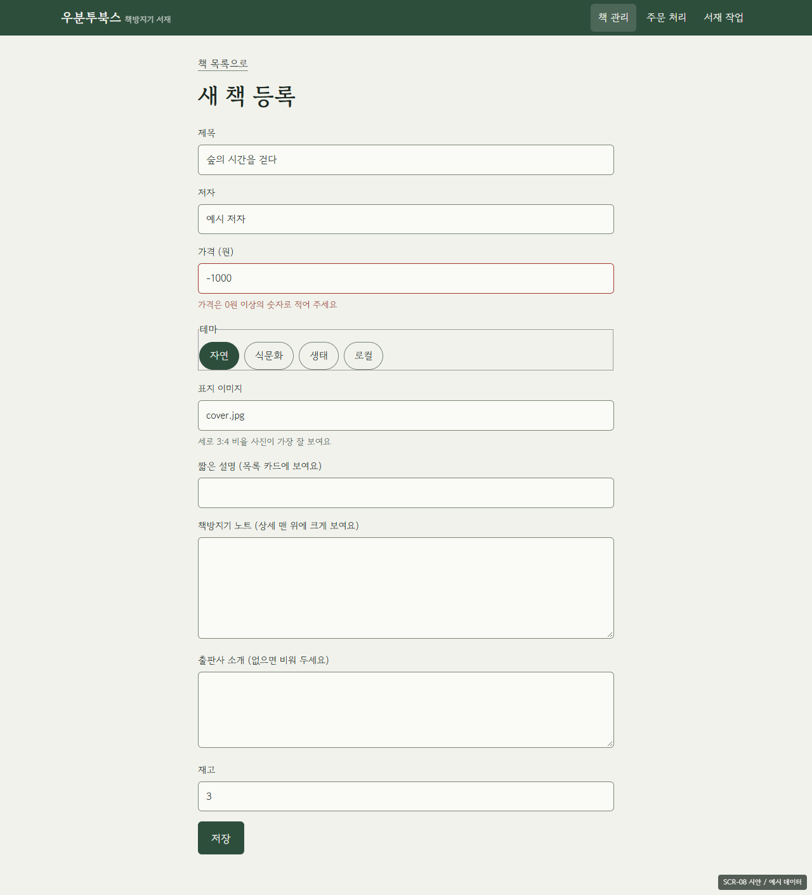 | 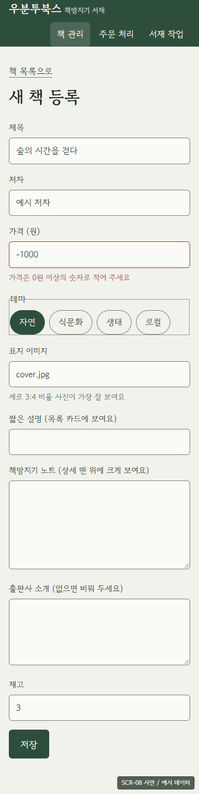 |

- 목록: 제목·테마·가격·재고·[고치기], 위에 [새 책 등록]. 삭제 버튼 없음(AC-06-3), 그 이유를 목록 아래 한 줄로 안내.
- 폼: PM-SCR 순서 그대로 한 열(제목, 저자, 가격, 테마, 표지, 설명, 책방지기 노트, 출판사 소개, 재고). 각 칸 라벨에 "어디에 보이는지"를 짧게 적어 책방지기가 결과를 예상하게 한다 `[제안]`.
- 시안은 가격 `-1000` 오류 상태(AC-06-4). 저장 성공 시 "저장했어요"(US-06).
- 관련: AC-06-1~5, UX-15, UX-18

## M3 구매

### SCR-09 장바구니 `/cart`
| 1280px | 360px |
|---|---|
| 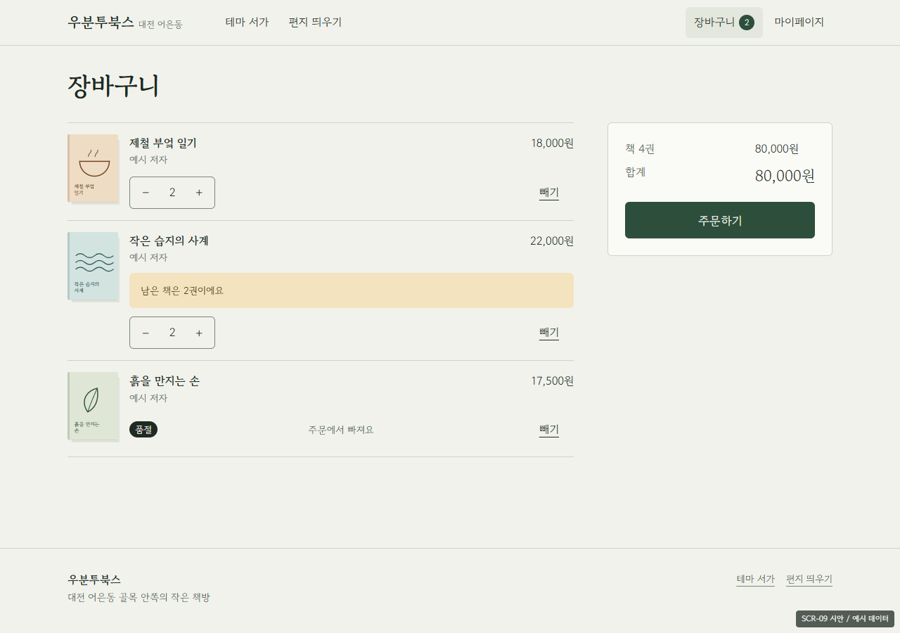 | 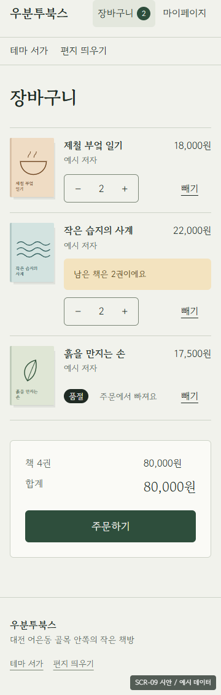 |

- 1280px: [책 줄 목록 | 합계 상자]. 360px: 목록 → 합계 상자.
- 책 줄: 표지(72px) → 제목·저자 / 금액 → 수량(−, 숫자, +, 각 44px) · [빼기].
- 재고 초과: 그 줄 안에 "남은 책은 N권이에요"(AC-07-4, `--accent` 안내). 품절 줄: "품절" 배지 + "주문에서 빠져요", 수량 조절 없음(AC-07-5).
- 비어 있을 때: "장바구니가 비어 있어요" + [테마 서가로 가기] `[제안]`(UX-14).
- 관련: AC-07-1~5

### SCR-10 주문서·결제 `/checkout`
| 1280px | 360px |
|---|---|
| 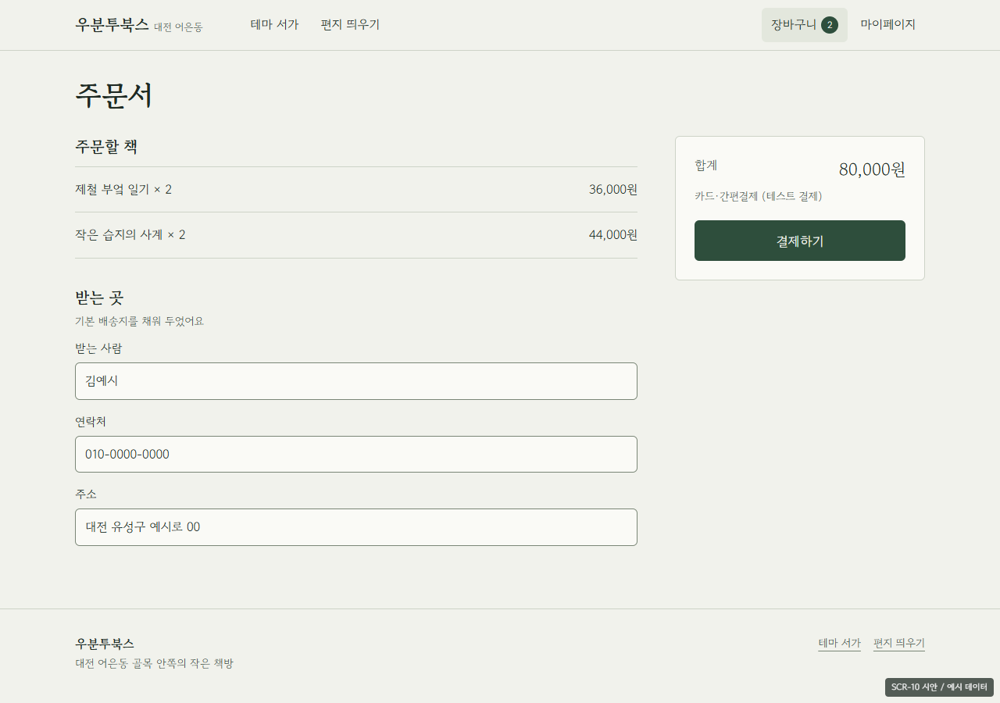 | 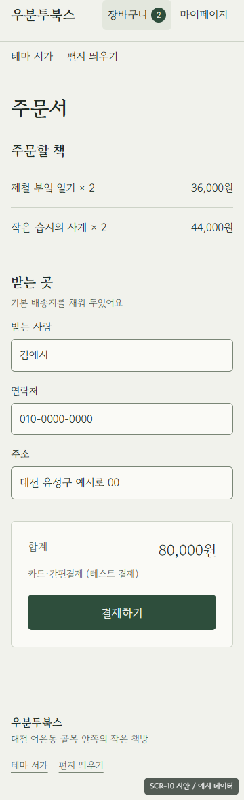 |

- [주문할 책 요약 → 받는 곳(기본 배송지로 채움) | 합계 + [결제하기]].
- 빈칸이 있으면 [결제하기]를 눌러도 결제 창을 열지 않고 칸 아래에 오류를 보인다(AC-08-7, UX-15).

### SCR-11 주문 완료 / 결제 미완료 `/checkout/result`
| 완료 1280px | 완료 360px |
|---|---|
| 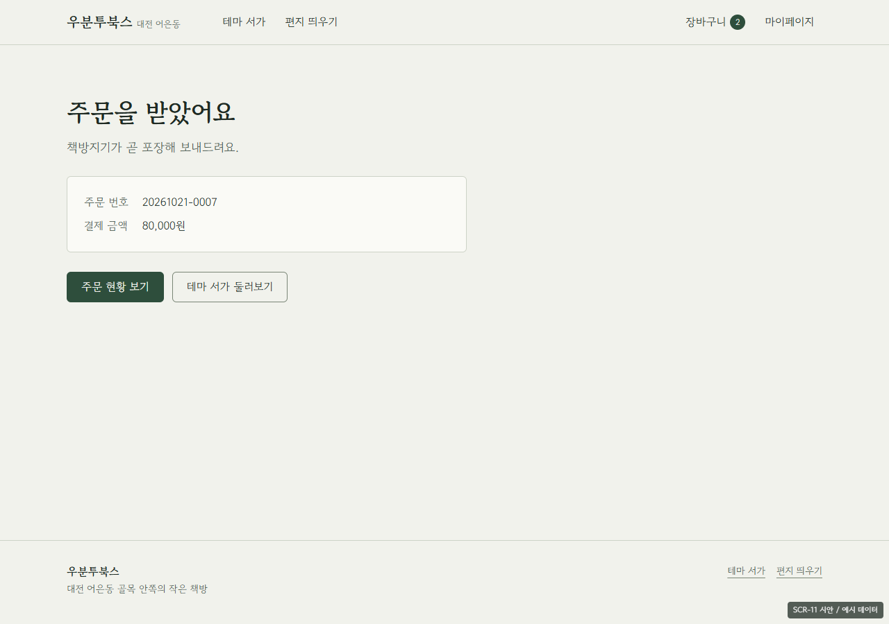 | 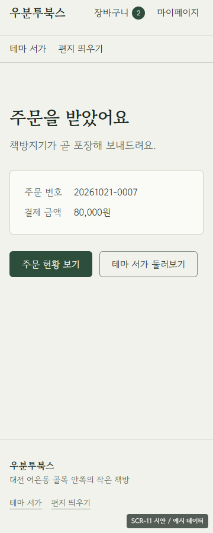 |

| 미완료 1280px | 미완료 360px |
|---|---|
| 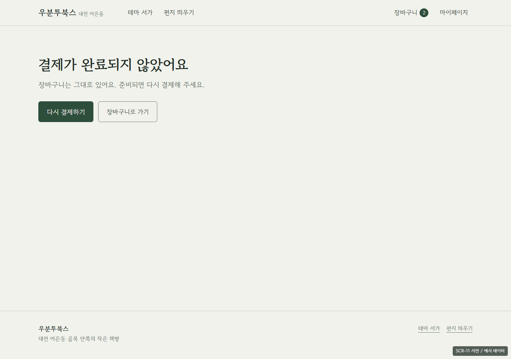 | 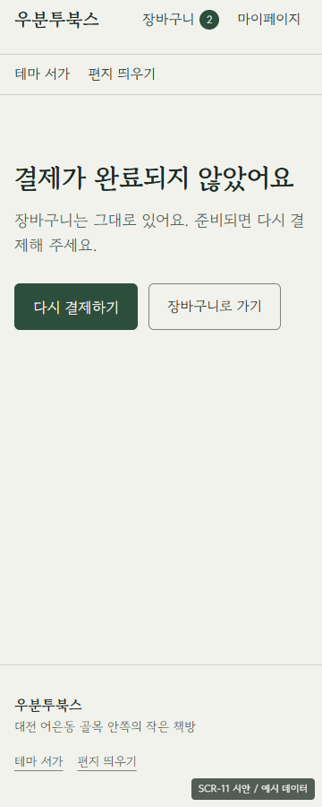 |

- 완료: 제목 `[제안]` + "책방지기가 곧 포장해 보내드려요"(US-08) + 주문 번호·결제 금액 + [주문 현황 보기]·[테마 서가 둘러보기].
- 미완료: "결제가 완료되지 않았어요"(US-08 REJ-15) + [다시 결제하기](AC-08-4).
- 재고 부족·금액 불일치는 미완료와 같은 모양에 해당 문구(REJ-16, REJ-56)를 넣는다.

### SCR-12 주문 현황 `/mypage/orders`
| 1280px | 360px |
|---|---|
| 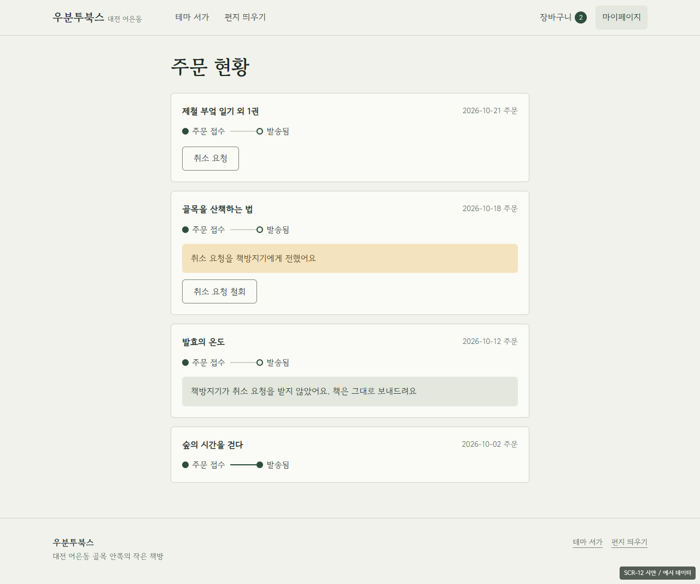 | 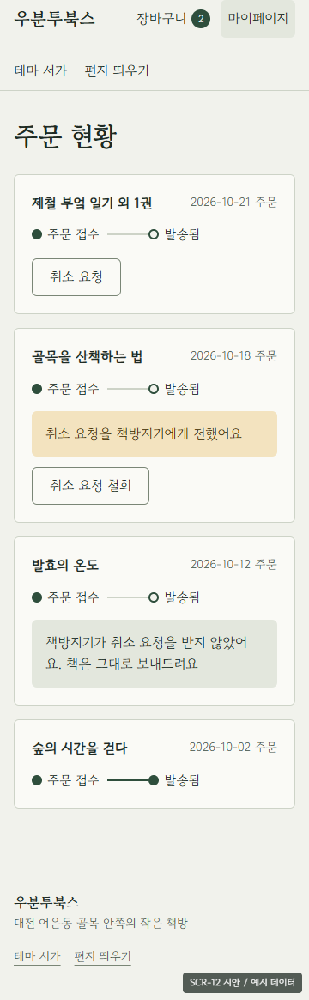 |

- 주문마다 상자 하나: 책 요약·주문일 → "주문 접수 → 발송됨" 2단계 점(AC-09-1) → 상태별 안내·버튼.
- 시안의 4개 상자가 상태 4가지다: 주문 접수 + [취소 요청] / 취소 요청 중 "취소 요청을 책방지기에게 전했어요" + [취소 요청 철회] / 거절 "책방지기가 취소 요청을 받지 않았어요. 책은 그대로 보내드려요" / 발송됨(버튼 없음).
- 환불 완료는 2단계 점 대신 "환불 완료" 배지.
- 주문이 없을 때: "아직 주문한 책이 없어요" + [테마 서가로 가기] `[제안]`(UX-14).
- 2단계 표시 외에 택배 정보는 없다(AC-12-4 정신, Q-004).
- 관련: AC-09-1~7

### SCR-13 관리자: 주문 처리 `/admin/orders`
| 1280px | 360px |
|---|---|
| 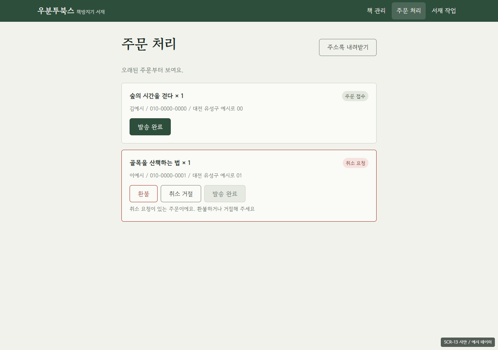 | 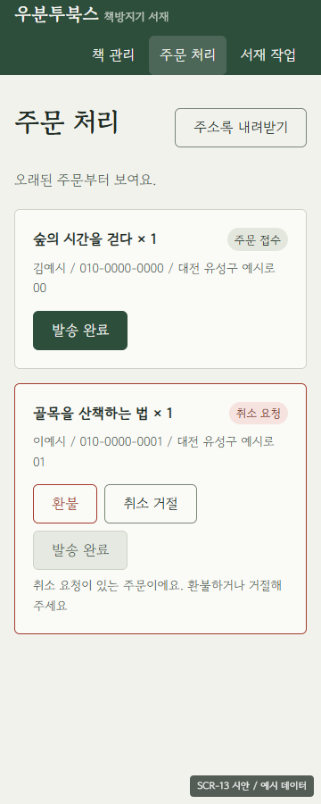 |

- 위: [주소록 내려받기]. 아래: 오래된 순 주문 상자(책·수량, 받는 사람/연락처/주소, 버튼).
- 취소 요청 주문: 상자 테두리 `--destructive`, [환불](빨간 외곽선)·[취소 거절]·비활성 [발송 완료] + "취소 요청이 있는 주문이에요. 환불하거나 거절해 주세요"(REJ-22).
- 발송 대기 0건: "지금 보낼 책이 없어요"(AC-19-2).
- 관련: AC-10-1~6, AC-19-1~4

## M4 편지 구독

### SCR-14 편지지(편지 띄우기) `/letters/new`
| 1280px | 360px |
|---|---|
| 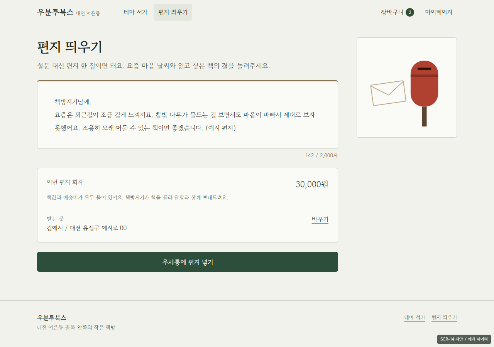 | 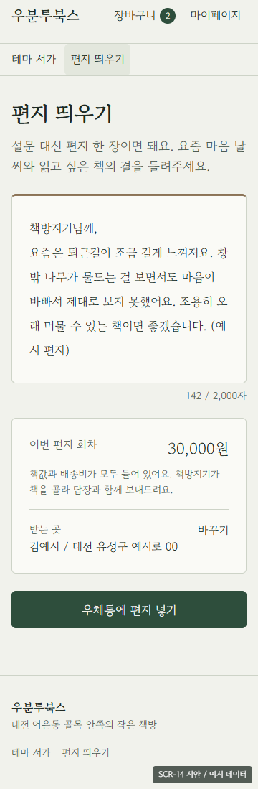 |

결제 미완료 상태:

| 1280px | 360px |
|---|---|
| 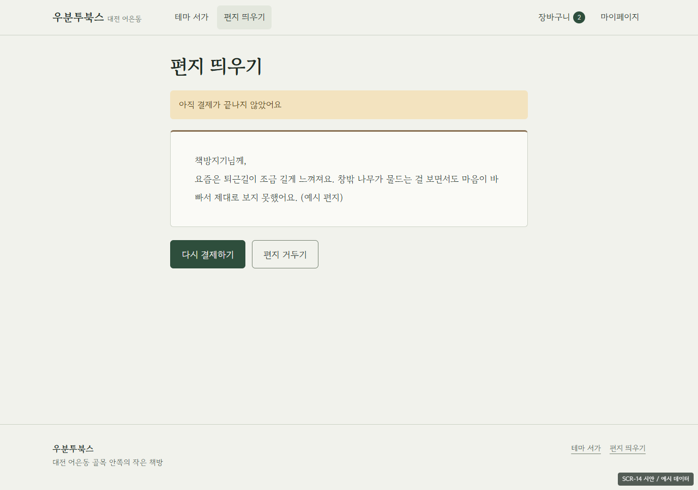 | 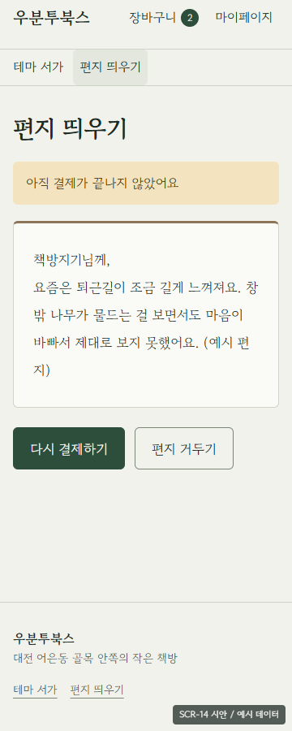 |

- 위→아래: h1 "편지 띄우기" → 안내(마음 날씨·책의 결) → 편지지(LetterPaper, 입력칸) → 글자 수 "N / 2,000자"(UX-10) → 회차 상자(30,000원, 책값·배송비 포함 안내, 받는 곳 + 바꾸기) → [우체통에 편지 넣기]. 1280px은 오른쪽에 봉투·우체통 그림(장식, 360px에서는 숨김).
- 체크박스·설문 없음(AC-11-1).
- 연출 순서: 누름 → 봉투 닫힘 → 결제 → (확정 뒤에만) 우체통 들어감 → 창가(AC-11-2, D-041). design-system §7.
- 결제 대기 회차: 편지 내용 + "아직 결제가 끝나지 않았어요" + [다시 결제하기]·[편지 거두기](AC-11-8). 봉투는 다시 열린 편지지 모양.
- 결제 확정된 진행 중 회차: 편지지 대신 "지금 책방지기가 편지를 준비하고 있어요" + 창가 링크(AC-11-4). 시안은 미완료 상태와 같은 틀에 문구·버튼만 바꾼다.
- 관련: AC-11-1~10, NFR-10, UX-10, UX-11, UX-D-05

### SCR-15 창가 `/mypage/window`
| 상태 | 1280px | 360px |
|---|---|---|
| 편지 도착 | 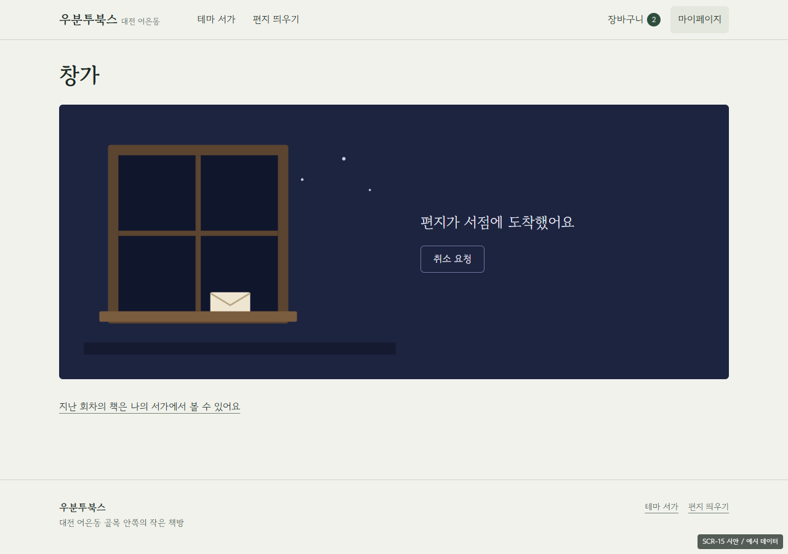 | 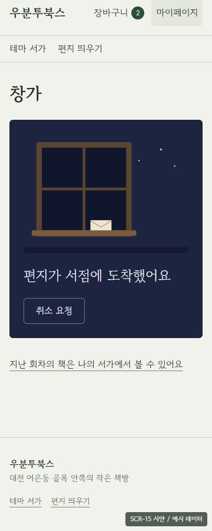 |
| 읽는 중 | 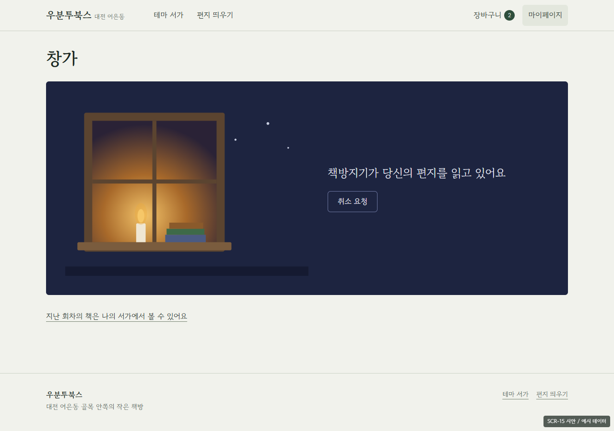 | 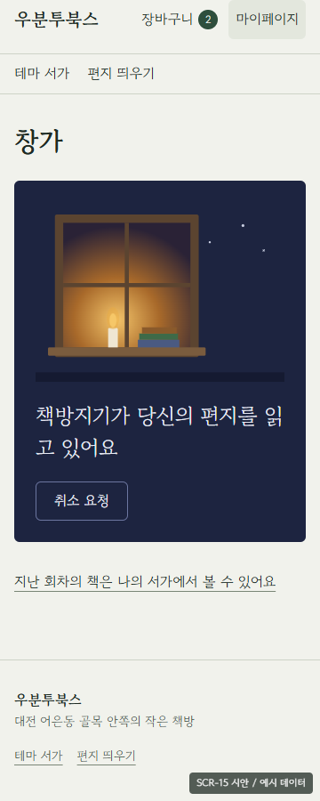 |
| 발송됨 | 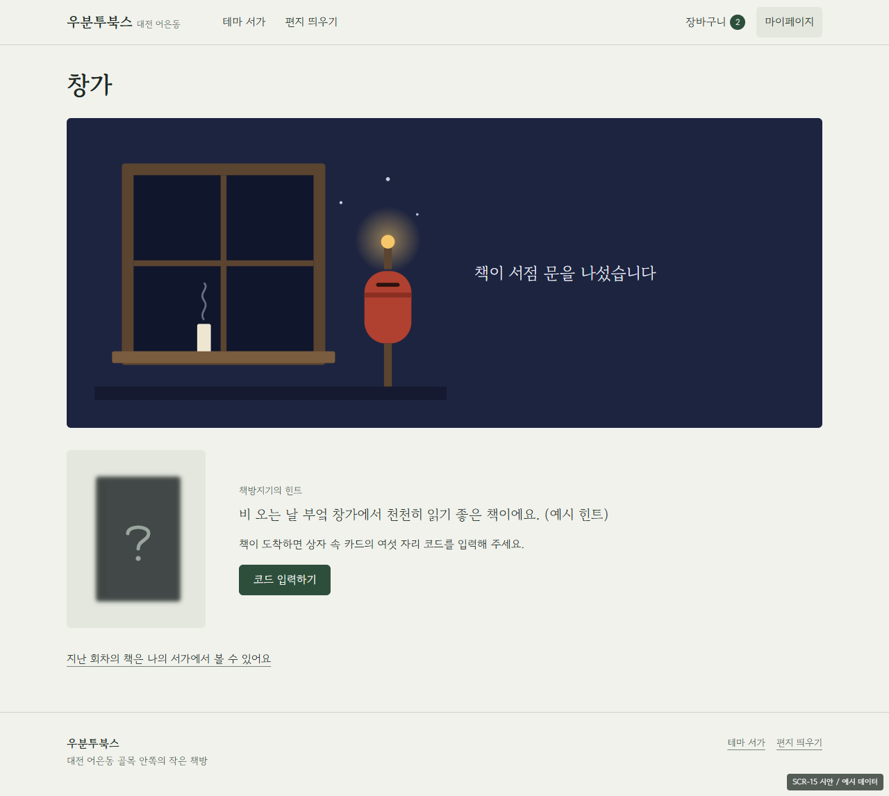 | 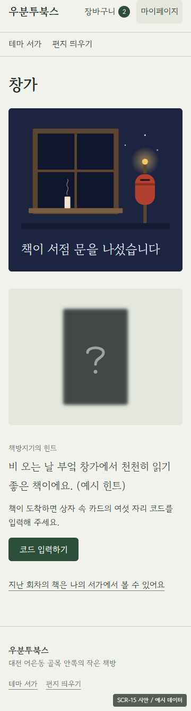 |
| 빈 창가 | 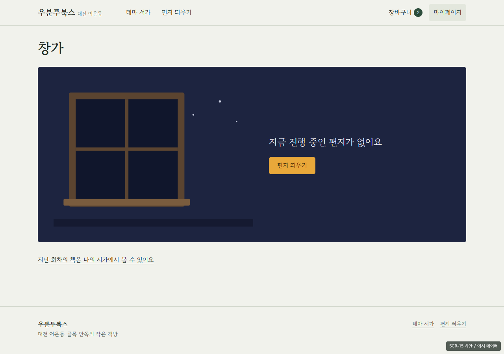 | 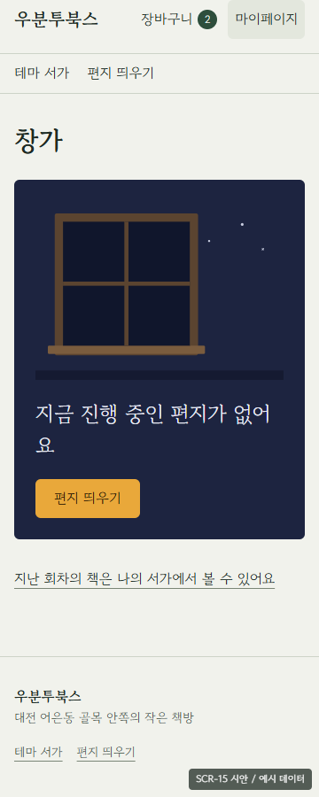 |

- `--night` 패널: 창가 그림 + 상태 문구(AC-12-1~3, AC-12-5 고정 문구) + 상태별 버튼.
- 편지 도착: 어두운 창 + 창턱의 봉투. 읽는 중: 촛불 + 창턱의 책. 발송됨: 꺼진 초(연기) + 우체통 불빛. 빈 창가: 빈 창턱 + [편지 띄우기](`--lamp` 버튼).
- 편지 도착·읽는 중에는 [취소 요청](밤 패널 외곽선 버튼). 취소 요청 중이면 그림은 그대로, 문구 아래에 "취소 요청 중" + [취소 요청 철회](AC-12-7). 거절되면 "책방지기가 취소 요청을 받지 않았어요. 책은 그대로 보내드려요"(AC-20-6).
- 발송됨: 패널 아래 BlindBook + "책방지기의 힌트" + 힌트 문장 + [코드 입력하기]. 제목·표지는 없다(AC-16-1).
- 패널 아래 "지난 회차의 책은 나의 서가에서 볼 수 있어요" 링크.
- 관련: AC-12-1~7, AC-20-1~7, NFR-11, D-043, UX-9, UX-17, UX-D-03

### SCR-16 언박싱 `/mypage/rounds/[id]`
| 코드 입력 전 1280px | 코드 입력 전 360px |
|---|---|
| 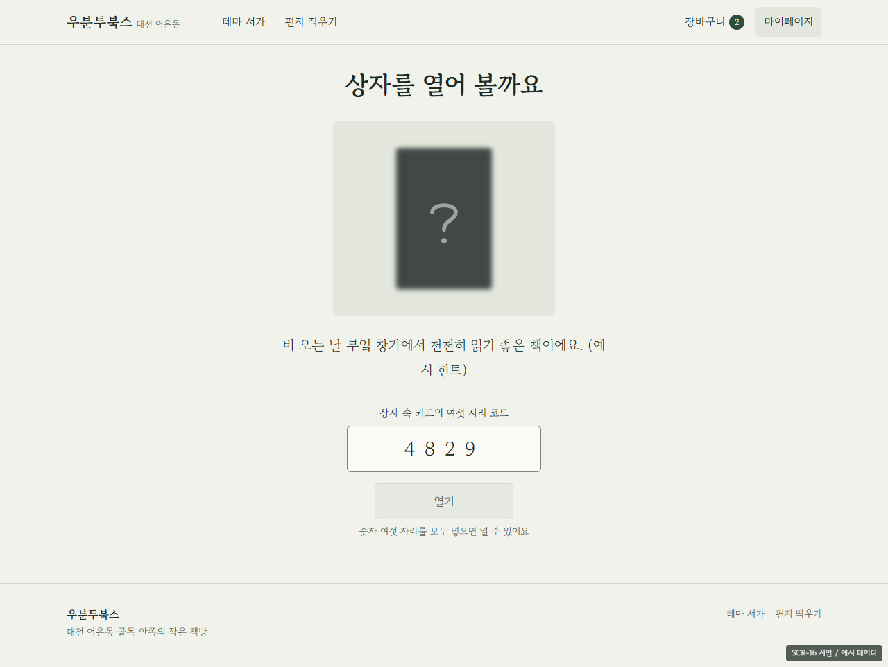 | 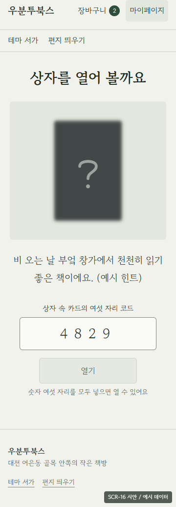 |

| 열린 뒤 1280px | 열린 뒤 360px |
|---|---|
| 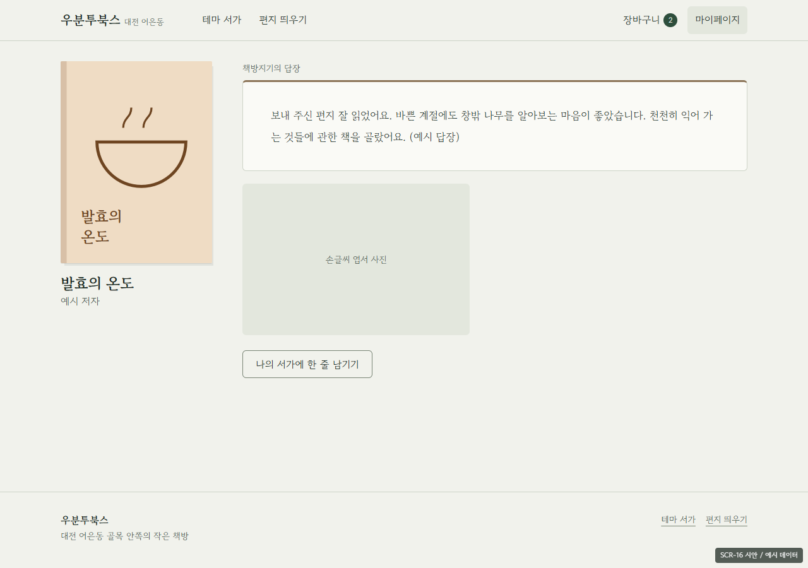 | 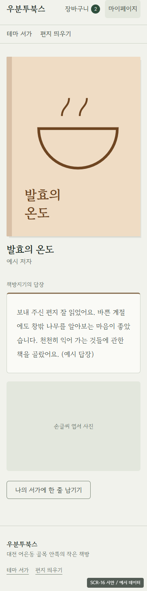 |

- 입력 전(가운데 정렬): 제목 `[제안]` → BlindBook → 힌트 문장 → 코드 입력 한 칸(UX-12, UX-D-07) → [열기](6자리 전 비활성, AC-16-5) → 도움말.
- 틀린 코드: "코드가 맞지 않아요. 상자 속 카드를 다시 확인해 주세요"(REJ-37)를 입력칸 아래 `role="alert"`.
- 열린 뒤: [표지·제목·저자 | 책방지기의 답장(LetterPaper) → 엽서 사진(있을 때만) → [나의 서가에 한 줄 남기기]].
- 관련: AC-16-1~7, NFR-08, NFR-10

### SCR-17 나의 서가 `/mypage/shelf`
| 1280px | 360px |
|---|---|
| 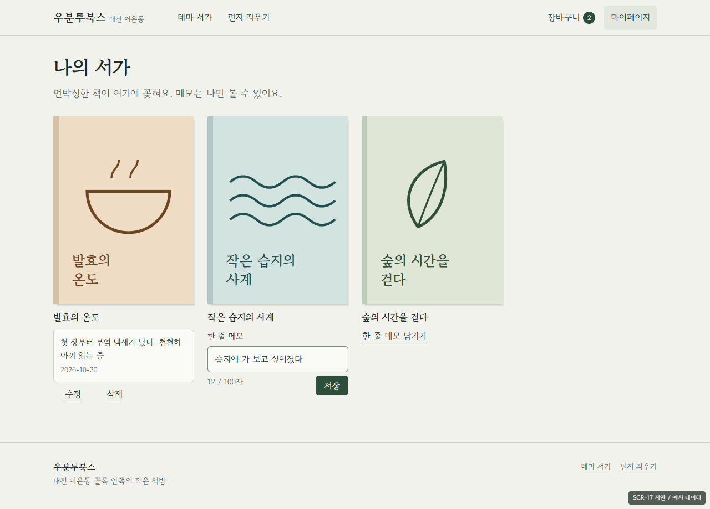 | 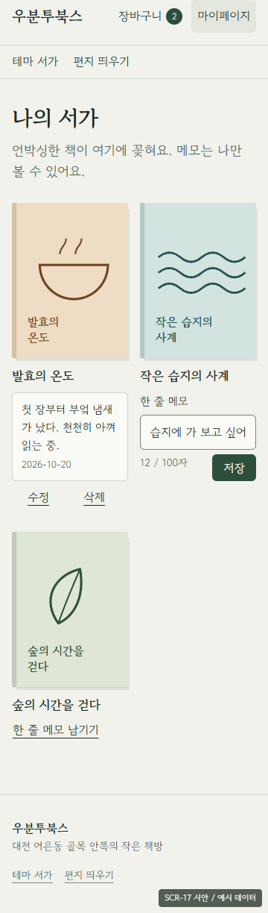 |

- 안내 "메모는 나만 볼 수 있어요" `[제안]`(INV-11을 회원에게 알림) → 언박싱한 책 격자(ProductCard 격자와 같은 열 수).
- 책 아래 상태 3가지(시안 왼쪽부터): 저장된 메모 + 날짜 + [수정]·[삭제] / 쓰는 중(입력칸 + "N / 100자" + [저장]) / 메모 없음([한 줄 메모 남기기]).
- 별점·공유·공개 요소 없음(AC-17-3).
- 언박싱한 책이 없을 때: "아직 서가에 꽂힌 책이 없어요" + [편지 띄우기] `[제안]`(UX-14).
- 관련: AC-17-1~6

### SCR-18 구독 마무리 `/mypage/farewell`
| 1280px | 360px |
|---|---|
|  |  |

- 위→아래: 마지막 인사 편지(LetterPaper, 줄바꿈 UX-D-06) → 진행 중 회차 안내 한 줄(있을 때, `[제안]` 문구) → 작별 안부 칸(0~1,000자) + 글자 수 → [구독을 마무리합니다](기본 버튼, UX-D-09).
- 누르면 바로 마무리, "그동안 고마웠어요"(US-18). 확인 팝업 없음(AC-18-2).
- 관련: AC-18-1~8, INV-13, UX-13

### SCR-19 관리자: 서재 작업 `/admin/desk`
| 작업 중 1280px | 작업 중 360px |
|---|---|
|  |  |

| 발송 완료 1280px | 발송 완료 360px |
|---|---|
|  |  |

- 한 열, 단계 번호 원으로 순서 표시(NFR-13): ① 편지 읽기(도착 순 회차 목록 + 상태 배지 + 펼친 편지 전문) ② 책 고르기와 답장(검색 → 결과 라디오, 품절은 비활성 + 배지 → 답장 → 엽서 사진) ③ 힌트 쓰고 발송(힌트 + 글자 수 → 빠진 항목 안내 → [발송]) → 작별 안부 목록.
- 취소 요청 회차: 목록 줄에 "취소 요청" 배지 + [환불]·[취소 거절]. [발송]은 막히고 "환불하거나 거절해 주세요"(REJ-51).
- 발송 완료: 코드를 `text-5xl` heading 글꼴로 크게 + "손글씨 카드에 이 코드를 적어 주세요" `[제안]`. 숫자는 `aria-label`로 한 자리씩 읽히게 한다.
- 관련: AC-13-1~5, AC-14-1~3, AC-15-1~5, AC-18-4, AC-20-3, UX-18

### SCR-20 관리자 홈 `/admin`
| 1280px | 360px |
|---|---|
|  |  |

- "오늘 할 일" 숫자 상자 3개(도착한 편지, 발송 대기 주문, 취소 요청) — 상자 전체가 해당 화면 링크 → 메뉴 3개.
- 숫자는 heading 글꼴 36px. 0건이어도 상자를 숨기지 않는다 `[제안]`.
